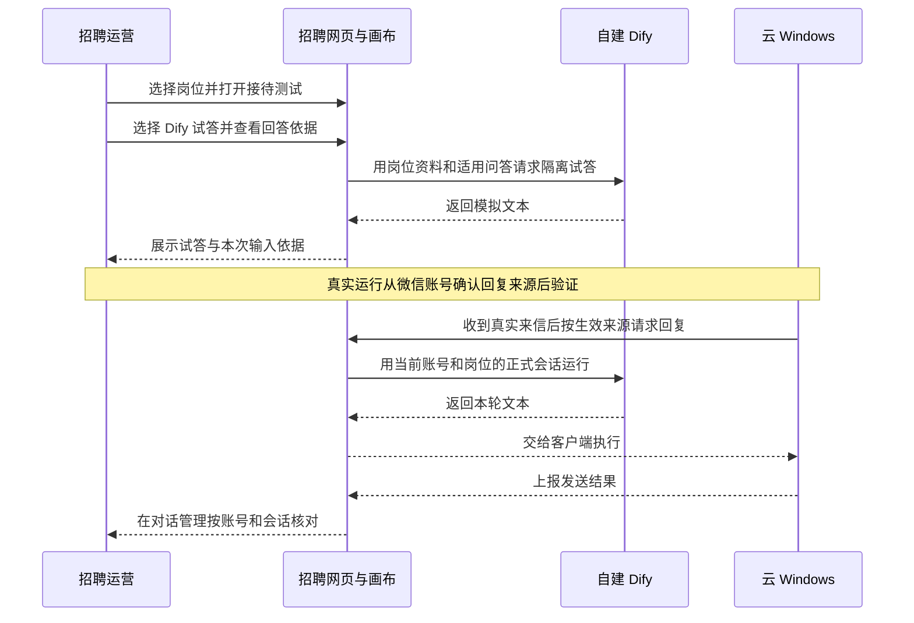
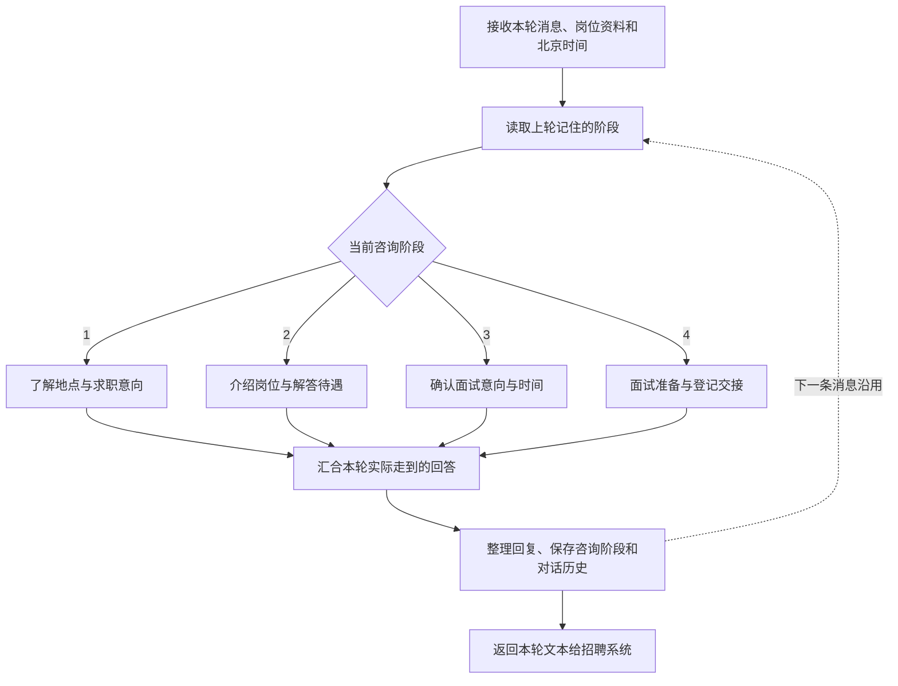
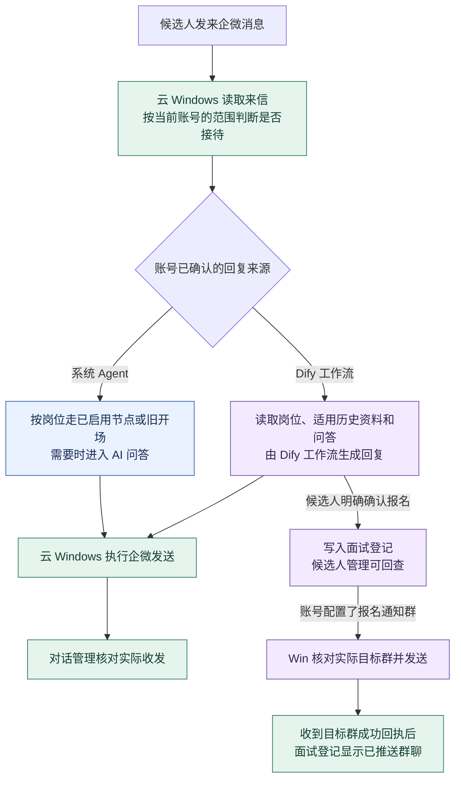
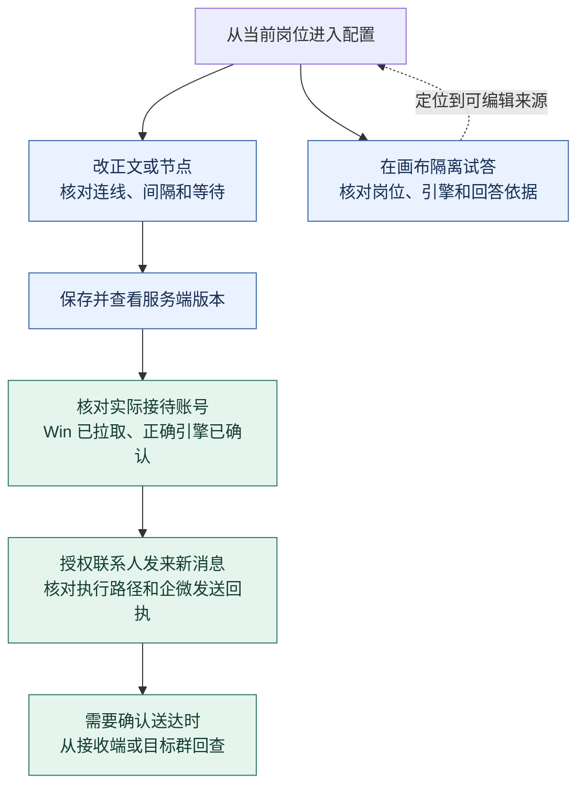

# Dify 与话术流程画布｜方案、实现逻辑和交接

对应 2026 年 11 月 22 日的线上版本 `257aecd`。主文档讲为什么要做可视化、目前做完哪一半、下一位接手要处理哪些入口。本文可以拿一个岗位边操作边核对。 [招聘系统交接](招聘系统进度-20261121至20261122.md)

## 方案介绍

「话术流程」是按岗位进入的工作台。运营从这里看当前接待怎么走、试两条回复线路，并回到对应资料或节点修改。岗位资料、问答和素材各有维护位置。工作台保留当前岗位、选择的测试引擎以及从账号进入时的账号信息。真实接待用哪个引擎由账号生效的回复来源决定。

| 内容 | 已有的主要位置 | 工作台中怎么接上 |
| --- | --- | --- |
| 工资、班次、工作地址和面试点 | 招聘岗位 | 从本轮采用的字段返回岗位。Dify 命中历史城市值时显示来源，维护入口或迁移方案仍需产品确认。 |
| 岗位问答、图片与视频 | 问答知识库、图片与视频 | 已有带岗位的快捷入口。后续把试答命中的问答和流程使用的素材关联到具体记录。 |
| Agent 正文、顺序和等待 | 人设和旧开场目前可从岗位及画布编辑，节点在画布编辑 | 先明确当前岗位走已启用节点还是旧开场。两个正文入口的归属待确认。 |
| Dify 节点、提示词和发布 | 自建 Dify 工作室的对应应用 | 已在同一个工作台试答。下一步呈现可验证的本轮阶段及其证据，并让有权限的人能找到正确的 Dify 应用和阶段。 |
| 正式引擎、设备状态与真实结果 | 微信账号、对话管理、面试登记 | 工作台读出正式来源与设备状态，联调结果带账号、岗位和会话。正式切换继续在微信账号发起。 |

## 实现逻辑

1. **进入时确定岗位和账号。** 从岗位进入即使用该岗位。从微信账号进入时带账号和绑定岗位。岗位、账号和测试引擎显示在页面上，避免在编辑 A 岗位时误测 B 岗位。
2. **Agent 和 Dify 各按自己的规则运行。** Agent 会按岗位使用启用节点或旧开场，再用实际适用的内容回答。Dify 由招聘系统组合本轮事实和问答，交给已发布的 Dify 工作流选择本轮阶段。两条线路可以使用同一处录入的资料，具体读取的字段和覆盖顺序仍以各自实现为准。
3. **模拟和正式接待各自保存结果。** 模拟试答展示岗位、引擎、回答和已有的取值依据，模拟产生的结果留在测试会话。正式账号按已确认的回复来源接待，由同一套 Win 客户端执行企微发送，报名与通知结果在原业务入口核对。
4. **定位结果时沿真实证据返回。** 对 Agent 核对保存版本、客户端拉取和节点状态。对 Dify 在工作室核对实际分支，再从招聘网页看已发布应用的试答和输入。后续在工作台呈现能关联到本轮的阶段、资料来源和可编辑位置。缺运行证据时显示「未上报」或「待核对」。

## 自建 Dify 在哪里

Dify 也是接手者会遇到的黑盒。它由本次交接的原负责人独立搭建，编辑和发布都在 Dify 后台。招聘网页的「接待测试」能看输入和回答。要知道本轮为什么走到某个节点、改哪段提示词、改后是否已发布，需要进这台自建 Dify 的工作室。

| 找什么 | 在哪里 | 用来做什么 |
| --- | --- | --- |
| 腾讯云主机 | 交接中说的 **2 核 4G** 主机，Ubuntu，`119.91.113.100` | 招聘系统和 Dify Community 1.20.0 共用这台主机，作为独立服务运行。 |
| 招聘网页 | [招聘系统](http://119.91.113.100:4222/) | 维护岗位、问答、素材和微信账号，统一试答，查看实际消息与面试登记。 |
| Dify 工作室 | [Dify 管理入口](http://119.91.113.100:8080/apps) | 用团队授权的 Dify 工作区账号登录，进入应用看画布、预览调试、运行记录和发布。 |
| 招聘系统接入的应用 | [系统岗位咨询 · Dify第二路线](http://119.91.113.100:8080/app/a5c7be0e-3543-4de9-8efc-d3abd87587e1/workflow) | 当前接入招聘系统的 Chatflow，发布版本通过 API 供招聘系统调用。 |
| 逆向历史测试应用 | [招聘流程还原测试 · 20261121](http://119.91.113.100:8080/app/7b360570-1c1d-49f4-a87b-ffe1e20acad6/workflow) | 导入记录中的独立草稿，用于回放和对照原逻辑。最后记录为未发布，未接企微、OA 或群通知。 |

Dify 用 Docker Compose 自建，部署目录是 `/srv/apps/dify/source/docker`。安装台账里，Web 和 Nginx 提供后台页面，API 接应用调用，Worker 处理后台任务，PostgreSQL 保存工作流、会话和运行记录，Redis 用于缓存和任务，另外包含沙箱、模型插件服务和向量存储。部署数据保存在 `docker/volumes/` 下。招聘服务及其业务数据单独维护。招聘后端用服务端保存的应用 API 配置调用 Dify，Win 客户端仍通过招聘系统收发。部署盘点记录 Dify 与招聘服务共机时内存偏紧，曾停用 Dify 的可选协作服务。 腾讯云部署台账见运维工作区的 `tencent-cloud-ops/docs/deployment-history.md`。 [第二路线接入记录](https://github.com/tjfeng741963/city-recruitment-mock-service/blob/257aecde8fc21bcb4782ea4aa8f4d4d77edd69ad/docs/Dify第二回复路线-接入与验收.md)

本次核查时，8080 可打开 Dify 登录页，两个工作室链接都跳到登录页，4222 招聘登录页可达。应用名称、发布关系和容器分工来自仓库与部署台账。本次 SSH 鉴权未通过，服务器当前容器清单和 Dify 登录后的草稿版本尚未现场核对。

## 工作流为什么这样搭

四段流程的依据是**对原招聘助手行为的逆向观察和多轮对照回放**。原负责人留下了原流程各阶段的用途、提示词、可观察到的输入输出，以及对话在什么条件下推进。原代码节点的源码没有取得，当前节点是按能观察到的行为重新实现。旧厂区目录和工资是当时的样本。正式咨询读取招聘系统当前岗位资料及适用问答，再由本系统接上岗位推荐、面试报名、OA 转档、通知群和 Windows 收发。历史样本可用于理解话术和测试覆盖的来历，当前招聘事实在岗位和知识库中维护。 [逆向还原材料说明](https://github.com/tjfeng741963/city-recruitment-mock-service/blob/257aecde8fc21bcb4782ea4aa8f4d4d77edd69ad/dify-workflow/README.md) · [Dify 当时的试答与取值验收](https://github.com/tjfeng741963/city-recruitment-mock-service/blob/257aecde8fc21bcb4782ea4aa8f4d4d77edd69ad/docs/Dify完整线路验收-20261121.md)

仓库的 `dify-workflow/recruit-chatflow.dsl.yml` 和 `prompt/system-flow1.txt` 至 `system-flow4.txt` 是原流程的还原资料。系统接入版用 `dify-workflow/system-position-consultation.dsl.yml` 作为可读的工作流定义。接手者有工作区权限后，可以从**接入版应用**导出当前草稿，并在后台核对已发布状态，再与仓库版本对照。 [接入版工作流定义](https://github.com/tjfeng741963/city-recruitment-mock-service/blob/257aecde8fc21bcb4782ea4aa8f4d4d77edd69ad/dify-workflow/system-position-consultation.dsl.yml)

## 接入版画布的节点各管什么

接入版仓库定义有 11 个节点。图里的四个 AI 节点是互斥分支。每条新消息先看会话当前阶段，只运行对应的一个 AI 节点，然后把回答和阶段存回会话，供下一轮继续。

| Dify 工作室里的节点 | 用业务话解释 | 改什么会影响它 |
| --- | --- | --- |
| 「接收系统岗位资料与求职者消息」 | 接收本轮消息、招聘系统整理的事实与问答，以及北京时间。 | 工资、地址或问答有错，先在招聘系统核对这次传给 Dify 的资料。调整输入字段要同步对照招聘系统。 |
| 「读取招聘咨询阶段」和「选择当前咨询阶段」 | 读取当前会话走到哪一步，然后选应处理本轮的 AI 节点。 | 候选人被重复问、过早邀约或长期卡在同一步时，查本轮属于哪个阶段，以及上轮有没有保存推进结果。 |
| 「① 了解工作地点与求职意向」 | 确认候选人在哪儿、想了解什么，已有信息尽量沿用。 | 在这里改开头怎么问、什么时候进入待遇介绍。 |
| 「② 介绍岗位与解答待遇」 | 用本轮岗位资料回答工资、班次、食宿和工作内容，明确有面试意愿后进入下一阶段。 | 在这里改答疑和邀约的表达。工资与班次本身回岗位和历史取值来源核对。 |
| 「③ 确认面试意向与时间」 | 按已有日期、时段和地址解释安排，并确认候选人是否愿意面试。 | 在这里改邀约、如何追问时间。可面试日期、预约时段和具体面试点从招聘系统维护。 |
| 「④ 面试准备与人工登记交接」 | 解释准备事项、路线与后续协助。在接入版定义中，正式登记结果以招聘系统为准。 | 在这里改面试提醒的表达。核对正式报名和群通知时，查招聘系统的登记和回执。 |
| 「汇合本轮回答」 | 接住四条分支中实际产生的那份回答。 | 调整分支时检查每个 AI 节点都连回这里。 |
| 「保存对话与咨询阶段」「记住当前招聘咨询」「返回客户端待发送的文本」 | 整理给候选人看的正文，把阶段与对话历史存下来。定义允许本轮停留或最多向前一步，最后把文本交回招聘系统。 | 改这段时，用多轮会话核对下一条消息有没有继承阶段、文本是否正常。实际企微发送由 Win 执行。 |

## 从哪里改，改完怎么用

1. **先定位是资料、话术还是执行的问题。** 工资、班次、面试地点回招聘岗位或实际取值来源。标准问答回问答知识库。某阶段的提问和答复规则到 Dify 的对应 AI 节点。报名入档和推群查招聘系统。企微收发查 Win 和对话管理。
2. **打开正确的 Dify 应用。** 从 8080 工作室进入「系统岗位咨询 · Dify第二路线」，核对应用名和当前发布状态。需要改节点时先保留能追溯的现有导出，测试改动可用副本或草稿。历史还原测试应用用于比对原逻辑。
3. **在 Dify 预览里查看每轮命中的节点。** 用虚构测试资料从地点咨询、问工资到确认面试走几轮。展开节点输入输出，核对选中的岗位事实、走到哪个阶段以及下一轮有没有延续。准备进入报名时，看回复是否与招聘系统的真实登记结果对应。
4. **在预览确认后发布，再从招聘网页复测。** 打开「话术流程 → 接待测试 → Dify 工作流」，选同一个岗位，查看回答依据并连续试答。Dify 工作室调试用于看草稿节点，招聘网页复测用于核对对接的已发布应用和系统传入的真实结构。
5. **核对正式运行。** 正式账号在「微信账号 → 回复来源」选择 Dify，等 Windows 确认。用获授权的测试联系人发送新消息，从对话管理查看实际回执。要验报名时再从面试登记和目标群核对结果。

目前接待测试向招聘系统管理员开放，运营能否试答取决于账号权限。**看 Dify 实际走过的阶段、改节点和发布仍需要 Dify 工作区权限。** 这部分是统一可视化尚未完成的交接项。后续评审应明确谁负责维护 Dify 的节点，用户从招聘页面怎样找到对应阶段、资料和返回试答的位置。

## 从岗位走到实际接待

| 要完成的任务 | 今天从哪里操作 | 保存后应核对什么 |
| --- | --- | --- |
| 填工资、班次和地点 | 「招聘资料 → 城市 → 查看岗位 → 编辑岗位」。工作地和面试地点分别填，岗位可新增多个面试点。 | 两条线路分别试答。Dify 若采用了历史城市默认值，需要在回答依据核对实际值。 |
| 调整 Agent 说话方式 | 编辑岗位的「系统 Agent」标签，或「话术流程 → 岗位配置 → 编辑人设」。 | 人设用于系统 Agent。工资、地点、时间应回岗位资料维护，避免在话术和岗位各填一份。 |
| 调整固定开场、发送顺序和节奏 | 旧开场在「系统 Agent」或画布的「编辑开场」维护。节点顺序在「话术流程 → 岗位配置 → 编辑流程」调整。 | 确认这个岗位实际走已保存并启用的节点流程，还是走旧开场。先保存正文，再按当前使用的流程检查节点内容、连线、间隔和等待条件。旧开场可以生成停用草稿，核对后再启用。 |
| 补常见问题或换素材 | 「AI 接待 → 问答知识库」和「图片与视频」。也可从画布带当前岗位跳过去。 | 问答检查适用范围、启用和命中情况。素材检查是固定节点发送，还是候选人问到才会使用。 |
| 试两个“脑子”的回答 | 管理员在「AI 接待 → 话术流程 → 接待测试」选岗位和 Agent 或 Dify。 | Agent 看岗位问答，Dify 可看本次采用的资料和问答。用同一个岗位问相同问题，能看出差异。 |
| 调整 Dify 的工作流节点 | 进入 Dify 后台的相应 Chatflow，改完在 Dify 发布。 | 返回本系统，用该岗位重新试答并核对输入。现在画布里的 Dify 标签提供试答，Dify 节点编辑在 Dify 后台。 |
| 切换真实接待账号 | 「日常招聘 → 微信账号 → 回复来源」。 | 等正在处理的任务和回执收尾，Windows 拉取并确认后，看列表中的已确认来源、登录和就绪状态。当前联系人范围也需核对。 |
| 看真实消息、报名和群通知 | 「对话管理」「面试登记」「候选人管理」。 | 同一个账号和候选人对应的企微对话、报名记录、群通知状态要能相互对上。 |

快捷入口已经统一了一部分。知识库带岗位进入画布，微信账号的「工作流配置」按当前回复来源进入相应画布或 Dify 测试，旧 Dify 测试链接归入同一面板。人设和旧开场目前仍有两个编辑入口，正式换引擎在微信账号。下一步要根据任务明确每个按钮具体会打开哪里。 [统一试答入口](https://github.com/tjfeng741963/city-recruitment-mock-service/pull/99) · [正式切换位置](https://github.com/tjfeng741963/city-recruitment-mock-service/pull/103)

## 两个“脑子”和一套“手”

- **系统 Agent** 的工作台可以编排文本、图片、视频、间隔和等待。新会话按已生效的配置运行，在途会话保留原过程。页面同时展示固定发送的内容和可能由 AI 按需使用的素材，便于运营查明为什么没有自动发图。 [画布与运行路径](https://github.com/tjfeng741963/city-recruitment-mock-service/pull/81) · [客户端同步](https://github.com/tjfeng741963/city-recruitment-mock-service/pull/89)
- **Dify** 根据岗位及设备招聘范围组织咨询，可推荐和切换岗位，提供当前岗位的面试时间与地点。适用的历史城市默认值优先，缺项时回到岗位资料。知识库会根据适用范围取通用、岗位和符合条件的历史品类问答。候选人问到工作、宿舍、食堂或路线时，有对应素材或地址才能按场景给出媒体或导航。多个面试点时先明确选点。 [岗位取值](https://github.com/tjfeng741963/city-recruitment-mock-service/pull/104) · [知识范围](https://github.com/tjfeng741963/city-recruitment-mock-service/pull/93) · [素材和导航](https://github.com/tjfeng741963/city-recruitment-mock-service/pull/105)
- **报名与群通知** 从候选人明确确认后开始。报名写入面试登记，候选人可回查。群清单暂缺时保留待发记录，后续由 Win 核对实际群后领取。重复确认使用原登记，群通知看真实目标群回执。 [选岗与报名](https://github.com/tjfeng741963/city-recruitment-mock-service/pull/97) · [报名群通知](https://github.com/tjfeng741963/city-recruitment-mock-service/pull/114)

## 实施进度与下一轮交付

| 阶段 | 当前进度 | 交付时能当场演示的结果 |
| --- | --- | --- |
| 岗位统一进入与双引擎试答 | 核心入口已上线。Agent 和 Dify 的编辑位置及输出证据各有差异。 | 从一个岗位连续试两个引擎，记录实际采用的工资和面试点。从账号或知识库进入时能核对当前岗位。 |
| 看懂数据来源和执行顺序 | Agent 已有节点、版本、拉取和上报。Dify 试答已能看输入，阶段定位要进自建后台。 | 用同一个测试问题展示采用的事实和问答。Agent 能定位当时节点和等待条件，Dify 能定位实际运行阶段及维护位置。 |
| 收口重复设置 | 城市重复资料弹窗已移除，岗位为主要录入入口，人设、旧开场和厂区仍有多个入口。 | 运营只维护一份资料。从原快捷入口带着正确的岗位到主编辑处，并能返回同一次试答任务。 |
| 从试答走到正式接待 | 正式换引擎与客户端确认已上线。已有单联系人定向发送的回读，整账号自动接待和实际推群待核。 | 在获得授权的目标账号上发起一条新消息，从来信到实际发送逐步核对。完成一次报名，核对面试登记、候选人和指定群回执。 |

## 一次验收要依次看到什么

图中的试答回到具体来源是产品要求。当前从答案定位到资料来源的页面仍需补齐。也要让运营知道，Agent 问答预览验证的是资料能否被拿来回答，检查固定消息顺序要看 Agent 路径和实际会话，Dify 测试则可分轮核对引擎回答及采用资料。

| 验收项 | 已有证据 | 下一位接手要补的证据 |
| --- | --- | --- |
| 画布编辑和 Win 读取 | 隔离岗位实测真实 Win 拉取、改变顺序、素材下载、旧会话保有原快照。执行顺序由记录器核查。 | 用授权测试会话看两条文本及媒体在实际企微中的顺序、间隔和等待分支。 [画布同步验收](https://github.com/tjfeng741963/city-recruitment-mock-service/blob/257aecde8fc21bcb4782ea4aa8f4d4d77edd69ad/docs/验收-画布同步云Windows-20261121.md) |
| Dify 资料与问答 | 隔离数据库用真实 Dify 回放，验证事实、知识及同会话资料更新。后续合并补齐岗位录入、面试点和新能力。 | 选首家客户的测试岗位，对照两条线路实际采用的工资、面试点和一条知识库回答，把覆盖关系写清。 [Dify 线路验收](https://github.com/tjfeng741963/city-recruitment-mock-service/blob/257aecde8fc21bcb4782ea4aa8f4d4d77edd69ad/docs/Dify完整线路验收-20261121.md) |
| 正式切换和企微收发 | 网页发起、Win 确认已部署。有授权单联系人的真实定向发送和回读。 | 在目标账号选定正式来源，确认 Win 安装版本、回复范围和企微状态，用授权联系人主动发新消息并核对自动回复。 [单联系人验收](https://github.com/tjfeng741963/city-recruitment-mock-service/blob/257aecde8fc21bcb4782ea4aa8f4d4d77edd69ad/docs/Dify模式二单联系人发送验收-20261121.md) |
| 报名和推群 | 入档、候选人回查、匹配群、领取和回执已有隔离测试，线上已部署。 | 核对真实目标群收到名单、面试登记显示对应状态，以及重复确认后的实际记录。 [群通知上线记录](https://github.com/tjfeng741963/city-recruitment-mock-service/pull/114) |
| 从配置回到结果 | 岗位、知识库和账号已有快捷入口，Agent 画布已有版本和状态。 | 将一个运营动作串完整。改一处资料或节点，回到同一岗位看采用值，随后能定位正式账号及真实对话。 |
