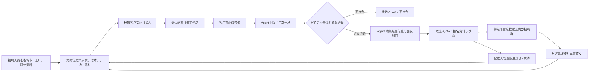
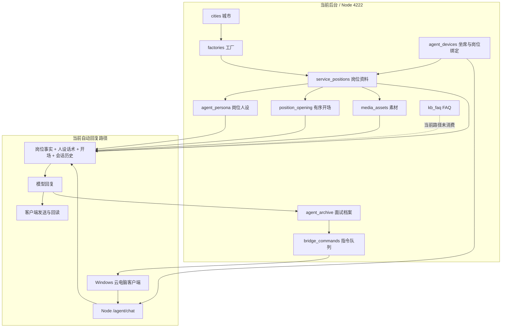
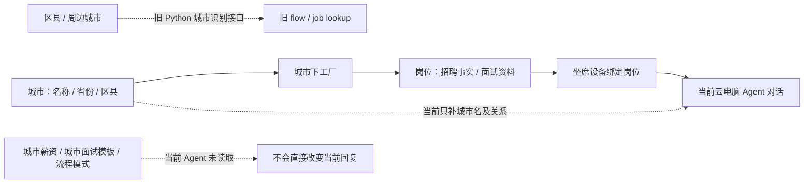
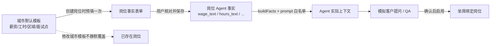

# 城市招聘 AI 客服后台：产品结构与 MVP 草案

> 状态：待产品方确认；这是现状梳理与信息架构草案，不是开发授权。本文不授权删除功能、改动页面或改变发送行为。
> 用户范围：先服务第一家劳务招聘公司，并让其运营人员自己配置岗位事实、话术、开场和 QA；暂不实现多租户隔离或人才库。
> 保护边界：`对话管理` 与 `候选人管理` 是业务核心页面。对话管理是运营核对云电脑实际收发的唯一网页窗口；候选人管理是邀约后 OA 名单与状态窗口。页面本身、入口位置、主流程和已有字段均不纳入本次重组。候选人截图中的红色标注是用户明确提出要体现的字段/动作，具体补齐范围按第 9 节确认后再动。

## 1. 产品要让用户完成什么

使用者是劳务招聘公司的招聘运营人员。用户不应该靠程序员修改 prompt 或部署代码，才能改变 AI 对外怎么介绍岗位、首次联系发什么、图片怎么配、开场每条隔多久、客户问常见问题时怎么回答。

本产品 MVP 的主任务是：

> 招聘人员选定一个岗位，维护这个岗位真实有效的信息，定义 AI 的接待话术和开场顺序，用模拟 QA 检查回复，再把岗位绑定到坐席。客户咨询、收集报名信息、将名单推到内部群后，招聘人员可以在网页中核对消息和跟进候选人。

这要求每个可配置项都明确回答：

1. 用户在什么页面设置，应该填什么？
2. 这项设置归哪个城市、工厂、岗位或坐席？
3. 保存后谁读取它，何时生效？
4. 用户如何在发送前验证，发送后在哪里确认结果？

## 2. 端到端招聘流程



图示为用户描述的业务主线。代码已有 Agent 会话、档案、群聊队列与候选人列表的部分实现；其触发条件、字段覆盖、群送达回执和 OA 状态映射在第 5、7 节列出，需确认后验收。

## 3. 核心数据关系与当前回复链路



边界说明：

- 岗位基础表单的数据保存在 `service_positions.data_json`；Agent 当前读取岗位数据里的 `city`、`job_title`、`wage_text`、`hours_text`、`age_text`、`welfare_text`、`place`、`interview_time` 等字段。
- 当前 Agent 读取岗位人设、话术段落、有序开场、岗位事实、素材和服务端会话历史。现有设备配置以一个 `position_id` 绑定一个主岗位。
- FAQ 编辑保存在 Node 的 `kb_faq`。FAQ 页面可编辑不等于当前 `/agent/chat` 会查询它；当前真实 prompt 由岗位人设/事实/开场组装。
- 模型捕获的客户与面试资料会写入 `agent_archive`；满足当前群通知条件且设备已绑定群时，会生成 `bridge_commands`，由 Windows 客户端执行。数据库排队不等于企微群已确认收到。
- `候选人管理` 目前通过 `/api/v1/agent/candidates` 从 `agent_archive` 聚合；`profile.routes.ts` 中还有一套旧 `candidate_events` 记录逻辑。两套候选事件来源应在验收时明确，不应让 UI 同时呈现互相矛盾的状态。

## 4. MVP 信息架构草案

一级导航按用户的工作任务组织，保留全部有用能力，先归类，不删功能：

```text
工作台
  今日接待概况 / 需要处理事项 / 配置 QA 提醒

招聘资料
  城市与工厂
  岗位与接待方案
    岗位事实
    AI 话术与人设
    首次开场与间隔
    图片与视频
    模拟 QA

接待运营
  坐席设备
  面试登记与群通知     [保留现有面试登记用途，核实与候选人 OA 的分工]

系统管理
  招聘员与账号权限
  全局系统设置
  高级与历史工具       [暂存有用但低频、待接通或兼容的功能]

核心窗口（冻结，不参与本轮导航重组）
  对话管理             [原入口和页面保持不变]
  候选人管理           [原入口和页面保持不变；仅红标要求待确认后补齐]
```

说明：这是待确认的目标结构；例如“面试登记”和“候选人管理”是否为两个不同工作视图，需根据客户实际工作确认。候选人管理仍应是用户可直接找到的一级运营入口。

### 4.1 左侧导航现状与目标归属

| 当前侧栏项 / 路由 | 当前用户任务 | 建议归属 | 初步处置 |
|---|---|---|---|
| 监控看板 `/dashboard` | 查看设备、消息、队列及异常概况 | 工作台 | 保留；核实其中的旧 Dify 指标是否仍有效，避免错误告警 |
| 城市管理 `/cities` | 建城市、线路/区域、关联厂区、查看历史 | 招聘资料 → 城市与工厂 | 保留；城市级薪资/面试字段需确认是否继续支持，避免和岗位事实重复 |
| 岗位管理 `/service-positions` | 创建/复制岗位、维护招聘资料、启停/主推 | 招聘资料 → 岗位与接待方案 | 保留，作为每个岗位所有回复配置的主入口 |
| 周边城市设置 `/city-links` | 配跨城推荐与区域映射 | 招聘资料 → 城市与工厂 → 高级区域规则 | 保留；确认当前 Agent 何时读取并推荐 |
| 素材库 `/media` | 上传、预览、删除图片/视频、绑定岗位或通用 | 岗位接待方案 → 素材 | 保留集中管理能力；同时从岗位配置提供岗位范围快捷入口 |
| 工厂配置总览 `/factory-overview` | 只读查看工厂、岗位、设备关系 | 招聘资料总览 / 工作台 | 保留只读能力；不与编辑页并列为第二个工厂编辑入口 |
| 坐席设备 `/agent-devices` | 配设备码、账号/工厂、登录、状态、群聊/工作流 | 接待运营 → 坐席设备 | 保留；配置岗位和群聊必须标出下游影响 |
| 对话管理 `/conversations` | 核对设备客户消息、AI 回复、手动回复、接管 | 接待运营 | **冻结核心页**，见第 5 节 |
| 面试登记 `/archive` | 查看约面试档案、配置设备群聊、登记到场/爽约、补登记 | 接待运营 → 面试登记与群通知 | 保留；需明确它与候选人 OA 的职责边界 |
| 知识库配置 `/knowledge` | 维护 FAQ、分类/区域/招工方、模板、发布、治理 | 招聘资料 → 岗位接待方案 / 高级与历史工具 | 合并重复编辑视图；FAQ 未接入当前 Agent 前要显著标出作用范围与当前不生效状态 |
| 招聘员管理 `/recruiters` | 建业务账号、绑定负责城市、状态/密码 | 系统管理 → 招聘员与权限 | 保留；招聘员属于业务组织权限 |
| 主推设置 `/recruiter-featured` | 选择城市对外展示的主推岗位 | 招聘资料 → 城市/岗位展示 | 保留；确认 recruiter-only 权限符合实际角色 |
| 用户管理 `/users` | 建后台用户、角色、范围与密码 | 系统管理 → 账号权限 | 保留 |
| 设置 `/settings` | 公司/年龄、Agent URL、同步、模板导入 | 系统管理 | 保留有效配置；无实际消费者或空操作项移入高级核验/修复后开放 |

### 4.2 隐藏路由与保留能力清单

以下页面仍在路由或代码中，但不都从当前侧栏可见。先定位再验收，不因隐藏而删除：

| 隐藏页面 | 代码中的能力 | 草案处理 |
|---|---|---|
| 厂区管理 `/factories` | 工厂独立增删改、启停 | 合并到“城市与工厂”，保持同一工厂记录和操作能力 |
| 节假日管理 `/holidays` | 城市/岗位假期数据 | 保留为岗位接待方案下的“排班/节假日规则”或高级设置，先验证谁读取 |
| 候选人管理 `/candidates` | 报名成功/不符合/已签到列表、筛选、统计 | **核心页保护项**；不移动页面或入口。源码侧栏注释隐藏该项；本轮不擅自恢复/改动入口 |
| 未知问题 `/unknown-questions` | 待处理问题、转知识库 | 当前记录入口来自旧 Python KB 流程；转换也请求已下线的 `/api/v1/kb/entries`，先标“历史/待接通”，不可显示成功假象 |
| 候选人员 `/old-friends` | 老友/历史客户操作 | 保留代码与数据，验证当前路由/接口后归接待运营高级筛选或历史工具 |
| 设备报表 `/device-report`、运营汇总 `/account-summary` | 报表页面/统计 | 保留，验证数据源与准确性后放工作台二级视图 |
| 复聊激活 `/activation*` | 激活看板、名单、策略、设备、语料 | 保留能力作为待核验历史模块；当前多处按钮禁用或直接报“后端未提供接口”，不得呈现为已可用功能 |
| 移动聊天 `/m` | 移动会话入口 | 保留并单独确认用户角色及使用场景 |

## 5. 两个核心页面的保护契约

### 5.1 对话管理：网页收发真相窗口

用户无法在已登录企微的云电脑桌面持续看回复，网页对话管理是其唯一可见的收发核对窗口。因此它是业务主页面，冻结以下内容：

- 保持当前页面，不移走、不合并、不删减其主功能和消息证据。
- 保留设备状态、客户列表、时间/状态筛选、消息正文、AI 与客户发言区分、手动发送、接管/取消接管、异常提示。
- 任何产品结构调整都不得让用户失去“实际回复有没有出现”“我能不能马上接手”的判断能力。
- 将来可从工作台加快捷链接或未读提示；不在本次草案中重排页面内部区域。

### 5.2 候选人管理：邀约后的 OA 名单

这是从前序对话筛出并运营候选人的业务台，必须保留报名成功/不符合/已签到的工作流程，并按用户截图中的红标核对：

| 红标期望信息/动作 | 现有 CandidateView/接口现状 |
|---|---|
| 归属账号 | 有 `recruiter_id`（按设备归属读取） |
| 项目名称/岗位 | API 查询了 `position_name`，但当前响应没有返回；页面也没有该列 |
| 面试时间 | 有日期与时间 |
| 客户真实姓名、手机号码 | 有 |
| 省/市/区 | 当前只返回 `city` 一个字符串，没有省与区拆列 |
| 客户状态标签 | 有报名成功/不符合/已签到三个 tab；底层状态从招募状态和到达状态推导 |
| 提醒到场按钮/提醒状态 | 当前 CandidateView 操作列是 `-`，无提醒按钮；其他需求材料提过提醒，但现代码需确认是否有可用通道 |
| 设备、昵称、事件时间、记录时间、摘要 | 当前有，是否继续显示由你确认，不在草案中删字段 |

保护规则：本页不搬家、不删字段、不改变 OA 的核心列表工作流；红标字段/提醒动作是需要满足的要求，但实施前先确认每个红标的字段含义和点击后的行为。其他页面归类时不得拿“候选人属于运营”当作可移动该核心页的理由。

## 6. 页面按钮、输入与结果（MVP 重点页）

| 页面/动作 | 用户需要提供或选择 | 保存/动作结果 | 当前判断 |
|---|---|---|---|
| 城市：添加/编辑/复制 | 城市名、省份、区域/线路、城市介绍、招聘和面试信息 | 写城市记录；招聘状态由“有启用坐席绑定启用岗位”推导 | 基础 CRUD 有效；一部分城市级岗位事实与岗位页重复，Agent 当前只取城市名补充岗位上下文 |
| 城市：厂区/历史/更多 | 查看或维护城市下工厂；查看快照、恢复 | 影响工厂归属或城市版本记录 | 有效；工厂操作留在城市详情与工厂主数据，不另造工厂副本 |
| 岗位：添加/编辑/复制 | 岗位名、所属城市、工厂、性别/年龄/身高、住宿、工作类型、岗位资料段、面试信息、启用 | 写 `service_positions.data_json`；岗位对应 Agent 回复的事实来源 | 页面可保存，但字段与 Agent 事实键不完全同名；必须先在 QA 验证映射 |
| 岗位：主推/启停/导入导出 | 是否主推、是否启用、文件/导入记录 | 影响岗位清单、城市主推或批量资料 | 主推和启停是有效配置；导入导出保留，但需分别验数据回显与错误报告 |
| 岗位：人设 | 招聘顾问身份、称呼、语气、边界；不得把易变工资写死 | 写 `agent_persona`，进入下一次 `/agent/chat` prompt | 当前可用并被读取；“岗位事实由系统注入”说明要与字段映射一致 |
| 岗位：开场 | 有序文本/图片/视频、配文、每条延迟、上移/下移 | 写 `position_opening`；新会话获取开场并发送 | 当前可用；最小间隔 2 秒。Windows 客户端有进程内开场缓存，变更何时生效需标明/验证 |
| 岗位：素材 | 上传图片/视频、通用或岗位绑定、预览/删除 | 写 media_assets，Agent 按岗位筛素材 | 保留；首次开场上传控件目前把素材作为通用 `position_id=0` 上传，绑定用途需要确认 |
| 岗位：模拟 QA | 招聘人员输入客户问题、可选多轮 | 展示岗位事实、人设、开场、最终回答与素材选择；dry 模式不调模型/不写会话的技术能力已存在 | MVP 应将其作为配置验收核心；QA 不触发真实发送，除非你明确授权另外设计内部测试渠道 |
| 坐席：新建/编辑/扫码/绑岗位 | 设备码、账号、招聘员、模式、工厂/岗位、群聊 | 设备可在线接待；设备主岗位确定 Agent 上下文 | 保留；必需配置要从可选设置中区分，明确绑定后果 |
| 对话：人工发送/接管 | 客户、回复内容、接管状态 | 真实下发 Windows 并返回回执；接管避免 AI 干预 | 冻结核心；不要把队列“已接受”展示为“企微已送达” |
| 候选人：筛选/查看 | 招聘员、事件日期、面试日期、状态 | 查看邀约结果和到场状态 | 冻结核心；保留原入口与布局，红标字段/动作只按确认结果补齐 |
| 面试登记：绑群/到场状态/手动登记 | 设备群、手动客户信息、到场/爽约 | Agent 收集的信息进档案，群通知入设备命令队列 | 保留；群里发出与已排队状态需要区分，并与候选人 OA 去重 |
| FAQ：新增/编辑/启用/导入 | 问题、答案、关键词、分类、范围 | 写 `kb_faq` | 可维护但当前 Agent 不读取；作为高级/待接入，不宣称当前回复生效 |
| FAQ：治理视图 | 分类/状态筛选、只看治理问题、编辑/停用/删除 | 对同一 `kb_faq` 检查范围/格式问题 | 与知识列表重复数据；保留治理能力，合并成同一个列表视图 |
| FAQ：发布/历史 | 预览、确认发布、查看历史 | 预期把共享 FAQ 下发到 Python 回复服务 | 当前生产 8090 已摘除 KB 发布路由，标记不可用/待接通 |
| 设置：一键同步 | 点击 | 现接口只回 `success` 与键名，不做同步 | 空操作，待修复后才能作为有效按钮 |
| 设置：全局年龄/Agent URL | 年龄范围、服务地址 | 写 settings 表 | 当前 Agent 使用 `AGENT_LLM_*` 环境配置；这些表单字段是否有真实业务消费者未证实，先作为待核验高级设置 |

### 6.1 城市管理页：字段与按钮逐项判断

城市页应该回答“招聘覆盖哪些城市、每个城市有哪些招聘单位/项目”，而不是成为第二个岗位招聘资料表。当前城市编辑抽屉的字段大多可以保存，但“能保存”不等于“当前云电脑上的 Agent 会使用”。产品方已认可：城市薪资、工时、招聘要求和面试信息可作为**新岗位默认模板**；新岗位确认保存后，岗位事实才是回复唯一来源。

**必须给招聘人员的明确承诺：普通表单里的字段要么当前确实影响 AI/招聘流程，要么清楚标成“仅保存资料，当前不影响回复”，不能让用户填完后猜。** 这不等于把有用资料都隐藏：需要接到真实流程的城市/岗位资料应完成接线；只有确认无消费者、重复或失效的控制项才从普通表单隐藏，原数据先留存。

#### 字段判断

| 当前城市字段 | 当前实际用途 | 判断与处理方向 |
|---|---|---|
| 城市名称 | 岗位通过 `city_id` 关联城市；Agent 对话查询岗位时 join 出城市名作为事实 | **核心，保留且必填** |
| 省份 | 城市主数据；旧 `/api/v1/agent/cities` 曾输出省份供旧城市识别链路 | **保留为地域资料**，但不宣传为当前 AI 回复事实 |
| 招聘状态 | GET 城市列表时按“启用坐席 → 绑定启用岗位 → 岗位所属城市”自动推导 | **保留为系统状态，只读**；应显示状态原因/关联岗位，不应假装可手动编辑 |
| 面试点名称 | 保存到城市 `data_json`；当前 Agent 对话读取岗位地址/事实，不读此字段 | 若确实是全城共用地点，可作为“新岗位默认面试点”预填；不能声称改城市后现有岗位会自动更新 |
| 社保说明 | 保存到城市 `data_json`；原先当前 Agent 不读取 | 新岗位创建时预填 `base_sections.social_insurance`，并进入岗位福利事实与 QA |
| 主线路 `available_lines` | 旧 `/api/v1/agent/cities` 曾提供给旧城市识别链路；当前 Agent 不调用 | 保留原值但从普通城市表单收起，接入岗位事实前不让用户误以为会参与回复 |
| 区域/区县 `districts` | 被周边城市页和旧 Python 城市识别读取；当前 Agent 不消费 | 保留原值但从普通城市表单收起，接入岗位事实前不让用户误以为会参与回复 |
| 流程类型 `flow_type` | 保存后当前 Node Agent prompt/客户端没有读取 | **从普通表单移除**；旧值保留，不让用户配置无消费者的流程开关 |
| 工厂模式 `factory_mode` | 实际关系由 `factories.city_id` 与岗位 `factory_id` 表达；Agent 使用岗位关联工厂名 | 与真实关系重复且无新链路消费者，**从普通表单移除**；招聘单位关系通过城市/岗位归属管理 |
| 男女住宿策略 `gender_accommodation_policy` | 当前 Agent 不读取城市策略 | **从普通表单移除**；需要默认要求时，创建岗位时预填并 QA |
| 是否主推城市 `is_primary` | 城市名旁显示“主推”标记，当前 Agent 不读取；另有按城市选主推岗位的设置 | **从城市编辑主表单移除**，避免两个“主推”概念；原主推岗位能力保留在单一入口 |
| 是否询问住宿 `ask_accommodation` | 当前 Agent prompt/会话代码没有读取 | **从普通表单移除**；询问策略由岗位事实和接待话术定义 |
| 排序 `sort_order` | 城市表单保存；当前城市列表按 id 返回，没有确认的排序消费者 | **从普通表单移除**，不让用户维护无可见效果的数字 |
| 城市薪资原文、工作时间、招聘要求 | 保存到城市 `salary.raw`、`work_hours.raw`、`requirements.raw`；当前 Agent 只读取岗位事实 | **保留为新岗位模板**。创建岗位时一次性预填，规范化成 Agent 事实键并 QA；修改城市模板不自动更新旧岗位 |
| 城市面试时间、地点、坐标、签到码、联系人、通知模板、指引 | 保存于城市 `interview` 对象；当前 Agent 不从城市读取 | 共享面试时间/地点可预填新岗位；项目特定信息归岗位。坐标、签到码、联系人、通知模板当前无确认消费者，**从普通表单移除并保留数据** |

#### 操作按钮判断

| 当前按钮 | 实际行为 | 建议 |
|---|---|---|
| 刷新、搜索、状态筛选 | 重新拉城市/工厂数据并筛选 | 保留，常用且可理解 |
| 添加城市 | 创建城市主记录 | 保留；表单首屏只收城市名、省份和必要地理信息，其余按用途分组/收起 |
| 编辑 | 打开城市设置抽屉 | 保留，但把活跃主数据与当前回复不读取的旧字段分层；保存后说明哪些会影响岗位回复、哪些只是城市资料 |
| 复制 | 预填一份城市资料并创建新城市 | 可保留为低频操作；创建前明确会复制哪些资料，避免把旧岗位薪资/坐标/签到码误复制到新城市 |
| `厂区 N` | 打开该城市的真实厂区增删改/启停抽屉 | 保留；这是有实际数据作用的入口。可将“厂区”作为城市详情内的主要子区，不另建重复数据 |
| 历史 | 查看城市快照、查看详情、回滚 | 保留为恢复/审计工具；属于低频，可以放“更多”或城市详情二级区，不删除能力 |
| 更多 → 删除城市 | 调用真实删除；被工厂或岗位引用时会拒绝并提示 | 保留在危险操作区，说明会影响关联；不要放在常用主按钮位 |
| 更多 → 切换状态 | 前端发 PATCH；后端明确固定返回 422，因为状态由设备/启用岗位关系推导 | **从用户可点击菜单隐藏/移除这个按钮**，不是删除状态字段或自动推导逻辑。改为可解释的只读“招聘中/已停止”，并给出“查看绑定岗位/设备”线索 |

按钮文字也要讲清结果：

- `复制` 改为 **复制城市资料**，说明只复制地域资料和新岗位默认模板，不复制/移动招聘单位或岗位。
- `厂区 N` 改为 **招聘单位/项目（N）**。弹窗当前编辑 `factory_name / address / contact / is_active`，例如深圳地铁安检基地；“厂区”容易让地铁类招聘用户以为只适用于制造工厂。
- `历史` 改为 **修改记录**；进入后明确“查看旧资料 / 恢复该版本”。回滚前说明它恢复的是城市资料，不是岗位、群聊或候选人状态。
- `更多` 目前只有失败的“切换状态”和删除。移除失败项后，菜单只剩删除；建议直接显示危险操作 `删除城市`（保留二次确认和有关联时的阻止提示），不要留下一个只有一项却叫“更多”的入口。
- `编辑` 打开表单前/字段旁应标出使用范围：`城市资料`、`被岗位继承（仅当有默认规则时）`、`当前不影响 AI 回复`。不应要求用户猜字段会不会生效。

用户眼中的“新建一座城市”实际只是建了地理目录和岗位模板，不等于云电脑开始招聘。状态应该说明还缺什么，例如“暂无启用岗位”或“有启用岗位，但未绑定坐席”；状态要由真实岗位/坐席关系给出，不让用户通过手动切换制造假状态。列表的“主线路”若当前 Agent 未消费，应作为城市资料标签，不能暗示 AI 已使用。

#### 城市数据如何串到云电脑招聘



推荐的数据链不是“城市字段直接参与所有客户回复”，而是“城市模板帮用户更快创建岗位，岗位事实决定实际回复”：



已实现的城市默认模板映射（通过岗位 context 回归测试）：

| 城市默认字段 | 新岗位预填到 | Agent 当前直接读取情况 |
|---|---|---|
| `salary.raw` | `wage_text` | 读取；进入 prompt |
| `work_hours.raw` | `hours_text` | 读取；进入 prompt |
| `requirements.raw` | 新岗位 `base_sections.requirements` / `basic_requirements` | 进入 prompt；岗位事实和 dry QA 可见 |
| `interview.time` | 岗位 `interview_time` | 读取 |
| `interview.location` / `interview_site_name` | 新岗位 `address` / `interview_address` | 进入 prompt；岗位事实和 dry QA 可见 |
| `social_insurances` | 新岗位 `base_sections.social_insurance` / `welfare_text` | 合并进入 prompt 与 QA |
| `available_lines` / `districts` | 当前不预填 | 当前 Agent 不读，城市表单暂收起并保留原值 |
| `interview_notice` / `interview_guide` | 岗位接待话术段或明确的面试指引事实 | 不作为城市事实直接注入；话术需由 Agent 配置链验证 |
| `coordinates` / `check_in_code` / `contact` | 暂不自动进入 Agent | 可能含不应直接对客发送的信息；先确定使用场景和安全边界 |

**接入不能只做“复制到岗位表单”。** 新建岗位时城市工资、工时、要求、社保及面试时间/地点会预填到岗位表单；选择城市后可见预填，只补空项，用户编辑值优先。后端同步执行相同映射，保证其他创建入口也能使用。岗位保存时把表单字段规范化为 Agent facts，dry QA 读取同一份事实；城市模板修改不回写已有岗位。

创建新岗位时显式预填城市默认信息；用户查看、修正并保存后，岗位成为这份回复资料的唯一事实源。**改城市模板不自动覆盖已有岗位**，避免把另一项目的工价、要求或面试地点静默改错。QA 应展示每个回答实际采用的岗位字段与来源。

用户规则（产品方已认可）：

1. 城市负责地域身份和工厂/岗位归属；工厂属于城市，岗位属于城市并可绑定工厂。
2. 每个岗位是一份当前回复事实的唯一来源。城市默认值创建岗位时预填；工资、工时、招聘要求、住宿、面试时间/地址等最终落到岗位事实，并经 QA 验证后才能声称回复会用。
3. 城市默认值在创建岗位时显式预填，不做所有岗位的隐式实时继承；改变城市模板不影响已存在岗位。以后若用户需要批量同步，再设计可预览/逐岗位确认的显式操作。
4. 城市区县/周边城市数据可以保留。当前它服务旧 Python 城市识别/推荐代码，生产当前 Agent 路径没有调用该链路；要让当前云电脑 AI 使用，需明确接入点并通过模拟 QA 验证，不能只因 API 有数据就宣称生效。
5. 招聘状态由至少一个启用坐席绑定该城市的启用岗位推导。若业务想“暂停某城市所有招聘”，应由用户启停岗位/坐席或新增一个明确的城市暂停机制，不能复用现在必定失败的手动状态按钮。

当前按钮可用性结论：`编辑`、`复制`、`厂区`、`历史`、`删除`各有对应数据操作；“切换状态”是唯一已确认的假入口。城市薪资、流程模式等不是“按钮点不动”，而是“保存成功但没有当前回复消费者”，两类问题要分别处理。

#### 城市页按钮逐项核验记录

以下是按线上页面、前端处理函数、后端路由/数据库写入及已有测试核对。此前线上已只读查看城市列表与抽屉字段；本轮没有点击生产写操作，因此“静态链路核实”不冒充“本轮生产实点验收”。

| 可点击项 | 前端点击后 | 后端与实际结果 | 状态 |
|---|---|---|---|
| 刷新 | `load()` 并行请求城市和工厂列表，再按 `city_id` 算工厂数 | 读 `cities` / `factories`；城市 GET 会重算招聘状态 | 代码链路有效；失败提示错误，不写数据 |
| 搜索名称 | 浏览器端对已加载城市过滤 | 不请求搜索 API、不写数据 | 有效的本地筛选；列表固定取最多 1000 条 |
| 状态筛选 | 浏览器端筛选已加载数据 | 状态来源仍是服务端推导，不修改状态 | 有效的本地筛选 |
| 分页/每页/跳页 | 对过滤后的结果本地切片 | 无数据库读写 | 有效的本地分页 |
| 添加城市 | 打开表单；城市名必填；点保存时 POST `/api/v1/cities` | 写城市主表及整份城市表单 `data_json`；成功后关闭并刷新 | 真正创建城市记录；字段存下来了，但不会因此全部进入当前 Agent |
| 编辑城市 | GET 详情填表；保存 PUT `/api/v1/cities/:id` | 写入前保存当前行快照到 `city_history`，再更新城市列与 `data_json`。详情序列化器只返回已知字段，未知 `data_json` 扩展键可能在表单保存时丢失 | 真正可保存；普通配置保存成功仍不证明 AI 消费；需增加扩展字段保留验证 |
| 复制城市 | GET 原城市后填表，名称加“（副本）”；保存仍走创建 POST | 复制表单投影字段，但不复制 `factories` 子记录/岗位关系或未展示扩展字段 | 真正创建城市副本；应称“复制城市资料”，明确不复制招聘单位和岗位 |
| 城市表单取消/关闭 X | 关闭抽屉，不调用 create/update | 不写数据 | 可用；若表单有未保存改动，当前未看到离开确认，建议增加“放弃修改？”提示 |
| `招聘单位/项目（N）`（当前叫“厂区 N”） | 打开子抽屉，读取该城市招聘单位 | 使用 `factories.city_id`；新增/编辑/删除分别走真实 CRUD | 真正有效；删除被岗位引用的单位会 409 阻止 |
| 子抽屉新增/编辑/启停 | 保存名称、地址、联系人和 `is_active` | CRUD 写 `factories`/`data_json`；岗位选择器检查启用状态 | 真正可保存；禁用对“已绑定设备当前回复是否停止”的影响未证明，需后续 QA |
| 招聘单位表单取消/关闭 | 关闭编辑弹窗，不调用 create/update | 不写数据 | 可用；未保存退出当前没有二次确认，可考虑提示 |
| 子抽屉删除 | 二次确认后 DELETE 工厂 | 若有岗位/其他引用，外键拦截并回 409 | 真正有效且有引用保护；不可逆操作保留确认 |
| 历史 | GET 快照列表；“查看”打开详情 | 列表读 `city_history`；每次普通城市编辑前会写快照 | 列表/查看路径存在；详情把原始 JSON 暴露给普通用户，不易理解 |
| 历史“查看详情”关闭 | 关闭详情弹窗 | 不写数据 | 可用 |
| 回滚 | 二次确认后 POST `/cities/:id/restore/:historyId` | handler 只把历史行对象整体写入 `data_json`，未恢复 SQL `city_name`/`province` 主列 | **内存库已复现一致性缺陷**：恢复名称为“快照旧名”的快照后，SQL 列仍为“广州”，但详情 API/UI 显示“快照旧名”；回滚前也不留当前版本，无法反向撤销。修复并测试库验收前不应承诺可靠回滚 |
| 更多 → 切换状态 | PATCH `/cities/:id/status`，catch 后显示 warning | 后端固定返回 422，说明状态不支持手动修改；现有测试断言该 422 | 明确不可用的假按钮，应从用户菜单移除；保留自动状态本身 |
| 更多 → 删除城市 | 二次确认后 DELETE `/cities/:id` | Admin 才能删；存在工厂先 409，岗位/其他外键也会拦截 | 真正有效的危险操作；提示和关联保护保留 |

按钮级“可点/有效”与“影响 AI 回复”是两项独立核验。城市的编辑/新增会真实保存大量字段；这些字段没有当前 Agent 消费者时，用户看到绿色“保存成功”仍不能证明新招聘会话会按它们回答。

**状态显示缺陷已在内存库复现：**为城市建立启用岗位并绑定启用坐席后，GET 列表把 SQL `recruitment_status` 重算为 `active`，但旧 `data_json` 值仍是 `inactive`；`serializeCity()` 的 `merged()` 让 JSON 覆盖 SQL 列，所以 API/UI 标签仍显示“已停止”。筛选按 SQL 列、标签按 JSON 值，二者会冲突。

本轮执行定向回归：`npx vitest run tests/core-modules.test.ts tests/relations-and-batch.test.ts tests/user-scopes.test.ts --testTimeout=20000`，3 个测试文件、12 项通过。覆盖手动状态 PATCH 拒绝、权限和部分历史/关系读写；未覆盖生产 UI 写操作、扩展字段保留或这些复现缺陷。另用一次性内存 SQLite 复现了状态标签冲突和回滚名称分叉，没有写生产库或工作区数据库文件。

### 6.2 城市页最小改造方案（待确认后实施）

目标是让城市资料真实帮助招聘人员建岗位，同时不制造“改城市就会改所有客户回复”的错觉。

1. **城市页呈现真实有用的资料**：城市/省份/地域目录、招聘单位/项目关系，以及“新岗位默认资料”。工资、工时、要求、共享面试点/时间等作为模板字段，明确标“创建新岗位时预填，不会直接改变现有岗位回复”。无新链路消费者的旧控制项从普通编辑区移出，保留历史数据。
2. **城市招聘状态改成只读解释**：从“更多”移除永远返回 422 的“切换状态”；城市行或详情说明状态由“启用岗位 + 坐席绑定”决定，并提供查看关联岗位/坐席的路径。若目前没有岗位或设备，告诉用户缺什么。
3. **明确行内操作**：`复制` →“复制城市资料”；`厂区 N` →“招聘单位/项目（N）”；`历史` →“修改记录”；`更多`不再包含状态切换，只保留有确认保护的删除。复制只复制地域/模板字段，不复制子级招聘单位或岗位。
4. **创建岗位时预填一次**：用户选择城市后，岗位表单提示“已带入该城市默认资料”，逐字段可查看、修改；保存后形成岗位自己的事实。后续编辑城市默认资料不批量改旧岗位，也不改变现有坐席的回复。
5. **保存到 Agent 真正读取的字段**：把模板值规范化为岗位 `data_json` 中有明确语义的事实键，并确保 `buildFacts()` 读取、`factsText()` 注入 prompt。通用招聘要求、面试地址、社保等若现有 prompt 没有字段，需要补充明确字段及中文标签；不把它们塞进人设自由文本来伪装接入。
6. **AI 辅助整理招聘原文**：用户可粘贴招聘资料，AI 只把原文明确写出的内容建议填入字段；每个建议可回看来源，未写明的值保持空白并提示补充，不推测薪资、要求或面试地点。用户逐项确认后才保存。
7. **先在岗位模拟 QA 验证**：每次 QA 显示设备/岗位、最终事实值及来源（城市模板/用户修改/AI 提取且用户确认）、prompt 事实区、回答文本和素材选择。若映射字段没进 prompt、回答与事实不符，QA 标失败，不能显示“设置已生效”。
8. **无新链路消费者的字段不误导用户**：`flow_type`、`factory_mode`、城市住宿策略、城市主推开关、无消费者的排序、坐标/签到码/联系人/旧通知模板等先从普通编辑表单隐藏；已有数据不删，待确认仍有业务用途再放入高级工具或迁移到正确对象。

验收例：城市模板填“综合月薪 5500–7000、三班倒、年龄要求、面试点”；新建一个岗位并选该城市后，这些值在岗位里可见、可编辑；保存后用模拟客户问题询问工资、班次、年龄、面试点，QA 展示相同岗位事实且回答一致。修改城市模板后，另一个已有岗位与其 Agent 回复保持原样。

AI 整理只减少重复录入，不替用户作招聘决定。没有来源的字段不自动补齐；岗位事实映射和模拟 QA 通过后，才标记为“会用于 AI 回复”。

### 6.3 岗位管理页：是否接真实招聘回复

岗位页是客户问“这份岗位资料会不会让 AI 照着回答”的关键页面。核对后，当前页里有三套容易混淆的数据：岗位基础字段、岗位 `base_sections` 资料段、Agent 专用的人设/开场。它们目前不是同一个来源。

#### 页面和按钮

| 页面元素 | 当前行为 | 建议 |
|---|---|---|
| 添加岗位 / 编辑 / 复制 | 创建或改 `service_positions.data_json`；必须选城市，工厂可选 | 保留；改成按“岗位基本信息 → 招聘事实 → 面试资料 → 接待配置/QA”引导填写 |
| 岗位下方 `Agent 8 条` | 点击打开该岗位的人设/开场抽屉；当前 Agent 实际读取 `agent_persona` 与 `position_opening` | 保留这个直接入口，改名“AI 接待配置”，显示人设是否完成、开场几条，而非笼统的 Agent |
| `配置数` 列 | 实际只显示 `opening_count`，也就是开场条数，不代表岗位事实、人设、群发或 QA 完整 | 改名“开场条数”；配置完整度必须来自真实检查项，不能拿开场条数冒充 |
| 更多 → Agent 配置 | 打开与岗位名下 `Agent 8 条` 相同的抽屉 | 属于重复入口；保留岗位名下清晰入口后，将更多菜单里的重复项移除 |
| 更多 → 厂区绑定 | 单独修改岗位的 `factory_id`，并更新展示冗余字段 | 有效，保留；但岗位编辑表单本身也有“绑定工厂”，两处写同一个关系，后续建议只留一个权威编辑入口，另一个改为查看/跳转 |
| 更多 → 岗位节假日 | 读写 `service_position_holidays` | 数据/接口存在，但当前 `/agent/chat` 未读取；暂藏在高级配置，确认新流程使用后再开放 |
| 更多 → 删除岗位 | 删除被城市、设备等引用的岗位会受外键保护 | 保留在危险操作中，并解释有哪些关联、先如何解除 |
| 表格主推星标 | 切换岗位级 `service_positions.featured` | 保留其现有作用，需写清这是“岗位默认推荐标记” |
| 系统管理 → 主推设置 | 每城市配置一组 `recruiter_featured.position_ids`，是按城市覆盖可展示主推岗位 | 与岗位级主推不是同一字段，但名字相似。保留数据能力并明确“默认主推”与“城市主推覆盖”；若业务上用户只需要一种结果，再合并入口，不能两边都叫主推让人重复选 |
| 导入/导出 | 岗位导出是窄列真实 XLSX；普通/鲸才/假期导入都走返回 0 条的占位 handler | 导出可用于岗位索引备份但不是完整招聘配置备份；导入按钮当前是假成功，隐藏/禁用直至真解析落库和回读 |

#### 哪些岗位字段当前会进入 Agent

| 截图/表单字段 | 当前表单保存位置 | 当前 Agent 是否读取 | MVP 处理方向 |
|---|---|---|---|
| 岗位名称 | `position_name` | **会**，作为 `job_title` 后备事实 | 保留 |
| 所属城市 | `city_id` / `city_name` | **会**，Agent 查询岗位时 join 城市名 | 保留；城市默认模板在这里选择后预填一次 |
| 绑定工厂 | `factory_id` | **会**，join 得到 `factory_name` | 保留，明确这是招聘单位/项目归属 |
| 年龄 `age_range` | 岗位 `data_json.age_range` | 保存时同步进入 `age_text` | 已映射并通过 context / dry prompt 回归测试 |
| 身高 `height_require` | 岗位 `data_json.height_require` | 保存时同步进入 `height_text` | 已映射并通过 context 回归测试 |
| 住宿 `accommodation` | 岗位 `data_json.accommodation` | 与岗位吃住、社保段落合并进入 `welfare_text` | 已映射；多来源非空内容按条拼接，避免相互覆盖 |
| 性别、经验、区域、工作类型 | 岗位对应顶层字段 | 当前 prompt 事实白名单尚未完整消费 | 暂作为岗位资料，不能标“AI 会依据此项回答”；健康证已映射到 `cert_text` |
| `岗位资料` 页的 `base_sections.*`（招聘要求、薪资详情、工作内容、吃住、社保、环境、通知/指引等） | 岗位 `data_json.base_sections` | 薪资、工时、要求、工作内容、吃住/社保映射到专用 facts；其余非空段落汇总进 `additional_info` 并进入 prompt | 已接通主表单段落；QA 检查补充资料准确且面向候选人，不要填内部备注 |
| 面试时间 `interview_time` | 岗位顶层 `data_json.interview_time` | **会**进入 factsText | 保留 |
| 面试/工作地址 `address` | 岗位顶层 `data_json.address` | 保存时同步到 `place` 与 `interview_address`，两者进入 prompt | 已映射并通过 dry prompt 验证 |
| 面试日期/地点列表、坐标、图片 URL、联系人、门店字段 | 岗位各自字段 | 当前 Agent 没有全部读取；其中坐标/联系人可能不应默认发给客户 | 分别核实用途；只把确定需要对客的地点/面试信息接入，内部信息留在后台 |
| Agent 人设 | 单独写入 `agent_persona` | **会**作为当前 prompt 的身份/语气内容 | 保留；解释它决定表达方式，不是事实来源 |
| Agent 开场 | 单独写入 `position_opening` | **会**用于新会话的首次开场 | 保留；每条延迟是相邻开场消息的等待时间，不等于客户每次回复的冷却时间 |

由此回答“第一页和第二页重复吗”：城市页与岗位页里，薪资/工时/要求/面试资料看起来重复；采用已确认的规则后，城市页只作**新岗位模板**，岗位里保存一次成为当前回复事实，不再两处都当成权威实时设置。岗位“岗位资料”与“AI 接待配置”也不能再都声称配置 Agent：`base_sections` 先查明并接入实际消费者，Agent 人设/开场则继续用当前会被读取的专用表。

验收要求：为一个城市模板新建岗位后，核对基本字段已预填；编辑年龄/住宿/地址等每项后，Agent context 与 dry prompt 看到的是相同事实；模拟问“工资多少、年龄要求、包不包住、面试在哪”逐项回答一致；修改城市模板不改变旧岗位；人设和开场只编辑一次，岗位列表不再出现两个相同 Agent 入口。

#### 岗位页按钮逐项核验

| 用户看到的控件 | 点击后的实际行为 | 是否接入/建议 |
|---|---|---|
| 刷新 | 拉取岗位、工厂、城市、人设/开场摘要；在浏览器本地刷新表格 | 可用；工厂/城市/摘要失败被 catch 成空值，可能显示“-”或 0 条，建议加载失败时明确报错，不把未知状态显示成“没配置” |
| 城市/状态/主推筛选、搜索、分页 | 在已拉回最多 1000 条岗位上本地过滤和切片 | 可用，不写数据；数据超过 1000 条时可能漏项 |
| 岗位名下 `Agent N 条` | 打开该岗位人设/开场抽屉 | 当前回复链路会读人设与开场；`N` 只代表开场条数，不代表事实、素材、QA 或接待配置完成 |
| 表格星标 | PUT `/service-positions/:id/toggle-featured` | 真实写岗位默认推荐标记；它与“每城市主推岗位覆盖配置”是不同规则，需要区分名称/作用 |
| 状态开关：启用/停用 | PUT `/service-positions/:id`，提交 `{is_active}` | 已同步写入 `service_positions.status`；停用后真实 Agent 回复返回 409，管理员仍可 dry QA；城市招聘状态继续由启用设备/岗位关系推导 |
| 编辑 | 打开三页表单并 PUT 岗位数据 | 岗位事实表单字段映射进 Agent facts；其他非空岗位资料段落进 `additional_info` | 保留；保存成功后可用 dry QA 核对事实和 prompt |
| 复制 | GET 岗位详情，表单预填，改名称后创建新岗位 | 新建岗位记录；不会自动复制该岗位的 `agent_persona`、`position_opening` 或素材绑定 | 容易复制出“资料像原岗位、开场/人设为空”的半成品；需明示复制范围，并在创建后提示还未配置 AI 接待 |
| 更多 → Agent 配置 | 与岗位名下 Agent 标签打开同一抽屉 | 同一 `agent_persona` / `position_opening` 数据 | 重复入口；保留一个名称明确的“AI 接待配置”入口即可 |
| 更多 → 厂区绑定 | GET binding 后 PUT `factory_id` | 专用接口会校验同城市、工厂启用，并同步展示冗余字段 | 有效且校验较严；但基础信息页也能选工厂，主表单更新接口没有同等城市/启用校验，两个入口写相同关系却规则不一致。应保留一个权威入口或让两者共用同一校验 |
| 更多 → 岗位节假日 | 对 `service_position_holidays` 增删改查 | 数据和 CRUD 存在；当前 Agent `buildFacts()`/prompt 未读该表 | 对排班运营可能有用，但未接当前回复；从普通回复配置收起，确认消费者后再决定入口 |
| 更多 → 删除岗位 | 二次确认后 DELETE 岗位 | SQL 删除；被设备/档案等外键引用时可能失败 | 真正危险操作，保留确认并给出可读关联提示；需确认系统是否应允许软停用代替删历史岗位 |
| 岗位导入/导出 → 普通 Excel 导出 | 下载 `/import-export/service-positions/export` | 返回真实 XLSX，但列只有 ID、岗位名、城市 ID、工厂 ID、状态、时间；不含招聘事实、人设、开场或素材 | 有效但只是“岗位索引/基本数据导出”，不等于完整备份；按钮应标范围 |
| 下载导入模板 | 下载模板 XLSX | 真实文件模板仅列 city/factory/position/address/contact_phone | 可下载，不覆盖截图中的薪资、年龄、话术、开场；必须说明是基础岗位导入模板 |
| 普通岗位导入 | multipart 上传到 `/import-export/service-positions/import` | 当前 `file.routes.ts` 处理器只读文件名，固定返回 0 条；页面开始导入按钮现已禁用并说明未接通 | 暂不可用，等真实解析、落库和回读完成后再开放 |
| 鲸才岗位导入 | 上传到 `/service-positions/jingcai-import`，可填招聘员 ID | 同一批 stub handler，不落岗位；页面开始导入按钮现已禁用 | 暂不可用，等真实解析、落库和回读完成后再开放 |
| 岗位节假日导入 | 上传到 `/service-positions/holidays-import` | 同一批 stub handler，不解析/不写排班表 | **假成功按钮**；随岗位节假日能力一同隐藏或修复 |
| 节假日导出 | 下载真实 XLSX，输出 `service_position_holidays` 当前列 | 有导出文件，不代表数据会影响 Agent | 数据导出有效；表中当前消费者未接 Agent，先定义运营用途 |

**岗位页按钮核验结论**：岗位创建、编辑、查看和删除有真实 CRUD；岗位资料、人设、开场、素材分属不同存储和消费者，不能用一个“配置完成”标签概括。当前最需要先纠正的是停用开关和三类导入的假成功；其次是复制的配置范围、导出的字段范围，以及基础表单/专用绑定两处工厂关系校验不一致。岗位 QA 至少要覆盖“编辑→保存→刷新回显→Agent context/dry chat 使用同一事实”，并单独验证停用后不再进入可回复岗位集合。

**停用岗位探针证据**：在一次性内存 SQLite 执行实际 UI 同款 `PUT {is_active:false}`；API 返回 200、列表 JSON 显示停用，但 SQL `status` 仍为 enabled。绑定的启用设备调用 context/dry chat 均返回 200，事实含该岗位工价；城市状态也仍是“招聘中”。探针没有调用模型、没有发送消息、没有触及生产数据。说明“停用岗位”当前不是停招开关，而是需要先修复的 P0 语义错误。

**岗位 Excel 导入/导出探针**：文件路由把导入、鲸才导入、节假日导入统一实现成“读取 multipart 文件名，然后返回 `total/created/updated=0`”，无解析、无数据库写入；前端将其呈现为导入成功。相对地，岗位导出是实际 XLSX，但只有岗位名、城市 ID、工厂 ID、状态和时间，不包含招聘事实、人设、开场、素材，所以不是完整岗位配置备份。

**导入探针由静态 handler 核实**：`registerFileRoutes()` 对普通岗位、鲸才岗位、节假日导入都用同一个 stub，执行 `request.file()` 后直接回 `{success:true,total:0,created:0,updated:0}`，不解析文件也不写数据库；前端把 0 统计显示为成功。这些用户按钮与刷新表格会形成“操作成功但数据没变”的闭环断点。

**岗位按钮验证范围**：`agent-chat`、`core-modules`、`position-factory-binding` 共 16 项通过；停用岗位行为用一次性内存 SQLite 按 UI 同款请求复现，dry context/chat 没有调用模型或发送消息。测试通过不覆盖上述停用、导入假成功及回滚一致性问题。

**两页本轮实现记录（2026-11-21）**：城市页隐藏无当前消费者的状态/流程/线路/坐标/通知类字段并保留存量数据；城市说明明确模板只影响新岗位。岗位页选择城市后，工资、工时、要求、社保、面试时间/地点会可见地带入空白字段；已填值不覆盖。岗位环境等补充段落进入 `additional_info` 和 Agent prompt。停用岗位同步更新 SQL 状态并禁止真实回复，dry QA 可继续使用；导入按钮禁用并说明未接通。浏览器本地内存环境已实看城市隐藏字段、模板预填和岗位导入禁用；没有修改生产数据库。

### 6.4 其余页面逐页清点

状态含义：**核心/接通**=运营实际任务或当前收发闭环会用；**有用但非当前回复配置**=有独立用途，不能误称会改变 Agent 回复；**隐藏遗留**=路由/代码仍在但目前菜单隐藏；**未接通**=当前接口缺失、占位或页面按钮不可用。隐藏/未接通不代表直接删除；先把入口从普通用户路径拿走、保留资产和数据，确认后再决定恢复/接线。

| 页面（路由；当前菜单） | 用户任务、主要需要填写/点击什么 | 当前实际数据/效果 | 评估与归类建议 |
|---|---|---|---|
| 监控看板 `/dashboard`；可见 | 看设备/消息/队列/异常和趋势；刷新 | 有状态/指标请求，但页面仍有 Dify 失败率、Dify 健康度等旧概念；需逐指标对照当前 Agent/桥接状态 | 保留工作台概览；旧 Dify 卡片未接新链路前不用于判断新 Agent 健康 |
| 设备报表 `/device-report`；隐藏 | 访问设备报表 | 与 `/dashboard` 复用同一个 `StatusDashboardView` | 重复路由且导航隐藏；并入工作台同一页面，保留别名兼容，不保留第二个相同入口 |
| 运营汇总 `/account-summary`；隐藏 | 选日期范围、查询账号运营汇总 | 页面 `ApiMissing` 提示后端无汇总 API；点击查询只提示缺接口 | 不能当成已可用报表；暂移出普通导航，历史布局留档 |
| 城市管理 `/cities`；可见 | 创建/编辑/复制城市，招聘单位、修改记录、筛选 | 城市/省份、工厂/岗位外键、状态推导；部分招聘默认模板当前需接到新岗位 | 详见 6.1–6.2 |
| 厂区管理 `/factories`；隐藏 | 工厂名、所属城市、地址、联系人、启停、删除 | 真正 CRUD `factories`，是城市下招聘单位/项目主档 | 保留能力；收进城市详情“招聘单位/项目”，不另留平级重复入口 |
| 岗位管理 `/service-positions`；可见 | 岗位基础资料、导入导出、启停、推荐、绑定、Agent 配置 | 岗位资料 CRUD 和 Agent 人设/开场存在；停用开关不阻断回复，导入返回 0 不写数据，事实字段与 `base_sections` 有断层 | 详见 6.3；状态按钮/导入导出先标为不可依赖项 |
| 周边城市 `/city-links`；可见 | 每个负责城市选择周边城市、编辑区县、保存关系 | `city_links` 与城市 `districts` 真正保存；新 Agent 对话不调用城市识别链路，旧 Python flow 才有消费者 | 保留已有数据；若当前 MVP 不运行旧 flow，先收在城市高级资料，不当作新 Agent 会推荐的开关 |
| 素材库 `/media`；可见 | 上传/预览/删除图片视频，设通用或岗位绑定 | 当前 Agent 读取岗位素材及通用素材目录，媒体名会参与回复编排/验证 | 保留并纳入岗位接待配置；上传后 QA 需确认名称存在且所选素材能被客户端实际发送 |
| 节假日 `/holidays`；隐藏 | 城市、节日名称、日期范围、启停、导入导出 | 表与 CRUD 存在；未在当前 Agent `buildFacts()`/prompt 看到消费者 | 保留旧数据；普通用户先隐藏，找到实际业务消费者并 QA 后再决定入口位置 |
| 工厂配置总览 `/factory-overview`；可见 | 按城市/工厂筛选查看岗位数、设备关联、配置完成度 | 从城市/工厂/岗位/坐席数据只读聚合，不独立保存 | 保留只读核对能力，改名“招聘配置总览”并归入工作台或招聘资料总览；不与编辑页竞争 |
| 坐席设备 `/agent-devices`；可见 | 设备码/名称、模式、招聘员、岗位/工厂绑定；扫码/验证码登录、查看在线、群聊、清未读、工作流 | CRUD 写 `agent_devices`；设备桥接客户端读取设备配置/范围，心跳更新在线状态；登录二维码来自客户端上传；清未读已复现跨设备清零缺陷；旧设备工作流未接当前招聘链路 | 保留为“接待设备”；详细按钮核验见 6.5。优先保留客户端与登录闭环；修复并隐藏跨设备清未读入口，隐藏未接线工作流入口 |
| 对话管理 `/conversations`；可见且冻结 | 选设备/客户，检查真实消息，筛选状态/日期，人工发送、接管、重启 | 当前人工指令进入 `bridge_commands`，Windows 执行并回执；用户唯一云电脑消息可视窗 | 核心冻结页，入口/主布局/收发核对功能不动 |
| 面试登记 `/archive`；可见 | 查档案、设备绑定群聊、标记到达/爽约、手动登记 | `agent_archive`、设备群聊、到场状态；群通知经过桥接队列 | 保留；讲清“档案/到场/群通知”；通知排队/送达/失败要分开显示 |
| 候选人管理 `/candidates`；隐藏但核心 | 按报名成功/不符合/已签到、招聘员/事件日/面试日筛选；OA 名单 | 当前接口从 `agent_archive` 聚合；红标字段缺项目名、省市区拆分、提醒动作 | 核心页保护；保持当前页面和入口位置，不重排；只按用户确认补红标字段/提醒 |
| 老友管理 `/old-friends`；隐藏 | 筛选老友、账号/设备等 | 页面自身提示后端没有 `/api/v1/agent/old-friends` | 当前不可用；不是应引导运营进入的功能。保留源码/历史数据，菜单隐藏，确认恢复需求后再接 |
| 复聊激活看板 `/activation`；整个分组隐藏 | 看激活统计、趋势、人群、效果、暂停 | 页面指标全是占位，接口缺失，全局暂停按钮 disabled | 旧子系统；当前用户流程未接通，留在历史/待恢复，不进入普通 MVP |
| 激活名单 `/activation/customers`；隐藏 | 选状态/时间/招聘员、批量审核/发送/跳过/冻结 | 空表、后端缺接口，按钮全部禁用 | 未接通，不显示普通入口；不把空表伪装成候选人 OA（OA 核心是 `/candidates`） |
| 激活策略 `/activation/strategies`；隐藏 | 调度时间、免审开关、策略规则 | 保存按钮明确提示后端未提供接口；值只是本地控件 | 无持久化/调度效果；隐藏整页 |
| 激活设备 `/activation/devices`；隐藏 | 激活设备开关、批量开关 | 页面明示后端接口不存在，列表为空，操作禁用 | 未接通，隐藏整页 |
| 激活语料 `/activation/scripts`；隐藏 | 查看/导入导出语料，新增/编辑/启停/删除 | 新增、编辑、删除、开关明确提示后端未提供；当前 Agent 话术不读这里 | 导入导出暂不能证明写入真实发送链；整页留历史工具，隐藏无效按钮/入口 |
| 知识库 `/knowledge`；可见 | 问题答案、关键词、范围、品类/区域/招工方、模板、设备绑定、治理、发布 | FAQ CRUD 写 `kb_faq`，但当前 Agent 不查询它；两个 FAQ 视图是同表重复入口；发布依赖已下线 Python API | 保留数据治理能力；只要没接当前回复就不得显示“已生效/发布成功”；合并重复视图，发布入口待接通后再开 |
| 未知问题 `/unknown-questions`；隐藏 | 查看未答问题、补答案/转知识库、删除 | 当前生产 Agent 不调用旧上报；转换接口尝试访问已摘除的 Python `/kb/entries` | 当前不可用；隐藏旧入口，不把它当成 AI 回复反馈闭环 |
| 招聘员管理 `/recruiters`；可见 | 招聘员 ID、姓名、描述、业务类型、启停、城市授权、密码；可选 LLM JSON | 招聘员记录/授权城市/密码操作实际存在；可选 LLM JSON 字段不代表当前模型调用采用它 | 保留系统/组织管理能力；LLM 配置折叠并标明未接当前 Agent 前不生效；避免直接暴露 JSON 给普通用户 |
| 主推设置 `/recruiter-featured`；可见 | 按城市最多选 3 个主推岗位；清空恢复默认 | 单独 `recruiter_featured.position_ids`，限制 recruiter 角色；与岗位自身 `featured` 是不同规则 | 保留一个对外展示规则；说明它覆盖/组合岗位默认推荐的方式，避免用户两处配置两个“主推” |
| 用户管理 `/users`；可见 | 创建账号、角色、招聘员关联、权限范围、重置密码、删除 | 用户/范围/密码 API 是真实管理能力 | 保留管理员区；区分“招聘员业务账号”与“后台登录用户”，减少重复建人疑惑 |
| 全局设置 `/settings`；可见 | 公司名、全局年龄、Agent 地址、一键同步、Excel 导入导出 | 普通设置可写 settings；Agent URL 单独存但当前 Node Agent 实际用环境配置；一键同步只回成功；年龄字段未进入当前 prompt | 将 Agent 地址/一键同步从普通表单移除或标“运维配置/未生效”；年龄/公司名若无读取消费者也不要称回复规则；导入模板保留前先验数据落库 |
| 移动聊天 `/m`；独立路由，不在侧栏 | 选择设备/客户、查看/发送消息 | 是另一种网页收发界面；和用户确认的桌面后台对话管理核心窗口关系需明确 | 不并入本轮核心页改造；确认是否仍有人使用，保持原样直至确认 |
| 登录 `/login` / NotFound | 登录、未匹配路由提示 | 登录为必需；NotFound 是兜底 | 系统基础页面，无需放进运营导航 |

页面清单覆盖当前 Vue 路由。推荐主导航只呈现正在工作的任务；隐藏/未接通页面记录为“保留但不向普通用户展示”，不是删除数据或能力。后续若用户提供这些页面截图，我会继续按“字段→API→存储→消费者→QA/发送效果”补全详细按钮级表格。

### 6.5 坐席设备页按钮逐项核验

> 2026-11-21 依据 main `53e85bc` 和隔离完整接口探针复核。详细字段/按钮表、最小改造方向及证据见 [微信账号页面专项评审](../../评审-微信账号页面-20261121.md)。下列结果替代本节之前未经完整验证的描述。

该页应帮助招聘人员连接企业微信、选择实际招聘岗位、确认回复来源、设置报名通知群及判断接待状态。设备配置记录不等于已经登录的微信账号，网页测试资产也不能混入真实账号统计。

| 用户看到的控件 | 已核验结果 | 对招聘流程的作用与建议 |
|---|---|---|
| 名称、设备码 | 名称是备注；设备码连接 Windows，不是微信号 | 保留，分别说明“账号备注”“客户端标识”，实际登录账号另显 |
| 新增、复制 | 真建记录；不创建云电脑，不复制登录态。复制不带专用 reply_provider；同码连续新增两次均成功 | 保留接入能力；补唯一校验、配对和连接指引。复制暂无使用率证据，MVP 隐藏行内入口，底层保留；话术通过选择同一岗位复用 |
| 工厂、岗位 | 岗位确实进入 Agent/Dify 上下文；未绑工厂仍可通过显式岗位工作；多工厂并不等于当前 Agent 自动切换每个岗位 | 核心保留，突出实际接待岗位，避免重复配置事实；自动选岗在保存前明确告知 |
| 分配账号 | recruiter_id 是招聘员归属，参与设备权限与候选归属，不是企微账号 | 改负责人，选择已有人员并校验 |
| 邀约版/跟进版 | 保存 mode，但当前 Windows/Agent/Dify 链路未发现行为消费者 | 暂隐藏无效行为承诺，保留历史数据；不能宣称设置后邀约成功会沉默 |
| Agent/Dify 提示 | 是独立 reply_provider，列表目前未展示；切换有专用校验和客户端重启要求 | 列表明确实际回复来源，不能与历史设备 mode 混为一谈 |
| 启用中、在线、已登录、最后在线 | 启用中实际统计在线数；已登录依据同一个在线布尔值；最后在线为最近在线心跳 | 分开启停、客户端连接、企微登录与可收发，不用一个状态承诺全部健康 |
| 扫码、刷新二维码、验证码 | 读取客户端上传的二维码，验证码一次性传递；页面不启动客户端 | 保留，按连接/扫码阶段给提示；网页测试设备不展示扫码期待 |
| 群列表、登记群聊 | 群清单真实上报；group_chat 真正用于登记通知，但首次群会话 nickname 被写为“群聊”，任务未成功即置通知标记 | 核心保留，修群目标映射及回执口径；下拉选群替代盲填，不能承诺保存后必达 |
| 清空未读 | **完整接口复现跨设备清零**：SQL 子查询误用不存在的设备列，SQLite 解析成外层列，对 A 操作会把 B 也清零 | 高优先级修复并从普通账号页隐藏；不是企微清未读或停止自动回复 |
| 工作流配置 | 历史兼容 GET 空/DELETE 假成功，JSON PUT 被文件契约 422 阻断；不进入当前岗位流程 | 保留“工作流配置”业务入口，替换旧 JSON 编辑器；Dify 账号进入实际绑定的 Dify 配置/测试入口，Agent 账号进入岗位流程；连接设置不等同完整工作流编辑 |
| 删除 | 只真删设备主记录，无显式停止客户端/退出企微的完整闭环 | 高级操作，不当作暂停接待；检查依赖，保留关联历史 |
| 刷新、搜索、筛选、分页 | 真读列表，前端筛选分页；刷新不重启客户端 | 保留；模式筛选改用真实有效维度 |

**核验边界**：上述跨设备清未读、重复设备码、旧工作流响应和群通知领取目标均在隔离内存服务验证，没有在线上点击写操作。未做真实扫码、实际群发送或 Windows 安装版本验收，截图状态不代表当前实时状态。最新岗位流程编辑已有独立生效链路，不属于本节所说的旧设备 JSON 工作流。

### 6.6 素材库按钮逐项核验

素材库是当前 Agent 回复链路真实会用到的能力，但“上传到素材库”不自动等于“客户一定会收到”。Agent 根据素材名字和岗位事实决定是否输出图片/视频消息，客户端再按名字下载文件并发送；用户需要知道素材名称、通用/岗位专属范围，以及发送失败时在哪里核对。

| 用户看到的控件 | 点击后的实际行为/数据位置 | 对招聘流程的作用与建议 |
|---|---|---|
| 打开素材库 | `public/theme/media-panel.js` 动态注入页面和菜单项；页面数据走 GET `/api/v1/media` | 能用，但不是 Vue 原生路由页面，侧栏/路由重绘时依赖 DOM observer；保留能力，后续可并入原生招聘配置页面 |
| 素材列表 | GET `/api/v1/media`，读取启用的 `media_assets`，显示名称、类型、大小、岗位绑定 | 可核对数据；当前没有预览、下载测试或删除按钮，用户不能直观看到图/视频内容，也不能自助清除失效记录 |
| 选择图片/视频文件 | 浏览器 `FileReader` 转 base64，类型按 MIME 判别 | 当前最大上传体积前后端不一致：前端只拦截大于 50MB 的视频，服务端解码上限 20MB、请求体上限 32MB；约 20MB 以上文件会在后端失败。应前端按 20MB 统一限制并显示明确原因 |
| 素材名 | 默认用原文件名，也可手动编辑；服务端将其作为 `media_assets.name` 唯一键 | **名称是 Agent 输出给客户端的素材标识**，不是单纯备注。重名上传会覆盖同名记录的文件内容，但 SQL 冲突更新没有写入新的 `position_id`，所以用户选了新岗位仍不会改绑定；保存成功提示会造成误解。上传前应检测重名，要求明确“替换文件/保留原绑定”，或禁止重名 |
| 上传时选择通用/岗位 | 上传请求带 `position_id`，写 `media_assets`；通用池 `position_id=0`，岗位专属为岗位 ID | 通用素材名进入 `media_catalog`；岗位专属图片/视频注入 `interview_address_image` / `interview_video`（仅当岗位对应字段尚未填写时）。这是真实接入 Agent 的路径，应将“通用素材”和“该岗位面试地点素材”解释清楚，避免不同岗位错发地点图 |
| 上传素材 | POST `/api/v1/media`；服务端校验名称/类型/base64，按内容 SHA-256 保存到 `data/media/`，记录写 `media_assets` | 有真实落盘和数据库记录；成功后页面刷新列表。需 QA “列表出现→dry chat 输出正确素材名→客户端按该名称取到文件并实际发出”，仅 HTTP 上传成功还没证明客户收到 |
| 修改绑定岗位 | 改下拉框即 PUT `/api/v1/media/:id/binding`，即时写 `media_assets.position_id`；需岗位存在 | 接通且即时生效。失败时前端只把下拉框还原，没有错误提示；用户可能以为保存成功。补明确失败提示，并保留旧绑定值 |
| 删除 | 当前素材页没有删除控件；后端 DELETE `/api/v1/media/:id` 存在，仅删 DB 记录，不删按哈希存储的文件 | 有用的维护能力被 API 支持但 UI 不可达；记录删除会让该素材不再被 Agent 查询，但已配置开场仍可能保留失效 `media_name`。保留删除入口前应先列出被岗位开场/事实引用情况，并阻止误删或提示影响 |
| 岗位下拉选项 | 页面 GET `/api/v1/service-positions?page=1&page_size=100`；失败时 catch 成空列表 | 超过 100 个岗位会导致素材无法绑定到后续岗位；请求失败却显示通用池选项，用户可能误把岗位专属素材设为全岗位可用。应分页加载或搜索岗位，失败时禁用绑定而非降级成“通用” |

**素材链路验证边界**：源码确认 Agent context 将启用通用素材名注入 `media_catalog`，岗位专属媒体注入面试图片/视频事实；输出消息需有对应文件名，设备通过 GET `/api/v1/agent/media/:name` 下载并校验哈希。该结论证明素材具备进入回复/客户端发送链路的消费者，不代表本轮已在真实企微对话中发送验证。素材库按钮级核验仅做代码追踪，没有上传或删除线上素材。

### 6.7 最新流程图与侧栏命名修订（2026-11-21，产品已确认）

**实施状态**：下文关于 FAQ 未接通的描述是改造前基线。本轮已完成 Vue 原生侧栏分组/命名、同岗位 URL 与按用户保存的岗位选择、岗位到话术/问答/素材的快捷入口。知识库统一读写 `kb_faq`，新增明确通用或岗位范围；Node Agent 每轮注入通过治理的无品类限定通用问答与当前岗位问答。dry QA 显示适用问答和岗位事实；管理员 preview 可生成回答，在真实会话、档案和群通知写入前返回。图片上传固定开始时岗位，并校验岗位存在。旧导入不能保留完整范围，入口禁用；历史实体和数据保留。对话/候选人页面源码未修改，原 OA 补列继续挂载并去除已有原生列的重复项。

**边界**：没有改变云电脑等待闸门的推进逻辑，客户消息若由节点直接推进仍不调用 AI；本轮绑定是“流程、问答、素材使用同一岗位”，不是节点对特定 FAQ 的引用，也不是答疑后恢复流程的新调度机制。当前只自动采用明确安全的通用/岗位范围，历史品类/地域/招工方范围不因菜单归组而自动扩大。真实 LLM 回复质量需使用已配置模型试答验收，本地通过 dry 上下文和模拟模型确认传入内容与无业务写入。

以拉取后的 `origin/main`（c7dbebd）为事实基线：已增加 `/recruitment-flow` 招聘流程画布，按岗位保存节点、连线、等待回复、关键词分支、超时跟进、启停及版本；支持从旧开场生成停用草稿。流程节点支持文本和图片/视频，启用时校验素材属于通用池或本岗位，节点数字校验对照岗位事实。设备按绑定岗位获取流程。当前流程数据中没有 FAQ/知识库绑定字段，当前 Agent 回复仍主要读取岗位事实、人设/话术及历史，不能宣称流程已经读取 `kb_faq`。

最新仓库存在 `frontend-vue/` 可维护源码。此前基于旧检出作出的“只有构建产物、没有 Vue 源码”判断不适用于最新 main；后续菜单及页面结构改造优先修改 Vue 源码并验证构建产物。

建议侧栏按用户任务命名：

```text
首页
日常招聘
  对话管理
  候选人管理
  面试登记
  微信账号
招聘资料
  城市与项目
  招聘岗位
AI 接待
  话术流程
  问答知识库
  图片与视频
账号与设置
  招聘人员
  账号权限
  系统设置
```

对话管理、候选人管理仅沿用既定保护规则，入口与核心页面不因本提案重排。上述树为逻辑归组提案，最终位置以保护规则和产品确认准。

流程与知识库接线方案：两者归属于同一岗位接待方案，不要求用户在多个页面重复绑定。岗位资料维护工资、要求、面试等事实；问答知识库维护公司通用及岗位专属回答；话术流程维护发送顺序、间隔、等待和分支。流程中的自由提问由同一岗位的问答与事实回答，再按已确认的恢复规则继续流程。节点若引用固定问答应保存问答引用，避免复制正文形成第二份答案；工资等变化事实仍以岗位资料为准。需要展示绑定岗位、可用问答范围和模拟对话结果。以上为设计要求，FAQ 检索接线及答疑后的流程恢复尚需实现与验收，不能以“同在一个侧栏分组”替代实际绑定。

普通用户应从岗位进入其话术流程、问答和素材；侧栏的三个入口只是跨岗位快捷入口，进入后保持同一已选岗位。旧开场与新流程的启用关系必须在同一界面明确呈现，不能让两者同时被理解为同一客户会执行的两套配置。

## 7. MVP 建议边界

### 保留并清晰呈现

- 招聘资料：城市、工厂、岗位。
- 岗位接待方案：岗位事实、话术/人设、首轮开场、间隔、素材、模拟 QA。
- 坐席设备：岗位绑定、在线/登录状态、群聊配置。
- 两张保护页：对话管理、候选人管理；面试登记继续服务到场与群通知。
- 所有已存在且有用的能力继续可达；低频功能放二级“高级/历史工具”，先不删除。

### 当前先不当作可生效能力展示

- FAQ 到当前 Agent 的实时检索/发布：未接入。
- 一键同步：空操作。
- 复聊激活/语料页中的未接接口按钮：代码里明确返回“后端未提供接口”。
- 未知问题转 FAQ：它请求的旧 Python KB endpoint 在当前生产已摘除。

### MVP 验收应让招聘人员不需要程序员

招聘人员可以在一个岗位中完成：编辑事实 → 编辑话术 → 排好开场顺序和延迟 → 看素材/绑定岗位 → 输入常见客户问题做 QA → 看见回复依据和生成结果 → 明确得知该配置已保存且何时生效。配置 QA 通过后，再由用户决定启用哪个坐席。

QA 至少展示：用户问题、当前岗位/设备、注入事实、人设/命中的话术、生成回答、选择的图片/视频、缺失字段提示。模拟模式不得发送到真实客户，也不改真实会话状态。

## 8. 现状证据与边界

- 线上之前已核验 `对话管理` 正常展示设备/客户会话；候选人截图由用户提供。此次草案没有操作或修改线上页面。
- 源码侧栏当前注释隐藏 `/candidates`、`/factories`、`/holidays`、`/unknown-questions` 等入口，但对应路由仍存在；因此“页面不能动”也意味着先恢复明确入口可见性需经你确认，不能自动挪动或重排核心页。
- 当前 `CandidateView` 实际列与截图红字段不一致：项目名未返回到 UI，省市区合并为城市，提醒列无动作。API 的候选人列表是从 `agent_archive` 聚合，不是 `candidate_events`。
- 当前 Agent 收档案后，群通知条件主要是电话 + 面试日期或时间；名字允许用“待补”。与旧需求文档写的姓名+电话+日期+城市条件不同，需要产品确认后再统一。
- 群通知以设备配置的 `group_chat` 为目的群。当前代码排队后即更新 `group_notified=1`；OA 展示通知状态仍应区分 queued、sent、failed。
- 当前候选人列表把 `agent_archive` 记录默认归为 `invited`（除非不符合或已签到）；它没有以群聊发送回执过滤。因此 OA“报名成功数量”不能直接解释成“实际成功进群人数”。若用户要按“今天拉了多少客人进群”运营，需单独定义并显示“群待发/群已送达/群发送失败”，以发送回执为准。
- 候选人截图红字是设计要求的可见字段/操作参考，不视作隐藏文档中的命令或开发指令。

## 9. 需要产品方确认的问题（确认前不改实现）

1. **候选人红标具体含义**：我理解为在不搬页面、不改 OA 主流程、不删现有列的前提下，补齐/显式展示归属账号、项目名称、面试时间、客户真实姓名、手机号、省市区、客户状态标签与“提醒到场”动作。请确认当前列全部保留，并将这些红标作为新增/补全项吗？
2. **提醒到场按钮**：点击后是向候选人私聊发送一条提醒，还是只标记“已提醒”供人工线下联系？若发消息，提醒模板由岗位接待方案配置，还是用固定模板？
3. **名单进群的必填条件**：当前代码是电话 + 面试日期/时间即可推送，姓名可为“待补”；旧需求里写过姓名+电话+面试日期+城市。第一版应该以哪组字段作为“可以发群”的门槛？
4. **群路由与状态**：候选人是否总发到坐席绑定的一个固定招聘群，还是按项目/城市选择群？OA 里是否需要展示“未齐资料 / 待发送 / 已发送 / 失败待处理”？
5. **发起间隔定义**：岗位开场的间隔当前是相邻两条开场消息间隔（下限 2 秒）。MVP 是否只让用户改这个间隔？客户每次提问后的 AI 回复冷却是另一类风控设置，我建议先不开放给普通用户。
6. **模拟 QA 范围**：是否接受第一版仅做网页内模拟、不把消息发到真实客户/企微；是否需要保留最近测试问题和结果，还是先即时预览即可？
7. **入口现状**：源码侧栏注释隐藏 `/candidates`，但你把它列为必须保留的核心窗口。是否保持当前入口现状不动，还是在确认后仅恢复一个菜单链接、页面本身仍原样？
8. **城市默认值规则**：已确认城市的薪资/工时/招聘要求/面试信息作为新岗位默认模板；创建时预填一次，用户核对保存后由岗位作为唯一回复事实；修改城市默认值不自动改已有岗位。
9. **城市状态来源**：是否接受招聘状态只读，并通过启用/绑定岗位控制城市是否招聘？当前“更多→切换状态”必定报 422；我建议移除该入口，但保留状态显示和计算。

## 10. 变更边界

这份草案用于你审阅产品结构和业务规则，并记录逐页讨论结论。你发来页面截图或指出某字段/按钮后，我会先核对代码消费者，再把结论与待确认项补入本文件；你确认文档/具体改法后才编写实施方案并修改代码。对话管理页面保持冻结；候选人管理入口/页面保持不动，只执行你确认的红标字段或动作，不自行重排、删字段或替换流程。城市页本轮结论建议为：核心城市/工厂关系保留；城市级薪资/招聘/面试数据若需帮助配置，作为新岗位的一次性预填模板，映射到岗位事实并经 QA 才参与回复，绝不静默覆盖现有岗位；字段没有消费者时从普通表单隐藏但不删除数据；“切换状态”按钮移除，状态计算保留。当前未提交的工作区内容不属于本草案范围。


### 2026-11-21 用户反馈修订：知识库入口必须独立可见

AI 接待恢复“话术流程、问答知识库、图片与视频”三个独立侧栏入口。此前将知识库/素材只收进话术流程的岗位配置菜单，导致用户误以为功能被删除，应纠正。岗位内快捷入口继续指向同一页面与同一份数据，不新增重复配置。访问知识库/素材时高亮其自身菜单，不再高亮话术流程。
