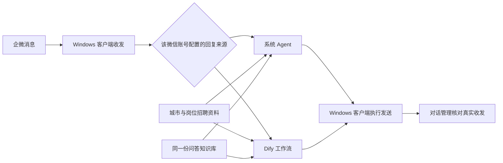

# AI 接待产品结构讨论稿

2026-11-21。复核至主分支 `33779cd`，本次涉及的网页和服务端源码与 `0348b15` 一致。本文讨论入口、资料归属和实际读取范围。

## 本轮提案 · 岗位统一录入，Agent 增加一个标签

用户提出沿用 Dify 线路已有的招聘业务顺序。先维护城市，再维护该城市下的普工、安保、保洁等岗位。录入沿用岗位页现成的三个标签。系统 Agent 的补充配置在这个页面增加一个标签，作为同一岗位的设置入口。

| 位置 | 建议职责 |
|---|---|
| 招聘资料 → 城市 | 将现有「城市与项目」改名「城市」。从城市查看所属岗位，维护适用于该城市的资料，并标明影响范围 |
| 招聘资料 → 招聘岗位 → 基础信息 | 编辑岗位名称、所属城市、项目或厂区等信息 |
| 招聘岗位 → 岗位资料 | 编辑工资、班次、工作内容、食宿与扩展资料。已验证两条线路能读取的字段各填一次。线路独有的业务字段仍按业务归属显示适用范围 |
| 招聘岗位 → 面试与门店 | 编辑面试安排、工作地点与门店信息。能用于咨询和能用于正式预约分别说明 |
| 招聘岗位 → 系统 Agent | 查看当前岗位引用的资料和已启用的流程。配置人设、开场、固定消息、间隔和分支时，从此处带着岗位进入现有画布 |
| AI 接待 → 问答知识库 | 维护通用与岗位问答。反复有人问、岗位表无合适字段的问题在此补充 |
| AI 接待 → 话术流程 | 做深度编排。画布查看当前启用的 Agent 节点，并通过现有接待测试核对两条线路的输入和输出 |

原有 Dify 专属的城市知识品类、面试指引按城市维护，岗位页显示来源并直达对应城市。Dify 工作流节点仍在其现有编辑位置维护，可以从对应的设置入口带上下文进入。真实微信账号使用的回复来源单独按账号确认。

这个结构的优点是运营按真实业务对象录入，普工、安保、保洁走相同路径。岗位填写仍用成熟表单，Agent 的新增复杂度集中在第四个标签，日常录入时比较容易忽略。知识库可以补通用问答，画布可以让需要定制的客户设置固定发送和分支。

风险集中在跨线路的取值与流程证据。Dify 当前对部分字段城市优先，Agent 以岗位为主。岗位保存一次之后，界面必须如实显示各线路最终取值。Agent 标签应展示已启用版本、固定发送步骤、等待条件、AI 生成回复的位置、使用的事实和问答。将草稿、模拟结果、客户端执行和真实发送分开核对。现有「面试/工作地址」在岗位归一化时同时写入工作和面试地址，两地不同的岗位需要独立核对。岗位资料页现有说明写「用于 Agent 与岗位详情展示」，其中部分字段已被 Dify 读取，后续应按实际字段更正说明。

问答库承担招聘咨询的补充内容。当前两条线路会把适用问答与岗位资料一起交给各自的回复逻辑，界面可核对该条有没有被读到。工资和面试时间等事实建议继续由招聘资料提供。原岗位行内「岗位配置」后续可明确命名为「编辑话术流程」，依然打开同一个画布。新 Agent 标签负责定位当前岗位的设置，原画布负责完整编辑。

首期建议验收同一城市下两个岗位有不同工价、工作地点与面试地点不同、普通 Dify 岗位无需填写 Agent 配置，以及 Agent 岗位可从标签找到启用流程并查看真实输入。本节是一项页面设计提案，下面保留前几轮的对比方案和实测。

## 上一轮页面入口提案

建议用现有「招聘岗位 → 编辑」承载录入，列表按钮改名「编辑岗位资料」，表单首区叫「基础招聘资料」。岗位列表、岗位表单和现有保存接口共同承担这项任务。若表单后续需要更多空间，可从同一个「编辑岗位资料」入口打开独立编辑页。左侧用现有「招聘资料 → 招聘岗位」进入。

| 用户要做的事 | 建议主入口 | 打开后的内容和操作 |
|---|---|---|
| 改工资、班次、吃住和面试信息 | 招聘资料 → 招聘岗位 → 编辑岗位资料 | 按现有岗位保存，字段旁显示适用线路和当前取值来源。共同字段维护一份 |
| 设置系统 Agent | AI 接待 → 话术流程 → 系统 Agent | 工作台顶部固定线路标签。用现有画布配置开场、人设、话术顺序、间隔和等待分支 |
| 设置 Dify | AI 接待 → 话术流程 → Dify | 同一位置的另一线路标签。查看连接状态，打开 Dify 后台编排，打开本岗位所属城市的 Dify 专属资料 |
| 维护问答正文 | AI 接待 → 问答知识库 | 编辑通用和岗位问答。线路页快捷链接带岗位定位到同一知识库 |
| 试答和验证资料来源 | 话术流程 → 接待测试 | 默认用当前线路和岗位，也可选另一条线路比较。展开回答依据查看实际值 |
| 给微信账号切换实际线路 | 日常招聘 → 微信账号 → 接待设置 | 明确选择并保存该账号的真实回复来源。按现有条件测试和重启客户端 |

两条线路标签放在同一个「话术流程」页面顶部。顶部岗位选择贯穿两条线路，普通切换线路保留岗位。Dify 页内的「编辑本城市 Dify 资料」直接定位当前岗位所属城市的现有编辑器。编辑区显示城市名与适用范围，关闭后回到同一岗位的 Dify 页。城市页原入口指向同一编辑器。城市级知识品类、面试指引等在这一处保存。岗位自身的业务事实从「编辑岗位资料」修改。

Dify 当前服务地址和密钥由服务端配置。Dify 标签首期显示连接状态，工作流节点的编辑与发布指向 Dify 后台。将来增加网页连接配置时，入口位置归 Dify 标签内。

现有招聘岗位行内「岗位配置」改名「AI 接待设置」，带岗位打开话术流程的两条线路，便于与同一行的「编辑岗位资料」区分。微信账号的「工作流配置」带账号和岗位直接打开实际线路。账号配置由「接待设置」写入，测试面板展示当前线路和对应快捷链接。以上为待讨论的入口迁移。

首批页面验收覆盖三个动作。修改工资能找到唯一岗位表单。修改 Dify 城市知识品类能从 Dify 标签直达正确城市的编辑区。修改 Agent 开场能进入对应岗位画布。保存后都可以回到同一岗位试答并核对来源。工资被城市当前值覆盖时，页面明确展示两条线路各自的实际值。

## 同一个岗位填一次，按线路补充配置

建议在「招聘岗位 → 编辑岗位」沿用现有表单，先展示共同资料，再展示按需展开的线路配置及入口。每项资料标明「两条线路使用」「系统 Agent 使用」或「Dify 使用」。标签根据已核对的读取范围展示，当前取值受城市资料覆盖的字段同时说明来源。

| 区域 | 用户维护的内容 | 位置 |
|---|---|---|
| 岗位共用资料 | 工资、班次、工作内容、食宿、面试时间、地点等同一岗位的事实，逐字段验证两条线路 | 「招聘岗位 → 编辑岗位」，优先展示。两个引擎读取同一岗位记录 |
| 系统 Agent 设置 | 开场、人设、固定话术、发送间隔、等待和分支。岗位招聘要求当前进入 Agent 结构化输入 | 「话术流程 → 系统 Agent」。岗位页只提供带岗位的快捷入口 |
| Dify 设置 | 工作流连接、Dify 使用的城市品类及面试安排相关规则。已有城市面试指引留在原编辑处，由线路入口显示来源和快捷链接 | 「话术流程 → Dify」显示配置入口与来源。节点在 Dify 后台维护，城市专有字段继续从城市页编辑 |
| 共享问答 | 通用及岗位问答，填一次。可从测试结果核对两条线路的实际使用范围 | 「AI 接待 → 问答知识库」 |

拟定的业务规则是「已有岗位明确填写的共用事实优先，岗位为空时采用有适用范围的城市默认值」。第一批建议只确认工资和班次。面试时间、地点和预约校验单独核对，现有城市与岗位存在差异时列出两值及受影响岗位，供运营核对。两条线路从同一处读取已确认事实，避免复制后分别维护。旧记录的覆盖关系在改变前按岗位预览。

页面示例为「时薪 34 元/小时 · 两条线路使用」。在当前规则下如有城市覆盖，则如实显示「Agent 34 元 · 来自岗位」「Dify 24 元 · 来自城市」，并给出查看城市资料的入口。模型输入尚未接入的字段标注「本线路暂未读取」。填写阶段解释影响，保存后的试答核对实际输入与回答。

### 本轮新增隔离验证

| 验证项 | 现有代码实测 |
|---|---|
| 城市对应字段为空，岗位保存一次时薪、班次和面试地址 | Agent 与 Dify 同时读取 32 元/小时、每天 10 小时、验收园区东门。只更新岗位时薪为 34 元后，两边下一次输入均为 34 元 |
| 城市和岗位均有时薪 | Agent 取岗位值，Dify 取城市值。填一次能够共用的前提是当前 Dify 路径没有更高优先级的城市值 |
| 补充同一岗位的招聘要求和面试点 | 岗位招聘要求进入 Agent 的结构化咨询输入，目前未进入 Dify 的对应输入。Dify 能读取岗位面试点及周一、周二的可面试日 |
| 为城市补充 Dify 使用的面试指引和可面试日 | Dify 读到城市面试指引，并把可面试日取为周三。Agent 结构化输入未收到该指引 |
| 停用同一个岗位的问答 | 两条线路均从本轮输入移除该条，其他岗位的同名答案保持隔离 |

样本经现有保存接口写入隔离数据库，再通过两条试答接口对照模型输入。问答正文、字段来源和取值已核对。真实模型回答与企微发送需在下一层验收。

建议把「只改一次」作为实施验收。第一批字段保存后，分别检查 Agent 和 Dify 的本轮输入与来源，使用同一个岗位问题检查回答。旧城市和岗位有不同值的样本保留对照，便于确认优先级变化。测试面板沿用原入口，显示所选线路，以及哪些值和答复进了本轮。线上账号实际使用哪条线路沿用账号配置。

## 本轮复核后的建议

保留「招聘资料」下的城市与项目、招聘岗位表单。保留独立的问答知识库和素材页。画布承载流程、试答和资料来源核对，看到问题可以带着岗位回原页修改。上一版提出的双线路列表降为后续待讨论项。第一步优先让用户看清同一个岗位在两条线路中的实际取值。

| 保存位置 | 系统 Agent 当前读取 | Dify 当前读取 |
|---|---|---|
| 招聘岗位 | 工资、班次、面试地址、招聘要求等进入岗位事实和回答上下文 | 工资、班次、面试地址等已接入的字段在城市对应项为空时回退岗位。岗位面试点也用于结构化预约。隔离验证中的岗位「招聘要求」未进入 Dify 咨询输入 |
| 城市与项目 | 创建新岗位时填充部分空白字段，之后按已保存岗位取值 | 每轮读取所属城市。已填写的城市工资、班次、面试地点优先 |
| 问答知识库 | 读取适用的已启用问答正文，将问题和答案加入模型上下文 | 共用问答数据，额外支持城市明确绑定的品类问答。发送给 Dify 的输入按本轮问题及容量选取完整条目 |

隔离验证通过现有城市、岗位、知识库保存接口写入样本，再分别读取两条测试接口的实际组装输入。同岗的岗位时薪为 27 元，城市时薪为 24 元。Agent 取 27 元、每天 9 小时、岗位东门，Dify 取 24 元、每天 8 小时、城北服务台。岗位时薪改为 29 元时 Agent 输入随之变化，城市时薪改为 25 元时 Dify 输入随之变化。清空样本城市时薪后，Dify 回退到岗位的 29 元。

同一次验证通过实际知识接口保存「行李放在哪里 → 行李交给蓝色服务台保管」。两条线路的输入含同一条知识 ID 和完整答案。另一岗位的同名问答未被纳入，停用当前问答后两条输入均不再包含该条。样本验证做到保存和模型输入组装。模型具体措辞与 Windows 发送是另外两个验收节点。

### 改造范围和工程量

| 范围 | 工作量及验收 |
|---|---|
| 首期在现有「回答依据」显示两条线路的核心事实和来源 | 复用两套预览接口，差异显示到字段。第一批验工资、班次、招聘要求、面试时间和地址。未接入输入的字段显示「本线路未读取」，无法读取时显示「读取失败」 |
| 后续统一工资、班次等事实的取值规则 | 逐项确认城市与岗位冲突时谁优先，并盘点已有差异。涉及同城多岗和面试预约校验，按岗位回归后再讨论发布 |
| 合并表单或搬迁保存接口 | 值的优先级、历史字段、账号与岗位关联、预约校验均需联测，工程量和出错风险最高。现有两个编辑入口各有真实消费者，建议保留 |

画布当前已有岗位选择、流程节点、开场、人设、执行与同步状态，以及测试抽屉。首期沿用现有「回答依据」区域呈现只读结果，编辑继续在城市、岗位和知识库的原位置进行。

## 两种入口摆法

以下保留上一轮讨论的导航选项，实施顺序以上方复核后的建议为准。

| 用户要做的事 | 方案一 · 侧栏拆成 Dify 和系统 Agent | 方案二 · 一个 AI 接待分组，里面分线路 |
|---|---|---|
| 配置线路 | 左侧直接点对应引擎，入口清楚 | 进入「话术流程」先看到两条同级线路，再点配置 |
| 给同一个岗位改问答 | 两套引擎页都需要指向公共知识库 | 左侧保留一项「问答知识库」，线路页可带岗位跳转过去 |
| 对比两条线路的回答 | 要在两个入口之间往返或再找共用测试页 | 在画布同一个测试面板里按同一岗位和问题对比 |
| 核对真实接待 | 仍需回微信账号查生效引擎和客户端 | 同样从微信账号查，可从线路卡片直接查看相关账号 |

建议方案二。运营要反复处理的是岗位、知识和真实微信账号。两条线路的名字需要同级可见，区分开编辑方式和输入来源，公共资料和测试仍然有固定位置。技术上，两个方案都能共用同一份问答库。导航选项影响的是用户如何找到和使用它。

## 建议的页面归属

```text
招聘资料
  城市与项目       维护城市资料和项目通用口径
  招聘岗位         维护实际招聘岗位及工资、班次、面试等事实

AI 接待
  话术流程         顶部列出两条线路，点对应线路配置或进入画布
    系统 Agent     自定义开场、人设、话术步骤、等待、间隔和分支
    Dify 工作流    查看实际资料来源、配置状态和编辑去向
    接待测试       画布右侧共用面板，按岗位挑引擎试答和查看依据
  问答知识库       保存通用和岗位问答，查看两条线路的适用范围
  图片与视频       保存招聘素材，展示当前可用的发送线路

日常招聘
  微信账号         每个账号的实际回复来源、岗位、客户端状态、通知群
  对话管理         核对真实企微收发和人工接管
  候选人管理       查看和跟进候选人
  面试登记         查看是否完成正式登记和通知
```

第一版复用现有「话术流程」路由，在页面顶部给两条线路同等位置，并提供「配置」和「测试」。系统 Agent 打开原来的画布。Dify 展示已连接应用的资料输入和回复关系，节点编辑在 Dify 后台完成。公开的测试快捷链接带入当前岗位或账号。深链接可直接打开指定线路或画布测试。

建议把实际引擎的保存位置从「接待测试」移到「微信账号 → 接待设置」。测试面板可以显示某账号当前实际使用的线路并跳转回接待设置。账号页的「工作流配置」仍带上下文打开相应线路。管理员切换真实引擎时沿用现有就绪检查和重启要求。

## 共享数据与实际运行



| 能力 | 当前核对结果 | 产品处理建议 |
|---|---|---|
| 通用及岗位问答 | 两条线路调用同一个问答读取函数，并从同一份知识表读取。Agent 当前按无品类通用问答和本岗位问答取用。Dify 还能按城市明确绑定的知识品类读取匹配模板，并按本轮输入容量选择内容 | 继续维护一份知识。先展示每条问答的适用范围和两条线路各自读到什么，再单独讨论是否统一品类规则 |
| 工资、班次与面试资料 | Agent 以当前岗位事实为基础。Dify 先使用城市资料，空白字段再从岗位取值 | 页面展示实际值与来源。遇到同岗两种答案时先定位城市与岗位的重复值，后续再讨论统一优先级 |
| 话术与素材 | Agent 有现有流程节点和客户端素材发送能力。Dify 使用发布后的独立工作流，当前集成回复按文本返回 | 两条线路分别显示真实编辑入口和已接通能力，素材共享维护按已有消费者展示 |
| 面试登记和群通知 | 最新 Dify 代码已支持岗位推荐、面试安排及正式登记写入，与现有面试档案关联。该登记路径仅核对到归档写入，群通知和 Windows 真机结果需要分别验收 | 面试登记使用已有页面，按线路确认「已登记」「已通知」各自的证据 |
| 客户端 | 两条线路复用 Windows 客户端，一台设备按其配置使用一个回复来源。画布上选择预览引擎仅改变本次预览 | 保留同一个账号连接入口和对话窗口。客户端联调以测试会话中的真实入站、发送记录和手机收信为验收环节 |

## 运营操作示例

用户要确认广州安检岗的工资时，先在招聘岗位核对已保存数字，再用「话术流程 → 接待测试」对同一问题分别试问 Agent 和 Dify。回答不同就展开依据，确认它读的是岗位还是城市，或者是否用了品类问答。

用户要让一个账号改用 Dify 时，在「微信账号 → 接待设置」查看账号、已绑岗位和当前引擎，按现有条件完成显式切换。然后用专用测试联系人给该账号发消息，在「对话管理」核对是否实际发回。如涉及报名，再去「面试登记」核对记录。

## 建议先确认的页面位置

保留侧栏下唯一的「话术流程」入口。页面打开时，两条线路同级可见，并允许通过已知岗位或账号直接进相应画布和测试。左侧知识库、图片与视频保留。把「账号实际使用哪条线路」放在微信账号的接待设置里。确认这两个位置后，再按入口规范安排实现。
