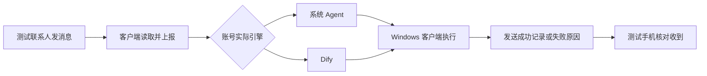

# Agent / Dify 统一画布测试方案（统一入口方向已确认）

日期：2026-11-21。核查源码：main `54c7981`。用户已确认统一入口方向，并要求新增功能先讨论页面位置。具体实施安排另行记录；本轮仅更新方案与规范，不修改应用或线上配置。

## 本次入口迁移

「话术流程」工具栏打开右侧「接待测试」。在同一面板使用系统 Agent 或 Dify 试答、查看输入与回答依据，也可展开账号回复来源。微信账号的 Dify 工作流链接保留账号和岗位，知识库快捷按钮带入岗位，旧 Dify 地址兼容跳转。首页与侧栏的独立 Dify 链接并入话术流程。城市资料仍在城市页维护，Dify 节点在 Dify 后台维护。

客户端联调、Dify 集成图和更细的发送证据属于后续设计。当前浏览器已用隔离测试服务核对跳转、岗位和账号、引擎切换以及模拟响应呈现。

## 1. 建议结论

将 Agent 和 Dify 的测试统一到现有画布工作台，使用同一个右侧测试面板。统一的是测试入口、岗位选择、问题输入、结果呈现与客户端核验；两种引擎保留自己的配置来源和运行机制。

Dify 的 Chatflow/Workflow 本身支持节点画布，但用户截图是本系统的 Dify 连接与测试页，不是 Dify 原生画布。现有集成通过 `/chat-messages` 调用已发布的 Dify Chatflow，未导入其真实节点图或节点执行轨迹，因此不能把系统 Agent 的节点图当作 Dify 正在执行的流程。

“换脑袋，看手有没有反应”是同一个端到端验收目标。网页生成回答、客户端执行、企微发送结果是其中连续但不同的步骤，统一界面后仍应逐步给出证据。

## 2. 方案比较

| 方案 | 优点 | 代价/问题 | 建议 |
|---|---|---|---|
| 原页面分别保留，只增加互相跳转 | 改动最少 | 测试仍分散，岗位/账号容易选错 | 不作为目标方案 |
| 现有画布＋统一测试侧栏 | 用户在一处看流程、选择引擎、提问和核验客户端；能复用现有接口 | 需整理测试上下文和结果状态 | 推荐，适合当前 MVP |
| 把 Dify 全部节点编辑器重做进系统画布 | 编辑外观统一 | Dify DSL、节点类型、发布与运行语义都要兼容，易形成第二套工作流 | 暂不做 |

## 3. 页面与入口

先保留“话术流程”这个已有菜单名称，页内说明“配置接待流程，测试 AI 回复和客户端收发”。不再同时更改多个菜单名。

```text
┌───────────────────────────────────────────────────────────────────┐
│ 岗位 [广州安检 ▼]  测试引擎 [系统 Agent / Dify]  [配置] [开始测试] │
├─────────────────────────────────────┬─────────────────────────────┤
│                                     │ 测试面板                    │
│            无限画布                 │ [模拟回复] [客户端联调]     │
│                                     │ 当前岗位、测试引擎          │
│ Agent：本岗位真实已保存节点          │ 当前账号实际引擎（如已选）  │
│ Dify：数据→Dify→客户端的集成关系     │ 问题输入 / 新建测试会话     │
│       不虚构 Dify 内部节点           │ 回答、依据、耗时、执行结果  │
│                                     │ 在对话管理查看真实记录      │
└─────────────────────────────────────┴─────────────────────────────┘
```

- Agent 视图继续使用现有岗位节点、连线、等待/间隔与编辑器。
- Dify 视图显示实际集成关系：城市/岗位/知识输入 → 当前已配置的 Dify 应用 → 返回文本 → Windows 客户端。它是集成图，明确标注“内部节点请在 Dify 后台编辑”。MVP 不展示虚构的内部执行高亮。
- 当前服务配置绑定一个 Dify 应用，不能做成任意切换多个 Dify 工作流的选择器；多应用绑定是后续能力。
- 右侧面板与节点属性共用固定区域，通过“节点配置 / 测试”切换，保留既有缩放、拖动、全屏与返回按钮。
- 知识库、图片与视频独立菜单继续保留；画布内快捷按钮打开同一份数据，不能再次将重要功能藏起来。
- 微信账号页的“工作流配置”改为携带该账号、岗位和实际引擎进入工作台。旧 `/dify-connection` 地址保留兼容跳转，避免存量链接失效；其测试 UI 迁入统一面板，维护一套。
- 城市/知识库里现有 QA 后续改为携带当前岗位及引擎的“到画布测试”，保留来源编辑页与返回路径，不强制用户重复选择岗位。

## 4. 同一面板的两种测试

### A. 模拟回复：先测脑袋

用户只选岗位、测试引擎，输入问题。无需设备在线，也不需要保存或切换真实账号的回复来源。

结果展示：此次引擎、实际使用岗位与资料来源、适用知识、回答正文、耗时，以及“仅预览，未经过客户端”。资料缺失或冲突要明确提示；适用知识数量不等于本轮精确命中数量。

Agent 使用当前 `dry` / `preview` 能力；Dify 使用独立的 `/api/v1/dify/preview`，不继续要求先修改测试设备的 reply_provider 才能试答。Dify 预览已有隔离会话，允许写测试会话/调用日志，但不写真实客户会话、档案、OA或群通知。Agent 多轮预览可使用面板本地 history，由服务端预览读取；不创建真实 session_key。

切换岗位或引擎会新建隔离测试会话，不把 Agent 历史带给 Dify；未保存流程不会当作实际执行结果。运行测试前提示使用已保存配置，明确当前版本；Dify 原生工作流版本当前 API 未返回，应显示未提供，不编造版本号。

Agent 固定节点/等待路径仍以画布配置或真实客户端执行为证；单纯调用模型预览不能声称已按配置等候、发图或推动节点。首版对节点内容做只读核对，不新建一套模拟执行器冒充 Windows 行为。

### B. 客户端联调：脑袋与手一起测

用户选择专用测试微信账号及明确的测试联系人，在手机上向该账号发送测试消息。沿用现有真实入站 → 指定引擎 → Windows → 企微的链路，网页观察并展示结果。



状态按证据显示：等待测试消息 → 已读取消息 → 已生成回复 → 客户端执行中 → 已发送 / 失败 / 结果待核对。节点流程中的固定消息可能不经过模型生成；展示实际步骤，不补虚构的“模型已生成”。客户端回执或本地数据库成功记录不是对方手机已收到的回执，最后一步由测试人员核对。

首版复用现有对话、桥接回执、配置同步和流程镜像来核对；若某一步缺事件或无法关联，就显示“无证据/待核对”，不能按时间邻近、昵称或出现在线心跳猜成功。选择测试会话后以精确 device_code＋customer_id/external_conversation_id 过滤，不显示其他客户正文。

网页的模拟输入不能伪装成企微真实入站；把一段模拟答案直接塞人工发送队列，只能证明发送通道，不证明自动读取、引擎路由和自动回复链路。所以 MVP 不增加“点击一次完成全部真实发送”的假验收按钮，也不默认对真实客户发测试消息。

## 5. 换测试引擎和换真实账号引擎分开

| 用户操作 | 改变什么 | 是否影响实际接待 |
|---|---|---|
| 模拟回复中选择 Agent/Dify | 本次预览调用来源 | 不影响 |
| 客户端联调中选择账号 | 查看该账号真实引擎与会话 | 只读选择，不自动切换 |
| 明确点击“切换该测试账号引擎” | 走专用 reply-provider 保存口 | 会影响该账号，需完成就绪检查 |

现有切换限制必须保留：客户端停止并确认离线、旧节点镜像/本地会话快照核对、Dify 独立且干净的客户端状态、重启后重新读取。不能因为 UI 合并就允许在线一键热切换存量客户。普通用户看到具体未完成项，技术细节收进高级说明；禁止用一个形式上的复选框代替实际核对。

“已保存、客户端已读取、账号已切换、实际消息已发送”分别展示；切换失败不回退其他引擎，不默默清理真实会话。MVP 沿用现有运维准备方式，不新增自动清理 Windows 数据目录或额外键鼠动作。

## 6. 当前能力差异必须可见

| 能力 | 系统 Agent | 当前 Dify 集成 | 工作台应怎样显示 |
|---|---|---|---|
| 按招聘资料/适用知识回答文本 | 已有 | 已有，城市资料及岗位回退口径与 Agent 不完全相同 | 分别展示实际输入依据 |
| 有序开场、间隔与等待分支 | 现有岗位节点流程/旧开场由 Windows 执行 | 本系统不向 Dify 账号下发 Agent 节点与旧开场 | 不显示为同一组节点；Dify 内部逻辑看 Dify 后台 |
| 图片/视频发送 | 现有客户端具备，具体配置需测试 | 当前只解析兼容文本，自动媒体未接入 | 标注未接通，不能显示已支持 |
| 正式登记、OA、群通知 | 存在业务链路，既有群通知问题仍需修复验收 | 当前文本咨询链路尚未接入 | 分能力显示，不把咨询成功当报名成功 |
| 客户端实际收发 | 复用现有 Windows | 复用现有 Windows；曾有定向单联系人验收，不能推断整账号自动接待已切换 | 只报告本次精确测试会话证据 |

Dify 的已发布配置不是本系统编辑器中的节点，不把本系统 Agent 的开场、人设或图片自动带入 Dify。统一界面不等于统一事实取值规则或全部业务能力相同。

## 7. 最小落地顺序

第一步：在现有画布右侧合并两种模拟回复和回答依据，复用预览接口；测试引擎可自由选，真实账号配置不动。迁移旧测试入口并保留兼容路径；知识库/素材菜单独立可见。

第二步：在同一面板加入客户端联调页签，复用现有只读会话/回执与就绪信息，明确测试账号与联系人，引导手机真实触发。缺少细粒度事件时保留未知状态；如需补跨阶段关联标识另立小改动，不改冻结发送动作。

第三步：再根据业务需要补 Dify 正式登记、群通知和媒体，不将这些作为“合并测试 UI”已完成的附带能力；Dify 原生节点图导入/可视化轨迹、多应用切换也不在首版范围。

建议将第一、二步作为统一测试 MVP 的两项验收，避免只合并聊天框就宣称“脑袋和手已打通”。

## 8. 验收清单

1. 一个画布工作台能按相同岗位分别试问 Agent、Dify，明确显示各自实际输入资料与隔离历史，不修改真实账号。
2. 不选设备/设备离线也能做模拟；无权限、岗位失效、未配置 Dify 显示具体原因，不自动换岗位或引擎。
3. Agent/Dify 切换或新会话后不会混入另一引擎历史；预览不创建真实登记、推群或企微发送。
4. Agent 图来自真实已保存岗位节点，Dify 集成图不冒充其内部工作流；无真实版本/节点轨迹就显示未提供。
5. 用专用测试联系人真实发消息，面板能看到本次链路证据并链接对话管理；离线、接管、未上传、生成失败、发送失败和结果未知能够分别定位。
6. 真实账号换引擎遵守现有限制；不清理真实快照，不让一次模拟操作变成线上切换，不自动重发结果未知的任务。
7. 登记、图片、群通知等未接通能力不能出现成功勾选。
8. 独立知识库与素材入口保留，普通视图和全屏都能打开测试面板并返回，不丢未保存流程修改。

## 9. 核查依据

- `public/dify-connection.html/js`：入口迁移前的独立连接、来源切换、模拟对话。
- `src/modules/dify/dify-reply.ts`：隔离 Dify preview、全局应用配置、真实来源切换限制、文本回复与安全校验。
- `src/modules/agent/agent-chat.routes.ts`：Agent dry/preview、history、真实归档路径和 Dify 提前路由。
- `src/modules/agent/agent-flow.routes.ts`：Dify 设备不下发 Agent 节点，配置同步证据。
- `frontend-vue/src/views/AgentFlowView.vue` 与 `components/agent/PositionQa.vue`：现有画布、模拟回答和岗位入口。
- `src/modules/messaging/device-bridge.ts`：命令领取、回执、结果未知。
- `agent/autopilot.py`：实际节点推进和企微收发；冻结动作层不改。
- `docs/Dify完整线路验收-20261121.md`：已测能力和报名/媒体/群通知边界。
