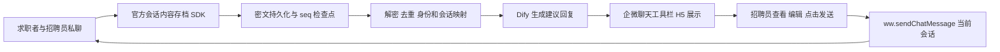
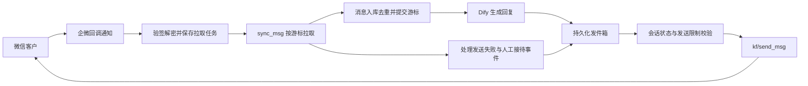

# 企业微信 API 接入断点分析与实施方案

核查日期：2026-10-25。代码基线：`60a886ea065c4797ca34b892e8927d36aa54ec48`。

本文基于源码检查及企业微信官方文档核对。尚未取得实际企业的应用配置、错误码或回调日志，因此这里定位的是代码链路缺口，不能据此认定某个实际企业的后台配置已经正确。本文是开发整改方案，尚未实施或完成企微实机联调。

## 1. 结论

当前主要问题是：系统还没有实现企微消息收发通道，Dify 生成回复被当成了消息发送成功。仅填写企微 API 凭证不能接通现有流程。

用户后来已明确本轮真实联调入口：**微信客服入口**。本次实现以第 3～5 节的微信客服方案为主；第 2.1 节仍保留为招聘员企微好友私聊的独立替代方案。微信客服的 48 小时、5 条、3 天拉取窗口只适用于本次客服通道，不适用于好友私聊方案。

采用官方 API 时应区分以下业务入口：

| 业务入口 | 官方接口适用范围 | 本系统应如何处理 |
| --- | --- | --- |
| 微信客服链接或二维码进入的客服会话 | 支持拉取消息、API 回复、分配人工接待；受会话状态、回复窗口和条数限制 | 适合实现 AI 自动接待的完整收发链路 |
| 求职者添加招聘员企微好友后的私聊（已选定） | 客户联系服务端接口、会话内容存档 SDK、聊天工具栏 JS-SDK 分工不同 | 会话存档采集、AI 建议回复、招聘员在当前会话侧边栏点击发送；不承诺后台无人值守的任意好友私聊收发 |
| 企业内部成员通知 | 属于内部应用消息场景，与微信客户私聊不同 | 单独建设到岗提醒等内部通知通道 |

微信客服和招聘员外部联系人私聊不是同一个通道。不要用 `kf/send_msg` 向已有招聘员好友会话发送消息，也不要把企业群发任务当作实时自动回复。[1][2][4]

## 2. 代码中已经确认的断点

| 优先级 | 位置 | 当前行为与影响 | 整改要求 |
| --- | --- | --- | --- |
| P0 | `src/modules/activation/activation.jobs.ts:32`、`activation.routes.ts:17` | 默认使用 `MockDifyProvider`，路由没有注入真实 HTTP provider | 明确演示与真实环境配置，真实模式缺少配置时不得回退为模拟成功 |
| P0 | `activation.jobs.ts:91–110` | 调用 Dify 前记录 `message.sent`；获得 AI 回复后写入 `sent`，用 Dify message ID 标记投递成功 | 拆开“生成回复”和“向渠道发送”，分别保存 Dify ID、企微 msgid 和各自状态 |
| P0 | `src/modules/agent/agent.routes.ts:32` | 人工回复仅插入本地消息表，没有任何渠道发送 | 进入统一发件箱，由渠道适配器发送；不能本地落库后就显示已发送 |
| P0 | `activation.routes.ts:91–98` | 激活记录的 `run` 操作直接改成 `sent` 并递增 tier | 改为排队发送；实际 API 受理后再按定义更新业务状态 |
| P0 | `src/modules/messaging/message-events.ts:59` | 现有 webhook 处理的是 JSON 与 HMAC-SHA256，没有企微回调处理 | 新增独立企微回调验签、解密、验收企业身份与 URL 验证，不能复用为同一种协议 |
| P1 | `message-events.ts:43` | delivery 一旦停在 `sending`，后续只允许从 queued/failed 发送，无法自动恢复 | 增加发送租约、过期恢复、未知结果状态和人工核查入口 |
| P1 | `activation.routes.ts:75–81`、`scheduler/scheduler.ts:34` | 当前入口只执行一次 `runOnce`；源码中没有持续消费任务的 worker | 增加持续 worker 和恢复扫描；扫描生成的发送任务必须被继续消费 |
| P1 | `agent.routes.ts:30–31` | 消息接口固定返回 `takeover:false`，接管只更新本地标志 | 读取实际接管状态；AI 生成前及发送前再次校验；同步官方客服会话状态 |
| P1 | `activation.jobs.ts:96–101` | Dify 调用没有带入已保存的 conversation ID，user 也没有企业/渠道命名空间 | 持久化 Dify 会话映射并隔离企业、应用和客户会话 |

`src/server.ts:34` 的公开路由也不包含现有 Dify webhook。新增企微回调时必须明确其独立认证方式，使官方请求能通过，而业务管理接口继续保留 JWT 与权限校验。

现有 numeric `customer_id` 应继续作为内部主键。企微 `external_userid`、`open_kfid` 是字符串，另建映射表，不得调用 `Number(external_userid)`，不得按昵称合并客户。[1]

### 2.1 已选定方案：招聘员好友私聊

好友私聊仍存在官方能力边界：服务器不能凭普通客户联系 API 代招聘员给任意好友逐条自动回复。若未来选择该入口，可落地方案需要会话内容存档 SDK 和企微客户端工具栏；本轮不把它与微信客服通道混用。

**补充前文能力说明：官方确实提供向当前会话发送消息的 `ww.sendChatMessage`，但它是在企微客户端特定入口调用的 JS-SDK 能力。它并非后台任意目标私聊发送接口。**[8][9]

“招聘员查看并点击发送”是本方案选择的产品流程；不将其表述成官方文档要求所有 JS-SDK 调用均弹窗确认。官方明确的限制是应用身份、权限及客户端入口上下文。[9]

#### A. 接收端：会话内容存档

- 先在企微管理后台核实已开通会话内容存档，并将目标招聘员纳入范围；配置调用 IP、消息加密公钥。员工须按官方流程告知；与外部联系人的会话经其同意后才能通过 API 获取。没有开通或客户没有同意时，展示不可采集原因，不使用虚假入站消息替代。[6]
- 使用官方 SDK 的 `GetChatData` 拉取记录，按 `publickey_ver` 选择对应私钥解开随机密钥，再调用 `DecryptData` 解密。存档 Secret、公钥版本私钥与普通应用 Secret 分开配置。[7]
- 当前 TypeScript 服务可保留业务逻辑，新增与官方原生 SDK 兼容的采集进程，经过内部认证将记录交给业务服务；具体采用原生绑定或独立进程，应在部署环境验证后确定，不引入未经核实的第三方协议。
- 客户联系新增/删除等事件用于更新客户关系，不能把这些事件当成普通私聊消息正文来源。

#### B. 这里的断点恢复使用 seq，不是客服 cursor

官方会话存档按 `seq` 增量拉取：首次为 0，后续传上次返回的最大 seq，返回从 seq+1 开始；支持从指定 seq 重新拉取，一次最多 1000 条，内容获取窗口不能超过 5 天。[7]

实施要求：

1. 按企业和存档连接保存 seq；该流不能按招聘员各自推进后再合并。`seq` 是 Uint64，代码、JSON 边界及数据库必须无损处理，不能用可能失真的 JavaScript Number。
2. 同一事务保存一页原始密文及逐条处理状态，再推进采集检查点。解密失败消息进入可重试队列，保留密文与公钥版本，不因密钥轮换失败而丢弃消息。
3. 将采集检查点与解密/业务处理进度分开。重启后从采集检查点续拉，已入库密文继续处理；同一企业内按 msgid 去重。
4. 增加定期拉取和启动补拉，监控采集延迟，接近 5 天窗口提前告警。不能承诺超过窗口后补齐未采集历史。
5. 区分招聘员发出的消息、客户消息、撤回与同意状态变化；只有客户的新消息生成相应建议。恢复时积压的旧消息可以补入历史，但先检查后续人工回复，避免给已处理会话生成过时待办。

#### C. 发送端：聊天工具栏 H5 与 JS-SDK

将 AI 助手 H5 配置到企微聊天工具栏。通过官方上下文和当前客户 ID 接口识别当前会话，服务端校验登录招聘员权限及客户关系，展示该客户对应的 AI 建议。[8]

招聘员点击发送后，通过官方 `ww.sendChatMessage` 向当前会话发送文本。该接口必须以应用身份注册，并满足官方规定的入口和权限条件；外部单聊工具栏入口是 `single_chat_tools`。普通独立浏览器里打开当前后台页面，没有这个企微客户端上下文。[9]

当前 `manual-reply` 应在这个场景下改为保存草稿或发送意图，不能在服务器写库后标成 sent。前端发送前再次核对当前客户、草稿版本与内容，成功、失败、取消分别保存；接口调用成功和客户已读仍应区分。JS-SDK 文档返回通用结果，不能假定存在官方 msgid 可供精确关联；后续存档中看到员工发出的消息可作为记录，不应仅按相同文本自动证明某次意图已发送。[7][9]

浏览器或企微客户端离线时保留草稿，不在重连后自动重放当前会话发送，避免客户上下文变化造成误发。重新进入侧边栏后核对会话并展示待处理建议。

#### D. 功能调整与第一期验收

- 私聊模式定位为 AI 招聘助手：客户资料同步、对话归档、建议回复、跟进提醒和招聘员点击发送。
- 沉默客户激活先创建跟进任务或建议文案，不能直接增加发送量。如采用企业群发，单独创建官方任务，并跟踪成员确认与发送结果。[4]
- 当前 `takeover` 在此模式下表示暂停/恢复 AI 建议；不要调用微信客服的 `service_state` 来管理招聘员好友会话。
- 若业务必须是招聘员离线后仍以其身份自动逐条私聊，需要先取得企业已获授权的具体官方能力及对应文档，再验证；现阶段不承诺普通官方客户联系接口能实现它。

第一期验收：选一个已开通存档的招聘员和一个同意存档的测试客户，真实私聊文本能被采集并正确归属；AI 建议可在企微侧边栏查看和修改；点击发送后客户手机实际收到；采集进程重启不漏采、不重复生成；切换客户后不会误用前一个客户的草稿；SDK 失败/取消保持准确状态。

## 3. 微信客服接入方案

本轮已选定“客户通过微信客服入口咨询”，以下方案是当前实现和验收依据。

### 3.1 接收与断点续拉

官方机制是回调通知有新消息，再调用 `kf/sync_msg` 读取具体消息。回调本身不是完整聊天记录。[1]

1. 增加独立回调端点，例如 `GET/POST /api/v1/channels/wecom-kf/callback/:connectionId`。端点按企微协议验证 URL、验签解密，并验证企业身份；不能依赖浏览器登录态。
2. 验证通过后持久化同步任务，再及时响应；Dify 调用放入异步 worker。保存任务失败时不能假装已接收。
3. 按连接配置、企业、`open_kfid` 保存独立游标并串行拉取，防止多个 worker 覆盖游标。官方返回 `next_cursor`，应持久化；`has_more=1` 时继续拉取，即使本次 `msg_list` 为空。[1]
4. 将一页消息去重入库、后续处理任务入库、更新游标放在同一个数据库事务中。先保存消息再提交游标；AI 是否成功不影响已经接收的消息完整性。
5. 启动时从持久化游标继续；回调遗漏时做受控补拉。回调中的拉取 token 有效期 10 分钟；允许不带该 token 拉取，但官方频率限制更严格，不能高频轮询。[1]
6. 官方只提供最近 3 天内的消息与事件。同步延迟接近此窗口必须告警，超过窗口不能承诺历史消息可恢复。[1]
7. 依据 `origin` 区分客户消息、接待人员消息、系统事件，只有适合的客户消息触发 AI，避免把人工回复再次当成客户输入。[1]

### 3.2 身份、会话与数据结构

建议在现有表外增加以下实体，迁移编号以实际分支为准：

| 实体 | 建议字段和约束 |
| --- | --- |
| `channel_connections` | 企业、通道类型、凭证引用、启用状态、权限配置、最近错误；密钥仅由服务端安全配置提供 |
| `channel_identities` | 连接、企业、渠道、`open_kfid`、`external_userid`、内部 customer_id；按外部身份范围设置唯一约束 |
| `channel_sync_checkpoints` | connection_id、open_kfid、cursor、同步租约与最近同步时间 |
| `channel_inbox` | 接收范围、官方 msgid、来源、内容、处理状态；官方消息 ID 加其渠道范围去重 |
| `ai_conversation_bindings` | 渠道会话、Dify 应用、Dify conversation_id、上下文版本 |
| `channel_outbox` | 业务幂等键、目标渠道身份、不可变内容、企微 msgid、状态、重试时间、租约及错误码 |

同一入站事件必须只创建一次 AI 处理任务和一次业务回复意图。不同企业、客服账号、应用身份范围中的外部 ID 不应自动视作同一个人。人才库跨渠道合并必须依靠经过验证的业务关联。

### 3.3 生成和发送必须分离

建议将现有 `DifyProvider.sendMessage` 改为表达真实用途的 `AIProvider.generateReply`，另建 `WeComKfChannel.sendText`。

- 生成回复成功只保存 AI 结果，不计入企微发送成功。
- 保存最终发送内容和固定企微 msgid 后，才执行发送。网络重试不能重新生成一份随机回复。
- Dify message_id 与 WeCom msgid 分字段保存，日志可以通过业务 trace ID 关联。
- 微信客服文本上限为 2048 字节；根据 UTF-8 字节数校验。现有 Dify 文档使用 `###` 分段，不能不加控制地拆成多条并消耗回复额度。[2]
- API 返回成功只能标为 `api_accepted`，不能标为已读或保证送达。官方明确提醒要处理消息发送失败事件；用 `msg_send_fail` 的 `fail_msgid` 回写对应投递记录。[1][2]
- 官方读取接口不返回通过发送消息 API 发出的消息，因此系统必须保留自己的发件箱，不能依赖 `sync_msg` 回显来确认发送。[1]

### 3.4 发送状态与断线恢复

建议状态：`queued → sending → api_accepted`；另有 `retry_wait`、`unknown`、`blocked`、`failed`、`cancelled`。

| 中断位置 | 恢复方式 |
| --- | --- |
| 消息入库事务提交前退出 | 游标未前移，重新拉取并去重 |
| 消息已入库，AI 尚未完成 | 从持久化任务继续处理；保存生成结果，避免重复触发业务副作用 |
| AI 已完成，尚未发出 | 从发件箱读取固定内容继续发送 |
| 已发请求但超时、没有收到响应 | 标为 unknown；保留原 msgid，按官方重复 ID 语义处理，不能换新 ID 盲重发，也不能直接判成功 |
| worker 停在 sending | 租约到期后进入核查/恢复流程；区分尚未请求与结果未知，不能一律重发 |
| 官方后来报告发送失败 | 根据 fail_msgid 更新状态；按失败类型决定重试、阻塞或通知人工 |

`kf/send_msg` 可指定不超过 32 字节、满足官方字符集要求的 msgid，且同一客服账号内须唯一。固定 msgid 有助于重试关联，但不能由此宣称系统实现了严格的“恰好一次送达”。[2]

临时网络故障、限流可退避重试；凭证失效通过统一缓存刷新并限制刷新并发。权限缺失、客户拒收、过期、会话状态不符等应停止自动重试并展示原因。租约要有续期和所有权校验，避免旧 worker 在任务被重新领取后继续提交结果。

## 4. 必须调整的业务规则

### 4.1 长期沉默客户激活

微信客服普通发送要求：客户在最近 48 小时主动发过消息，且当前会话处于“新接入待处理”或“由智能助手接待”；最多可发送 5 条，客户继续发消息后可重新获得发送机会。最终以官方接口判定为准，本地计数只能做预检查。[2]

因此，超过窗口的沉默客户不能通过不断重试 `kf/send_msg` 解决。激活策略应增加渠道适用性检查，输出“等待客户再次咨询”或“待人工跟进”等实际状态。

若是员工好友场景，可以评估官方企业群发任务作为特定运营触达方式，但必须显示“待成员确认”等真实执行状态，并遵守群发规则；创建任务并不会直接把消息发给客户。[4]

### 4.2 人工接管

官方微信客服状态包括：0 未处理、1 智能助手、2 待接入池、3 人工接待、4 已结束/未开始。状态变化有允许的流转关系。[3]

用户在本系统点击接管时，先停掉本地 AI 待发意图，并按允许的状态调用官方分配接口；同步失败要明确展示，不得假装接管完成。AI 生成结束与真正发送前都需要再次检查状态及会话版本。

人工在企微客户端接管时，本系统处理会话状态事件并暂停 AI。处于官方人工接待状态时，不能承诺本系统人工输入框仍能通过同一个 `kf/send_msg` 代替企微客户端回复：应按官方允许的状态发送，或引导接待人员在企微客户端回复。[2][3]

## 5. 实施顺序与验收

1. 确认求职者入口，选定首个测试企业和客服账号；如果目标是招聘员好友私聊，先采用对应的业务方案，不套用客服接口。
2. 修正所有“仅写数据库就 sent”的路径，明确模拟状态；把 AI 生成与渠道投递拆开。
3. 配置可调用微信客服的应用、API 管理账号、可见范围和服务器所需配置。部署可被企微访问的回调地址；本机 `127.0.0.1` 无法直接接收外部回调。凭证通过服务端配置注入，不写入仓库或聊天消息。
4. 完成回调验证、消息拉取、游标事务、身份映射与持续 worker，再接 Dify 和发件箱。
5. 接入发送限制、人工接管、失败事件、异常状态展示，最后开放自动激活等业务操作。

必须通过以下验收后才宣称接通：

- 求职者从真实客服入口发一条消息，后台可追溯收到、生成、API 受理，求职者手机能实际看到回复。
- 相同消息重复通知、重复拉取，不重复生成业务回复。
- `has_more=1` 且空页时继续拉取；重启后从正确游标恢复。
- 入库与游标提交、AI 完成与发送、发送超时等边界分别模拟中断，验证无静默丢失且未知结果可见。
- 超过 48 小时、超额、用户拒收、权限错误均展示准确原因，不无限重试或增加虚假发送数。
- AI 生成期间人工接管，待发 AI 消息被取消；企微客户端接管也能同步暂停 AI。
- 两个企业或两个客服账号相似客户标识不串会话、不串 Dify 上下文。
- `msg_send_fail` 能反向修正投递状态；不能把 API 受理当成已读或已送达证明。

## 6. 官方核查依据

以下均为企业微信开发者中心页面，2026-10-25 已核对正文：

1. [微信客服：接收消息和事件](https://developer.work.weixin.qq.com/document/path/94670)：通知后主动拉取、cursor、has_more、最近 3 天、10 分钟 token、origin 与发送失败事件。
2. [微信客服：发送消息](https://developer.work.weixin.qq.com/document/path/94677)：可发送状态、48 小时与 5 条限制、msgid、2048 字节、成功响应不保证最终成功。
3. [微信客服：分配客服会话](https://developer.work.weixin.qq.com/document/path/94669)：接待状态、查询及转换接口、人工接待要求。
4. [客户联系：创建企业群发](https://developer.work.weixin.qq.com/document/path/92135)：创建任务与成员确认的区别、群发额度与权限。
5. [会话内容存档：概述](https://developer.work.weixin.qq.com/document/path/91360)：获取开启存档员工的沟通内容；它不是消息发送接口。
6. [会话内容存档：使用前帮助](https://developer.work.weixin.qq.com/document/path/91361)：开启范围、IP、公钥、员工告知与外部联系人同意。
7. [会话内容存档：获取会话内容](https://developer.work.weixin.qq.com/document/path/91774)：官方 SDK、seq、msgid、解密、公钥版本、1000 条上限与 5 天获取窗口。
8. [客户联系：聊天工具栏接口](https://developer.work.weixin.qq.com/document/path/91789)：将应用页面配置到客户聊天工具栏，使用当前客户 ID 等会话接口。
9. [JS-SDK：分享消息到当前会话](https://developer.work.weixin.qq.com/document/path/100749)：`ww.sendChatMessage`、应用身份、入口和权限限制、成功/失败/取消结果。

已确认入口为招聘员企微好友私聊。仍需现场核实：会话内容存档开通及招聘员覆盖范围、客户同意情况、可调用应用与工具栏配置、采集日志和真实错误码。源码问题已有明确证据；企业后台是否还有独立配置问题，需要这些现场信息才能进一步判断。
