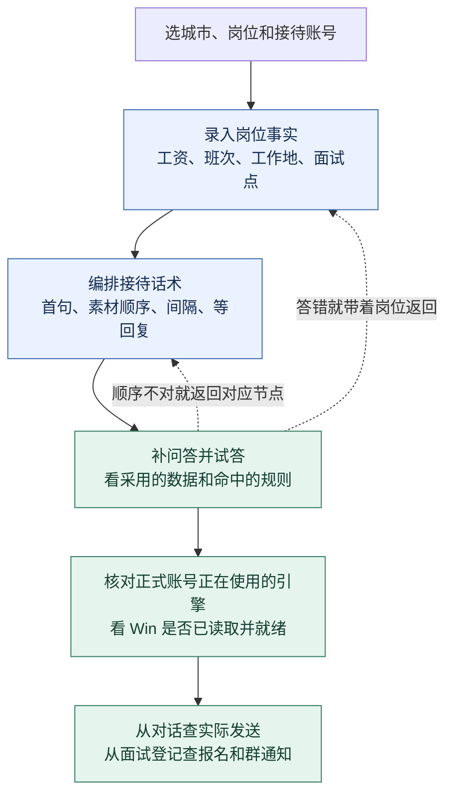

# 招聘系统交接｜把 AI 接待变成运营能配置、能验证的流程

本期接手范围为北京时间 **2026 年 11 月 21 日至 22 日 12:20**。当前交接基准为线上版本 `257aecd`（#114）。这两天围绕三件事展开。**把原先是黑盒的 Agent 变得可看、可改、可验，让同一个接待账号可以切换 Dify 或 Agent，把负责收发消息的云 Windows 客户端做稳。** 共同目标是让劳务招聘公司的运营人员自己维护话术，无需为了改一段开场、发送先后或问答去找开发者。

进度到了一半。Agent 已经能在画布查看和调整岗位流程，两个引擎已经可以从同一个地方试答，正式来源可以按账号切换。运营要配完一个岗位，今天依然会遇到多个入口、两套 Agent 开场配置和不同的资料取值规则。**下一位接手开发者的主要任务，是把这段用户路径收完整，并证明用户录入的资料确实被选中的引擎按预期使用。**

## 接手先看｜这两天做到哪一步

| 用户现在能做的事 | 已经上线的部分 | 还差哪一步 |
| --- | --- | --- |
| 看懂并调整 Agent 话术 | 按岗位打开画布，查看或编辑节点、顺序、间隔和等待，查看已保存路径、设备拉取与节点上报。 | 从一条实际回复回到当时采用的资料和节点，再直接进入它的编辑位置。统一人设和旧开场的主入口。 |
| 在 Dify 和 Agent 之间选择 | 管理员可以在同一个面板试两条线路，在微信账号按设备发起正式切换。 | 在同一个岗位内看清两条线路取值差异和 Dify 本轮所走阶段。正式调用、群通知仍需用目标账号和群回查。 |
| 确认 Windows 在执行 | 网页可看客户端连接、企微登录反馈和自动回复是否就绪。断线补传和送出回读已上线。 | 网页补充当前自动回复的联系人范围，并能带着当前账号和会话定位没有回复卡在哪一步。 |
| 配置城市和岗位 | 城市简化为基础资料，能按「选岗位 → 选账号 → 保存绑定」设置接待。 | 厂区状态与实际推荐过滤需对齐。历史城市字段覆盖岗位字段的原因及维护位置仍需解释。 |

## 1. 先理解用户在做什么

我们的用户是第三方劳务招聘公司。每家公司都有自己的话术，有些岗位先发工作介绍再发图片，有些岗位先问对方位置，有些岗位在发下一段之前要等回复。首家客户的话术可以作为模板，岗位和公司仍需各自调整内容、间隔、问答和报名路径。

日常流程从企业微信里的候选人来信开始。AI 按配置发送介绍、回答咨询，合适时收集信息，候选人确认后进入面试登记。有报名通知群的账号还需要把名单转给负责对接的人。招聘人员用**对话管理**查实际沟通，用**候选人管理**和**面试登记**跟进。这几处属于日常工作窗口。尤其是对话管理，用户扫码登录云电脑上的企业微信后，网页是他们查看真实对话的关键窗口。

以前的 Agent 对运营来说像黑盒。点了几个地方填东西，用户仍搞不清招聘资料有没有被用、某张图片是固定发还是按问题触发、两段之间等多久、改完应该用什么办法确认。这些问题决定了可视化应该展示什么。

## 2. 可视化的交付标准

这张图是产品要让运营走通的一条路。现在能从相应页面完成其中多步，跨页时的上下文和结果解释仍需收口。以一个在招岗位为例，运营改了一段开场、把宿舍图放到第 2 条，并要求等候选人回复后再问面试时间，产品需要回答下面的问题。

| 运营需要弄清的事 | 用户应该看到什么 |
| --- | --- |
| **数据我去哪填、填完谁会读** | 工资、班次、面试地点在岗位维护。说话方式、固定开场、问答和素材各有清楚的主入口。从流程跳去修改时，能直接打开当前岗位或当前条目。页面标明两条线路各自实际采用的字段或来源。 |
| **先发什么、什么时候发** | 有明确的起点、连线和等待条件。能区分「固定会发的图片」「用户问了才可能发的素材」「超时才走的分支」。位置拖动只改变画布布局，发送顺序由连接关系决定。 |
| **改完什么时候开始生效** | 看见浏览器草稿、服务器已保存、绑定设备读到哪个版本。Agent 已开始的会话按原快照执行，新会话才使用最新保存且已拉取的流程。 |
| **真的会按我的配置回复吗** | 试答时知道引擎、岗位和本轮实际采用的工资、面试点或问答。对确认报名、群通知等有实际后果的步骤，验收对应的面试登记和回执。 |
| **真实候选人有没有收到** | 对话管理能查对应账号与会话中的收发。客户端发送回执和接收端收到分别记录。配置、试答和发送各有自己的证据。 |

最重要的验收口径是让运营指出**哪条数据、哪个节点、哪个账号、哪次执行**。页面只展示一张顺序图、保存成功提示或一段通顺的试答，都无法把这四件事串起来。

### 用一个测试岗位演示可视化

以下是验收用例。测试岗位叫「仓库分拣」，工资设为「26 元/小时」，设置两个面试点「东门」「南门」。Agent 配置为先发文字介绍，等待 5 秒发宿舍图，再等候选人回复后询问面试意向。另录入一条岗位问答「带什么资料」。

| 我现在想做什么 | 现在从哪里操作 | 本次怎么验 |
| --- | --- | --- |
| 确认两条线路是否读到工资和面试点 | 编辑岗位保存后，在「话术流程 → 接待测试」选择同一个岗位，分别用 Agent 和 Dify 试答。 | 问「工资是多少」「面试在哪」。Dify 先点「查看回答依据」核对实际传入的值，再生成模拟回答。若采用的是历史城市工资，记录这个覆盖来源。 |
| 确认 Agent 按我设置的顺序走 | 在「话术流程」打开这个岗位，检查已保存的起点、文字、间隔、宿舍图和等待连线。 | 先查绑定设备是否已拉取版本，再用授权测试会话核对文字和图片的先后、是否等到回复才继续。 |
| 确认 Dify 为什么开始邀约 | 进自建 Dify 正式应用的预览，对相同的阶段输入检查本轮分支。 | 在 Dify 工作室看本轮选了哪个节点、下一阶段是否正确，回招聘网页核对实际传入的工资、面试点和问答。 |
| 确认失败卡在哪 | 同一个账号分别检查回复来源、Windows 状态、自动回复范围和对话记录。 | 记录来信、引擎判断、客户端执行与回执。报名时继续核对面试登记和目标群。 |

## 3. 三条主线做到哪里

### 可视化与入口归并

- **已上线。** Agent 有岗位流程画布，支持普通视图和全屏，能编辑文本、图片、视频、连接、发送间隔和等待条件。可看已保存的执行路径、绑定设备、配置拉取情况和已有节点执行上报。已用隔离岗位验证云 Windows 拉取、改变节点顺序、素材下载及旧会话快照。 [画布同步验收](https://github.com/tjfeng741963/city-recruitment-mock-service/blob/257aecde8fc21bcb4782ea4aa8f4d4d77edd69ad/docs/验收-画布同步云Windows-20261121.md)
- **已上线。** 管理员在「话术流程 → 接待测试」选择 Agent 或 Dify。知识库和微信账号有带岗位或账号的快捷入口，原 Dify 测试入口归入这里。独立的问答知识库、图片与视频继续服务日常维护。 [统一试答入口](https://github.com/tjfeng741963/city-recruitment-mock-service/pull/99)
- **还没做完。** 从某段回答回到实际来源和可编辑位置，仍要人工找。人设、旧开场、画布节点、岗位要素和知识问答的作用关系在页面上仍需讲清。Dify 试答能看输入依据，Agent 试答主要是岗位问答预览，整条流程的等待、分支和实际发送要看对应的执行证据。目前测试面板向管理员开放，首次交付给劳务公司的运营账号时也要核对权限和可操作范围。

### Dify 和 Agent 是可以换的“脑子”

- **已上线。** 同一套 Windows 负责收发，按接待账号选择系统 Agent 或 Dify。正式切换在「日常招聘 → 微信账号 → 回复来源」发起，由 Windows 完成读取和确认后生效。画布中的引擎选择用于试答。 [正式切换](https://github.com/tjfeng741963/city-recruitment-mock-service/pull/101) · [账号列表入口](https://github.com/tjfeng741963/city-recruitment-mock-service/pull/103)
- **已上线。** Dify 接入按范围推荐岗位、换岗、工资和岗位问答、面试点、素材与导航、确认报名进 OA、报名通知群。历史城市默认值仍可能优先于岗位资料。新运营流程把岗位作为录入主入口，展示和试答必须让用户看见这些取值差异。 [岗位取值](https://github.com/tjfeng741963/city-recruitment-mock-service/pull/104) · [推荐和报名](https://github.com/tjfeng741963/city-recruitment-mock-service/pull/97) · [素材和导航](https://github.com/tjfeng741963/city-recruitment-mock-service/pull/105) · [报名推群](https://github.com/tjfeng741963/city-recruitment-mock-service/pull/114)
- **还没做完。** 本系统的画布编辑的是 Agent 节点，Dify 节点依然在 Dify 后台编辑发布。统一用户入口已做到试答与带上下文跳转，跨两条线路看步骤、看数据来源、调整并回到验收，还没有一条完整路径。Dify 已有真实引擎回放和授权单联系人的定向发送回读。整账号自动入站回复与 Dify 报名后目标群实际收信，仍需按账号核对。

**Dify 本身也是一处需要交接的黑盒。** 自建 Dify 和招聘网页在同一台腾讯云 2 核 4G 主机 `119.91.113.100` 上，分别使用 8080 和 4222。Dify 的四段咨询流程来自对原招聘助手的行为逆向与回放，接入版由原负责人独立搭建。接手者要分清正式应用和历史还原测试稿，知道从哪里看运行节点、改哪段话术、发布后如何回招聘网页复测。 [自建 Dify、节点和使用说明](Dify与话术流程画布方案及实现-20261122.md)

### Windows 是共用的“手”

- **已上线。** 改进客户端更新与启动、云电脑断线后的来信补传、连接和企微就绪上报、企微扫码结果反馈。网页可以区分客户端在线、企微未登录、自动回复未就绪等情形，查看实际环境还要看设备上报和企微会话。 [客户端可靠性](https://github.com/tjfeng741963/city-recruitment-mock-service/pull/98) · [登录启动](https://github.com/tjfeng741963/city-recruitment-mock-service/pull/100) · [断线补传](https://github.com/tjfeng741963/city-recruitment-mock-service/pull/107) · [扫码反馈](https://github.com/tjfeng741963/city-recruitment-mock-service/pull/108)
- **已上线。** 补传消息先入本地待处理，再更新读取进度。太旧或发送结果不明的来信可先人工核对，符合条件的旧消息可逐条恢复。文本发送成功以目标企微会话中的新增消息回读作证据，减少回复实际没发出却被记成已发的情况。 [旧消息恢复与回读](https://github.com/tjfeng741963/city-recruitment-mock-service/pull/112)
- **还没做完。** 服务端部署、安装包发布、云电脑装上该版本、成功启动及完成一次真实收发是四件事。网页还要让运营看懂自动回复究竟覆盖所有人还是仅指定联系人。已有「切到了 Dify 但没回复」的现场案例，原因是 Win 当时的联系人范围拦住了新消息。遇到类似情况，先查账号实际来源、自动回复范围和客户端就绪，再查引擎是否生成回答。

## 4. 下一位接手时，按这些页面继续收口

### 城市的接待设置与厂区入口

当前进入「设置招聘接待」后，先选本城已启用的岗位，再选接待账号，最后沿用已有账号表单保存并返回城市。账号已绑其他岗位时有替换提醒。城市显示「已配置接待」代表已有启用账号绑定本城启用岗位。岗位的启用开关负责岗位可用性，实际回复还要看设备、企微和回复范围。右上角刷新重新读城市和厂区列表，向导保存返回时已自动更新。城市表单只维护基础信息，复制和重复 Dify 城市资料弹窗已移除。 [城市设置接待](https://github.com/tjfeng741963/city-recruitment-mock-service/pull/113) · [移除重复资料](https://github.com/tjfeng741963/city-recruitment-mock-service/pull/111)

厂区仍有岗位归组与设备推荐范围用途。当前分散在城市的「更多 → 厂区」、岗位的「更多 → 厂区绑定」和账号表单的「绑定工厂」。现有厂区「启用」也有脱节问题，界面可显示停用，Dify 取岗位读取的状态仍可能是启用。接手时逐入口核对它在编辑厂区资料、关联岗位和限制账号推荐范围中各承担哪项任务，再确定用户从哪一处编辑与核验。城市「更多工具」下的地域与周边城市、招聘配置检查同样要说明谁会使用及作用，再决定摆放。

### 招聘岗位、画布和知识库的重复入口

| 容易走错的入口 | 当前实际行为 | 交接时需要解决的事 |
| --- | --- | --- |
| 岗位「系统 Agent」和画布「岗位配置 → 编辑人设／编辑开场」 | 两处都能打开同一岗位的人设和旧开场。用户仍要区分旧开场与画布当前已保存的节点。 | 给人设和旧开场各一个清楚的主编辑位置，快捷入口带岗位。明确编辑文字后画布当前节点会不会读取该文字，并展示启用、停用分别走哪套开场。 |
| 画布里的「岗位问答／图片与视频」和侧栏知识库、素材库 | 画布入口可以带岗位去独立页面。知识库「到画布测试」目前进入 Dify 测试入口。不同问答可能有不同适用范围，素材可能是固定发送或按需触发。 | 继续复用同一份问答和素材。测试入口显示岗位、引擎和命中范围，答错时能回到具体记录。逐项核对历史品类、岗位和通用问答真正在哪条线路生效。 |
| 岗位资料与历史城市默认资料 | 岗位已成为新的主要录入位置。Dify 部分字段仍会优先采用历史城市值。 | 用户看到工资或地址被覆盖时，要能看见本轮采用值及维护位置。先向产品确认历史值的归属和迁移方式，再调整取值优先级。 |
| 微信账号的「工作流配置」、岗位的「话术流程」、画布的「接待测试」 | 岗位链接打开 Agent 画布。账号「工作流配置」按当前来源进入 Agent 画布或 Dify 测试。相同按钮名称可能落在不同任务。 | 把编排、试答和正式切换的角色讲清。快捷入口把账号与岗位带到对应位置。运营应知道这里能改节点、只试答，还是要去 Dify 后台发布。 |
| 岗位「复制」「厂区绑定」「岗位节假日」及城市「更多工具」 | 入口仍存在，涉及岗位复用、推荐范围、预约条件或配置检查。 | 逐个用真实用户任务走一遍，记录保存后哪条线路读取以及怎么核对，根据任务和验证结果讨论保留位置、改名或合并。 |

新增或调整主要按钮前，先写清运营要完成的事、页面位置、点击后看到什么、会保存哪份配置、旧入口如何处理。用户确认后按整条路径验收。已确认的一项能力有一个主要编辑位置，其他路径可作为带上下文的快捷入口。 [产品功能与入口规范](https://github.com/tjfeng741963/city-recruitment-mock-service/blob/257aecde8fc21bcb4782ea4aa8f4d4d77edd69ad/docs/产品功能与入口规范.md)

### 对话管理、面试登记和候选人

对话管理用于网页查真实收发。候选人管理已汇总对话、历史记录和登记档案并可打开只读对话，「沟通中」与「已报名」分开，能看记录所处阶段。下一轮联合验收时，由真实来信走到确认报名，检查同一人是否进入面试登记、在候选人页面能否找到、能否精确打开对应对话、群通知状态有没有实际回执。 [候选名单与对话同步](https://github.com/tjfeng741963/city-recruitment-mock-service/pull/87) · [历史记录和沟通状态](https://github.com/tjfeng741963/city-recruitment-mock-service/pull/88)

## 5. 交给下一位的验收顺序

1. **先选一个已确认的测试岗位。** 记录城市、岗位、账号、当前正式来源、Win 安装版本和联系人范围。挑一项易辨认的岗位事实、一条知识库问答、两条带顺序的开场消息和一个面试点。
2. **从页面录入并走回试答。** 在运营正常入口改资料，再从当前岗位打开画布或知识库快捷入口。分别用 Agent、Dify 问相同问题，记下取值、回答和命中问答。遇到历史城市覆盖或问答范围不同，当场记下原因和可编辑入口。
3. **验证 Agent 的顺序和生效。** 保存并启用后核对版本、Win 拉取和节点上报。用测试会话核对文字、图片、等待和分支顺序，同时检查在途会话是否继续按原快照走。
4. **验证换引擎和真实发送。** 用授权账号及联系人发起正式切换，等 Win 确认为 Dify 或 Agent，再从联系人发起新消息，核对选中的引擎、企微会话和回执。分别记录来信到了没、是否允许自动回复、有没有生成、有没有实际发出。
5. **验证报名交付。** 用测试流程确认报名，核对面试登记、候选人详情和原对话。配置通知群时核对领取目标及实际群回执，并检查重复确认是否保留同一条登记、不重复推送。

MVP 围绕首家劳务公司跑通这套过程。多租户隔离和人才库留在后续阶段。两条线路的配置与验收细节见 [Dify 与话术流程画布说明](Dify与话术流程画布方案及实现-20261122.md)。

## 附录 · 主分支推送清单

时间以 Git 合并记录为准，均为北京时间。点击流水线可查对应版本的检查与部署结果。

另外，11 月 21 日 00:46 有一条直接进入主分支的文档提交 `16ac1f6`，更新开场流程的实机交接记录。它计入本期项目记录，下面的 36 条只统计合并 PR。 [开场流程交接记录](https://github.com/tjfeng741963/city-recruitment-mock-service/blob/16ac1f69301eabd9d67cf783ef5c403f64ad06bb/docs/进度与交接-20261120-客户端与网页端.md)

| 时间 | 更新 | 主分支提交 | 流水线 |
| --- | --- | --- | --- |
| 11-22 10:55 | [#114 fix: 接通 Dify 报名后的对接群通知](https://github.com/tjfeng741963/city-recruitment-mock-service/pull/114) | 257aecd | [通过](https://github.com/tjfeng741963/city-recruitment-mock-service/actions/runs/44978276179) |
| 11-22 10:55 | [#113 feat: 从城市分步设置招聘接待](https://github.com/tjfeng741963/city-recruitment-mock-service/pull/113) | 86e1b2d | [通过](https://github.com/tjfeng741963/city-recruitment-mock-service/actions/runs/44978260754) |
| 11-22 10:20 | [#112 fix: 恢复 Windows 升级前未回复的消息](https://github.com/tjfeng741963/city-recruitment-mock-service/pull/112) | dd49e42 | [通过](https://github.com/tjfeng741963/city-recruitment-mock-service/actions/runs/44975622133) |
| 11-22 09:50 | [#111 fix: 移除重复的 Dify 城市资料弹窗](https://github.com/tjfeng741963/city-recruitment-mock-service/pull/111) | 3ba0217 | [通过](https://github.com/tjfeng741963/city-recruitment-mock-service/actions/runs/44973337087) |
| 11-22 09:21 | [#110 fix: 精简城市编辑并移除复制入口](https://github.com/tjfeng741963/city-recruitment-mock-service/pull/110) | e688af7 | [通过](https://github.com/tjfeng741963/city-recruitment-mock-service/actions/runs/44971045820) |
| 11-22 08:52 | [#109 fix: 区分城市接待配置与岗位启用状态](https://github.com/tjfeng741963/city-recruitment-mock-service/pull/109) | 264df57 | [通过](https://github.com/tjfeng741963/city-recruitment-mock-service/actions/runs/44968763095) |
| 11-22 08:30 | [#108 fix: 显示企微扫码登录结果与安全验证指引](https://github.com/tjfeng741963/city-recruitment-mock-service/pull/108) | ec6dd63 | [通过](https://github.com/tjfeng741963/city-recruitment-mock-service/actions/runs/44966955273) |
| 11-22 02:03 | [#107 fix: 补齐 Windows 断线消息并加固恢复](https://github.com/tjfeng741963/city-recruitment-mock-service/pull/107) | 61defcb | [通过](https://github.com/tjfeng741963/city-recruitment-mock-service/actions/runs/44933382825) |
| 11-22 01:37 | [#106 fix: 精简城市页并直达招聘岗位](https://github.com/tjfeng741963/city-recruitment-mock-service/pull/106) | 7f9db70 | [通过](https://github.com/tjfeng741963/city-recruitment-mock-service/actions/runs/44931062654) |
| 11-22 01:02 | [#105 feat: 为Dify路线接入岗位素材和面试导航](https://github.com/tjfeng741963/city-recruitment-mock-service/pull/105) | f4ab791 | [通过](https://github.com/tjfeng741963/city-recruitment-mock-service/actions/runs/44927807010) |
| 11-22 00:49 | [#104 fix: 接通 Dify 岗位资料并修正线路标签](https://github.com/tjfeng741963/city-recruitment-mock-service/pull/104) | f9f8009 | [通过](https://github.com/tjfeng741963/city-recruitment-mock-service/actions/runs/44926691102) |
| 11-22 00:29 | [#103 feat: 在微信账号列表切换回复来源](https://github.com/tjfeng741963/city-recruitment-mock-service/pull/103) | d4a66f3 | [通过](https://github.com/tjfeng741963/city-recruitment-mock-service/actions/runs/44924866610) |
| 11-22 00:21 | [#102 feat: 支持岗位多面试点与 Agent 话术录入](https://github.com/tjfeng741963/city-recruitment-mock-service/pull/102) | e0b46de | [通过](https://github.com/tjfeng741963/city-recruitment-mock-service/actions/runs/44924109705) |
| 11-21 23:38 | [#101 feat: 支持网页和 Windows 确认接待来源切换](https://github.com/tjfeng741963/city-recruitment-mock-service/pull/101) | 2a5599b | [通过](https://github.com/tjfeng741963/city-recruitment-mock-service/actions/runs/44920300140) |
| 11-21 22:41 | [#100 fix: Windows 登录直接启动已安装客户端](https://github.com/tjfeng741963/city-recruitment-mock-service/pull/100) | 33779cd | [通过](https://github.com/tjfeng741963/city-recruitment-mock-service/actions/runs/44915250192) |
| 11-21 22:17 | [#99 feat: 将 Dify 配置与试答归入话术流程画布](https://github.com/tjfeng741963/city-recruitment-mock-service/pull/99) | 0348b15 | [通过](https://github.com/tjfeng741963/city-recruitment-mock-service/actions/runs/44913124798) |
| 11-21 21:48 | [#97 feat: 接通模式二岗位推荐和面试报名归档](https://github.com/tjfeng741963/city-recruitment-mock-service/pull/97) | 638291a | [通过](https://github.com/tjfeng741963/city-recruitment-mock-service/actions/runs/44910690100) |
| 11-21 21:45 | [#98 fix: 改善 Windows 客户端更新、进程状态与网页联通](https://github.com/tjfeng741963/city-recruitment-mock-service/pull/98) | 5f3ffd8 | [通过](https://github.com/tjfeng741963/city-recruitment-mock-service/actions/runs/44910457832) |
| 11-21 21:02 | [#96 fix: 恢复AI接待知识库和素材独立入口](https://github.com/tjfeng741963/city-recruitment-mock-service/pull/96) | 54c7981 | [通过](https://github.com/tjfeng741963/city-recruitment-mock-service/actions/runs/44906876188) |
| 11-21 20:31 | [#95 fix: 恢复内嵌流程画布并明确全屏返回入口](https://github.com/tjfeng741963/city-recruitment-mock-service/pull/95) | ff0f7fe | [通过](https://github.com/tjfeng741963/city-recruitment-mock-service/actions/runs/44904345328) |
| 11-21 20:27 | [#94 fix: 整理微信账号页并接通真实工作流入口](https://github.com/tjfeng741963/city-recruitment-mock-service/pull/94) | ee901a1 | [通过](https://github.com/tjfeng741963/city-recruitment-mock-service/actions/runs/44904035103) |
| 11-21 20:17 | [#93 fix: 接通Dify历史品类知识并验收城市资料招聘回答](https://github.com/tjfeng741963/city-recruitment-mock-service/pull/93) | c4d263a | [通过](https://github.com/tjfeng741963/city-recruitment-mock-service/actions/runs/44903149277) |
| 11-21 20:02 | [#92 fix: 默认收起流程画布并统一岗位配置入口](https://github.com/tjfeng741963/city-recruitment-mock-service/pull/92) | a200213 | [通过](https://github.com/tjfeng741963/city-recruitment-mock-service/actions/runs/44901913882) |
| 11-21 19:01 | [#91 feat: 恢复城市完整招聘资料并接回Dify及现有知识库](https://github.com/tjfeng741963/city-recruitment-mock-service/pull/91) | 53e85bc | [通过](https://github.com/tjfeng741963/city-recruitment-mock-service/actions/runs/44897095293) |
| 11-21 18:47 | [#89 fix: 接通工作流编辑热更新与客户端同步证据](https://github.com/tjfeng741963/city-recruitment-mock-service/pull/89) | 5c3ac4d | [通过](https://github.com/tjfeng741963/city-recruitment-mock-service/actions/runs/44895973982) |
| 11-21 18:37 | [#90 fix: 对齐收缩侧栏图标与展开按钮](https://github.com/tjfeng741963/city-recruitment-mock-service/pull/90) | 32e5d44 | [通过](https://github.com/tjfeng741963/city-recruitment-mock-service/actions/runs/44895251901) |
| 11-21 17:31 | [#88 fix: 补齐全部对话及历史候选记录](https://github.com/tjfeng741963/city-recruitment-mock-service/pull/88) | 1583a81 | [通过](https://github.com/tjfeng741963/city-recruitment-mock-service/actions/runs/44889960917) |
| 11-21 17:11 | [#86 feat: 前端明确区分系统 Agent 与 Dify 两套模式](https://github.com/tjfeng741963/city-recruitment-mock-service/pull/86) | 513dda2 | [通过](https://github.com/tjfeng741963/city-recruitment-mock-service/actions/runs/44888365194) |
| 11-21 16:50 | [#87 fix: 同步面试登记候选名单与真实对话记录](https://github.com/tjfeng741963/city-recruitment-mock-service/pull/87) | 4c28667 | [通过](https://github.com/tjfeng741963/city-recruitment-mock-service/actions/runs/44886773832) |
| 11-21 16:06 | [#85 fix: 展开招聘流程媒体分支和真实预览](https://github.com/tjfeng741963/city-recruitment-mock-service/pull/85) | 5310539 | [通过](https://github.com/tjfeng741963/city-recruitment-mock-service/actions/runs/44883334830) |
| 11-21 16:04 | [#84 feat: 增加按设备切换的 Dify 第二回复路线](https://github.com/tjfeng741963/city-recruitment-mock-service/pull/84) | daf2f5e | [通过](https://github.com/tjfeng741963/city-recruitment-mock-service/actions/runs/44883117649) |
| 11-21 15:40 | [#83 fix: 补齐测试服实际前端目录的主题与导航资源](https://github.com/tjfeng741963/city-recruitment-mock-service/pull/83) | 0892d02 | [通过](https://github.com/tjfeng741963/city-recruitment-mock-service/actions/runs/44881358445) |
| 11-21 15:37 | [#80 feat: 理顺招聘导航并接通岗位流程与问答](https://github.com/tjfeng741963/city-recruitment-mock-service/pull/80) | 7bbc23d | [通过](https://github.com/tjfeng741963/city-recruitment-mock-service/actions/runs/44881106227) |
| 11-21 15:17 | [#82 fix: 修复流程画布图片视频素材下拉为空](https://github.com/tjfeng741963/city-recruitment-mock-service/pull/82) | 5a0b60f | [通过](https://github.com/tjfeng741963/city-recruitment-mock-service/actions/runs/44879558276) |
| 11-21 14:16 | [#81 feat: 全屏流程画布与真实运行路径可视化](https://github.com/tjfeng741963/city-recruitment-mock-service/pull/81) | 66dd75a | [通过](https://github.com/tjfeng741963/city-recruitment-mock-service/actions/runs/44874745264) |
| 11-21 11:37 | [#79 feat: 添加招聘流程图编辑页面](https://github.com/tjfeng741963/city-recruitment-mock-service/pull/79) | c7dbebd | [通过](https://github.com/tjfeng741963/city-recruitment-mock-service/actions/runs/44862110859) |
