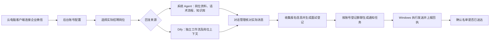

# 微信账号页：功能有效性与招聘链路评审

日期：2026-11-21。源码基线：main `53e85bc`。对应用户最新截图：微信账号页，两条记录分别为 Dify 网页测试、客户端云服务器。

本轮只读评审，修改文档，不修改应用代码、线上配置或客户数据。证据包括截图、最新源码、隔离内存 SQLite 和完整 Fastify 接口探针；未扫码、未发送消息。截图离线状态只代表截图时刻，不作为当前实时状态。

## 1. 这个页面应帮用户完成什么

用户关心的是：哪个企业微信号在接待、接哪个岗位、采用哪套 AI 回复、报名名单发到哪个群、出了问题到哪里查看。设备码和云电脑是实现这些业务的连接信息，不应成为用户必须先理解的主体。



图表达用户目标关系，不表示每段已经通过实机验收。当前群通知存在下文所列断点；Dify 对话返回成功也不能直接证明已完成登记和推群。

## 2. 截图各列和全部操作

| 当前入口/字段 | 实际作用与核验结果 | 面向用户的处理建议 |
|---|---|---|
| 微信账号页标题 | 列表实际主体是 `agent_devices` 配置记录，不全是真实登录的微信账号；网页测试记录也出现在此 | 可保留“微信账号”，副标题改为“连接企业微信，设置接待岗位和报名通知群”；真实账号与网页测试分开 |
| 设备名称 | `name/device_name` 是后台备注，不是从企业微信同步的昵称；改名称不改变招聘话术 | 保留编辑，改叫“账号备注”；实际登录账号另从桥接 `account_id` 展示，未上报就显示未确认 |
| 工厂标签 | `factory_ids` 有实际保存、下发和资料范围消费者 | 保留为岗位所属项目/工厂的辅助信息，不让用户重复填写招聘事实 |
| 未绑定工厂 | 空工厂范围不等于不能回复：`devicePositionId()` 仍可读取显式 `position_id`；截图第一行就是这种组合 | 展示“使用岗位所属工厂”或明确说明范围；不能把此标签当错误或未配置好 |
| 绑定岗位 | 当前 Agent 的开场、人设、流程及回复上下文通过设备定位岗位；Dify 也检查设备岗位并取岗位上下文 | 核心，保留并突出。明确显示当前实际选中的岗位，不能只显示多个工厂让用户以为会自动逐厂切换 |
| 工厂多选＋岗位留空 | 保存时从已绑工厂中按岗位 ID 取第一个启用岗位；运行解析也有回退逻辑 | 不建议让业务用户依赖隐式选择；保存前展示“将使用岗位 X”。不能承诺多选工厂后 AI 会自动正确路由每个客户 |
| 设备码 | Windows 用它查配置、上报消息和领取任务；并非微信号，也不是登录凭据 | 保留系统标识及复制编号能力，放详情；新用户不必手填 |
| 扫码登录 | 读取客户端已上传的二维码，每 3 秒刷新；页面没有启动云电脑或企微登录的动作 | 核心能力保留，但区分“客户端未连接”“等待二维码”“等待扫码”“登录待确认”；不能在没有客户端的网页测试记录上放同样按钮 |
| 在线后显示“已登录” | 前端直接依据 `online/status` 布尔值显示；这是客户端上报状态，页面未独立检查收发成功 | 改为“客户端已连接”，实际企业微信登录状态、最近收发结果分别展示；连接成功不等于回复链路健康 |
| 模式：邀约版/跟进版 | 存为 `data_json.mode`；最新 Windows `autopilot/brain/remote_config` 与当前 Agent/Dify 回复路径未找到该字段的行为消费者 | 当前不能承诺“邀约后沉默/继续回复”。普通编辑暂隐藏并保留历史值，后续若要此能力，应接入真实流程结束策略并做端到端验收 |
| 顶部 Agent/Dify 提示 | 这是另一维度 `reply_provider`，与上面的邀约/跟进模式不同；设备列表又未返回该来源 | 将列表模式改为可核实的“回复来源：系统 Agent/Dify”；设置要走专用切换接口，不能仅修改标签 |
| 分配账号 | `recruiter_id` 是业务招聘员归属，参与用户设备可见范围及候选归属/筛选，不是企业微信登录账号 | 有用，改“负责人”，使用现有招聘员选择项并校验；自由输入陌生文本容易造成归属不正确 |
| 状态 | 由设备心跳镜像的在线布尔值展示，超时清扫后离线；不是数据库的启用/停用状态 | 保留，叫“客户端连接状态”；不混用启用、登录、在线、可发送四个概念 |
| 最后在线 | 在线心跳更新 `last_online`，离线后保留最后一次值 | 保留，文案“最近心跳”；空值为“尚未连接”，不要只放横线 |
| 队列数 | 前端有队列显示，但有值不证明任务已发送；桥接有真实 queued/claimed/unknown 统计 | 高级详情显示待发送/结果待核对，并跳到相应记录；成功必须看回执 |
| 编辑、保存、取消 | 确实更新设备记录；岗位、工厂、负责人和登记群聊均落库。名称只是备注，mode 当前无行为闭环 | 主操作保留，称“接待设置”。保存成功与客户端已同步分别反馈；取消不保存 |
| 登记群聊 | `group_chat` 被 Agent 归档和手动登记生成通知时读取，是真实业务配置；但发送目标及通知状态有缺陷（见第 4 节） | 核心保留并修复，改“报名通知群”；从本账号上报群列表选择，展示绑定结果和实际回执，不能只用自由文本 |
| 复制 | 新建记录，复制备注、mode、负责人、工厂、岗位、登记群、列表序列化后的 config；不复制客户端连接/微信登录态，也不复制专用 `reply_provider` | 移至高级操作，改“复制接待设置”；明确新号需单独连接，复制 Dify 测试记录不能承诺新号仍用 Dify |
| 更多→查看群组 | 读取客户端上传的 `device_group_chats` 清单；有真实存储与读取 | 有用，合并进“报名通知群”选择器；空列表说明未上报，不能说企业微信没有群 |
| 更多→工作流配置 | 旧设备 JSON 入口，GET 可能由兼容占位路由返回空列表；前端 JSON 保存遭文件契约 422；删除可返回假成功 | 普通用户移除此旧入口，保留历史数据；改为跳到当前岗位话术流程，或对应 Dify 设置。不要与最新已经接入的岗位流程编辑混为一谈 |
| 更多→清空未读 | 已在完整接口复现跨设备清零，见第 4 节；它操作网页未读计数，不是企微未读，也不是“AI 不再回复” | 高优先级修复并从账号页隐藏。逐会话阅读仍留在对话管理；不删对话或历史数据 |
| 删除 | 真删 `agent_devices` 主记录，没有显式停止 Windows、退出企微、撤销 bridge token 或清理关联历史的完整闭环 | 从行内移到高级操作；不能替代“暂停接待”。删除前核对依赖，说明会话数据保留与配置丢失范围 |
| 新增设备 | 只建立后台记录，默认 observe_only=true，避免服务端/Windows 双发；不会创建云电脑或完成客户端配对 | 改“连接新账号”，串起建记录→客户端配对→登录→岗位→通知群；现有新增接口还须补设备码唯一校验 |
| 自动生成设备码 | 本地 crypto 随机生成 `AG-` 六位码；客户端接入另有注册/配对接口 | 技术能力保留，但必须由服务端验证格式、唯一性，不能靠随机降低碰撞代替校验 |
| 刷新、搜索、筛选、分页 | GET 列表后在前端完成筛选分页，是真实列表操作 | 保留。模式筛选应跟随有效回复来源/接待状态，不继续筛无消费者的历史模式；刷新只拉数据，不重启客户端 |
| 总设备 | 把网页测试记录一起计数 | 改为真实接待账号数，网页测试独立计数或移回测试工具 |
| 启用中 | 实际取 `onlineCount`，截图 0 是离线数口径，不是 SQL enabled 数量 | 改“客户端在线”，与启停状态分别展示 |
| 邀约版/跟进版统计 | 按历史 mode 分类；缺失 mode 也计入跟进版 | 当前没有可靠运营意义；换成待连接、连接异常等有依据的状态统计 |

扫码弹窗里的二维码刷新、关闭和短信验证码提交是独立步骤。短信验证码 POST 后存在服务进程的一次性队列，客户端 GET 一次取走；“已提交”不能表述为“已登录”。网页端传递能力存在，客户端实际完成登录仍需实机核验。

## 3. 两条截图记录该如何解释

- `dify-sandbox-only` 明确是网页测试配置。未接企业微信，不能当真实离线接待账号，也不应给用户扫码期待。截图标“跟进版”不能说明它使用哪个回复来源。
- `pc-win-01` 是真实客户端标识，岗位绑定有实际作用。截图里“离线、最后在线 17:16:50”仅说明当时没有在线心跳，不能凭此判断是进程停止、断网、登录失效还是其他原因。
- “未分配”表示负责人字段为空，不等于企业微信未登录。

## 4. 已复现的问题和准确边界

### A. 清未读会跨设备操作：高优先级

`agent.routes.ts` 使用：

```sql
UPDATE agent_conversations SET unread=0,updated_at=CURRENT_TIMESTAMP
WHERE device_code=(SELECT device_code FROM agent_devices WHERE id=?)
```

`agent_devices` 没有 `device_code` 列，该值存于 JSON。SQLite 把子查询中的裸列解析成外层 `agent_conversations.device_code`，使条件变成对自身比较。不是先前猜测的必然 SQL 报错。

内存完整 API：A/B 两台设备各 unread=4，POST A 的 clear-unread 返回 200 success=true，A/B 都变为 0。这是在管理员身份下复现的跨设备影响，非线上执行。修复必须参数绑定已解析的设备码，并测试 A/B 隔离。

### B. 工作流是假入口，不是现有岗位流程：高优先级

当前环境带历史 `过程文件/api-contracts.json` 时，generic 路由为旧 workflow 提供 GET 空列表和 DELETE success=true 的占位应答，未写任何流程表。没有这份文件时该路由可能根本不注册，不能据本地 200 推断线上也可用。

前端保存 JSON；旧契约要求 multipart 文件 `file`。在内存完整 API，PUT JSON 即使含字符串 file 仍返回 422，前端随后更新设备 config 的语句不会执行。GET 空时回显的 row.config 更容易让用户以为已有可执行流程。

### C. 设备码允许重复：高优先级

对同一设备码连续 POST 两次均返回 200，数据库产生两行。后续多个查询按 JSON 设备码 `get()`，会造成配置指向不明确。新增/复制输入框虽说“不可重复”，后端没有阻断。应先查历史重复记录，再明确处理，不自动删除。

### D. 报名通知群存在发送断点：核心业务优先修复

群设置确实被读取，问题不是字段完全无用。自动归档和手动登记在首次创建群会话时，`nickname` 固定写成“群聊”，而 Windows 领取命令后按 `nickname` 搜索会话。

内存完整 API 手动登记：配置群为“审核专用测试群”，生成命令的 contact_id 是该群名，但领取返回 nickname="群聊"；此时 `group_notified` 已为 1，尚无发送成功回执。新群目标可能因此错误。已有正确映射的群不一定触发同一问题，不能断言所有历史推群都失败。

列表通知状态又会在找不到命令时用 group_notified=1 推断 sent，存在把“生成过任务”显示为“已发送”的风险。应保存真实群标识/群名映射，区分待发送、发送中、已送达、失败、结果未知；成功只由回执确认。不得盲目重发历史 unknown 命令。

### E. 邀约版/跟进版缺实际消费者：行为承诺不成立

前端存 mode，桥接 config 不下发该字段；当前 Windows 与 Agent/Dify 回复路径未发现根据设备 invite/followup 模式决定沉默或继续回复。流程里名为 followup 的节点和定时跟进模块是其他机制，不能当作该下拉已生效的证据。

建议先隐藏无效承诺、保留数据；如果要做“登记后停止自动接待”，应单独定义完成条件、作用范围与恢复入口，并接入真实状态机后验收。

## 5. 最小改造方向（待用户确认，不是已实现）

正常列表只突出：账号备注/实际账号、接待岗位、回复来源、连接状态、报名通知群、最近收发结果。主按钮为“接待设置”“查看对话”，需连接时展示有明确状态的登录入口。

保留岗位/工厂绑定、负责人、扫码/验证码和群列表。复制仅在批量接入多个同配置账号时节省少量选择操作，没有点击埋点或用户研究支持使用率估计；当前 MVP 建议隐藏行内复制入口，保留底层能力。新账号选择同一岗位即可复用岗位配置，不需要靠复制设备来复用话术。设备码、删除和诊断收进详情/高级操作。网页测试归到 Dify 测试工具，不删除测试资产。无消费者的模式选项、危险清未读退出普通页面。

工作流配置是核心能力，应保留可见入口。原建议移除的是按钮目前打开的旧设备 JSON 编辑器，不是 Dify 工作流。账号使用 Dify 时，“工作流配置”应进入该账号实际绑定的 Dify 配置/测试入口，并说明工作流编辑的实际位置；使用系统 Agent 时，进入该账号实际岗位的话术流程。共享的流程只维护一份，账号页提供绑定和跳转，不重复编辑。不能把仅设置 Dify 连接地址的页面称为完整工作流编辑器。

先修复跨设备清未读、设备码唯一性、群发送目标和回执口径，再整理展示；不可只改名称掩盖链路问题。最新配置同步接口已能提供设备上报的版本证据，账号页可复用它区分“已保存/客户端已同步/等待连接”，不额外建立一套配置事实。

本轮没有变更对话管理或候选人管理，也没有修改 Windows 动作层。群通知修复如涉及 agent 代码，仍遵守先诊断、写方案、用户确认的规则。

## 6. 证据位置

- `frontend-vue/src/views/AgentDeviceView.vue`：列表、表单、复制、扫码、更多操作和旧工作流 JSON 保存。
- `src/modules/agent/agent.routes.ts`：CRUD、岗位校验、验证码、清未读。
- `src/shared/device-factories.ts`：实际岗位解析；`response-serializers.ts`：在线口径及模式投影。
- `src/modules/messaging/device-bridge.routes.ts` / `device-bridge.ts`：配对、配置、群列表、命令领取、心跳与回执。
- `src/modules/agent/agent-chat.routes.ts`：开场/上下文、归档、群通知及通知状态。
- `src/modules/dify/dify-reply.ts`：专用回复来源切换和 Dify 岗位消费。
- `src/modules/generic/generic.routes.ts` / `shared/request-contracts.ts`：旧工作流占位和文件契约。
- `agent/autopilot.py` / `brain.py` / `remote_config.py`：实际 Windows 执行、内容来源和远端参数消费。

## 7. 本次已实施的页面调整

用户确认后实施：隐藏行内复制、历史邀约/跟进模式和清未读，删除移至更多；工作流改为可见主入口，Agent 按岗位跳转、Dify 按账号深链接进入配置/测试；真实回复来源来自列表字段；统计与状态使用客户端在线口径，现有网页测试记录单独标识且不提供扫码。岗位、负责人、工厂、群聊配置保留。未改 Windows 动作、对话或候选页面。

跨设备清未读 SQL、重复设备码和群通知目标/回执缺陷仍是已记录待修项，本次隐藏危险入口不等于底层缺陷已修复。Dify 页未新增完整流程编辑器。
