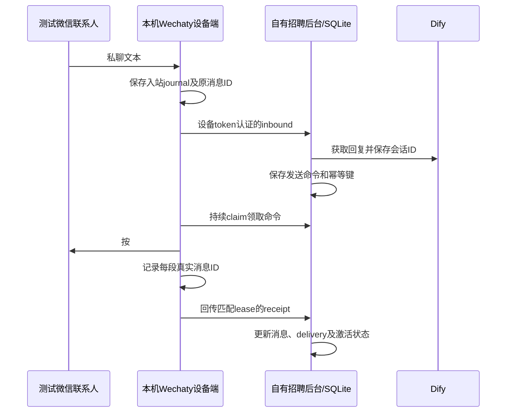

# 独立微信设备桥接

2026-10-25。本版本按对标系统可见的业务逻辑自行实现，不依赖对标网站的后台 API，不声称恢复了它的私有微信协议。

## 做了什么



- 原设备管理和对话界面仍可使用。人工回复、AI 回复、激活话术共用通道。
- 设备第一次登录绑定实际账号 ID，后续换账号会被拒绝。新账号用新的设备码，避免旧联系人映射串号。
- 外部微信联系人 ID 保持字符串，单独映射内部数字 customer_id；不按昵称或强转数字识别人。
- 设备 token 每设备独立；后台仅保存 token 的 SHA256，管理员重新配对会使旧 token 失效。
- 网关和设备端各有 SQLite 日志，设备不需要向公网开放端口，只需主动连接网关。
- 设备发送返回真实消息 ID 后才更新 sent；Mock 标 simulated。发送中崩溃、租约过期或结果不确定标 unknown，禁止盲目重发。
- 前端人工发送会保留幂等键，刷新页面或超时重试沿用同一发送意图；成功后才生成下一次意图。
- 服务器迟到回执会对账，避免设备已发而后台一直报失败。

## 目前验证到了哪里

自动化测试已经覆盖独立设备配对、设备与账号隔离、联系人映射、入站到 AI 再到设备回执、重复事件、分段发送、丢失回执补报和进程日志恢复。另有一个使用真实 Chrome 和上游 SDK 的登录长轮询回归测试。收发测试中的设备 driver 是可控替身，不能证明微信客户端实际收到了消息。

2026-10-25 实机运行已经验证：腾讯云网关可达，正式设备进程成功启动并生成登录二维码，设备状态为 scanning。尚未取得扫码登录成功、测试联系人实际收发、真实 Dify 返回的证据。线上当前 REA_DIFY_PROVIDER=mock；必须替换为自己的真实 Dify 配置后再验收 AI 质量。

已修复旧 SDK 等待 load 事件导致的 60 秒启动超时：微信登录页面的长轮询会持续占用该事件。bridge/web-navigation.mjs 对锁定版本的 Web 适配器使用 DOMContentLoaded，仍由 SDK 检查 Angular 就绪和执行正常登录流程。兼容层不修改 node_modules、登录凭据或协议请求头；更换 SDK 版本时必须重跑下述浏览器回归。

该 Web SDK 的 contact.say 实际不返回发送 ID。bridge/web-send-receipt.mjs 在发送前观察本次 Web 发送请求，只匹配文本类型、当前账号、联系人及原文，再绑定同一个 HTTPRequest 对象的响应；仅 HTTP 200、BaseResponse.Ret=0 且带可验证的真实 MsgID 时确认发送。消息 ID 保持字符串，拒绝精度丢失的数值。不会将 chatFactory 的本地消息编号或本地 UUID 当作服务端消息 ID。超时、页面关闭、HTTP 错误、缺少 ID 都保留 unknown，不盲目重发。当前原文严格匹配，线上 Angular 若改写发送内容则需要据实适配；未凭空假定 HTML 编码方式。服务端确认接收也不代表对方已读，仍需在测试联系人手机核对。

一旦 Web 发送回执不确定，该浏览器页面的后续发送会暂停，同时设备上报 offline。原因是超时无法取消已交给网页的旧发送，旧请求可能迟到，不能让它被下一条消息误认。需先人工核对该 unknown 命令和真实聊天，再关闭旧设备进程及其浏览器、重启设备；不会因 SDK 的旧 Promise 后来返回或简单刷新页面而自行放开发送。不要通过启动第二份设备进程绕过暂停。

本轮对标站与线上部署的 61 个只读 GET 契约检查：45 个响应结构一致、16 个因城市、联系人、报表和其他业务数据不同而有差异。该检查不覆盖写操作、真实消息通道或所有角色，不能据此宣称 1:1 完成。脱敏结果在 过程文件/parity/readonly-authenticated-diff-bridge.json。

默认适配器为 Wechaty 1.20.2 + wechaty-puppet-wechat 1.18.4（个人微信 Web 协议）。上游依赖较旧，部分微信账号不允许 Web 登录；若扫码被拒绝或协议不可用，不能宣称接通，更不能通过改变本地状态假装成功。该实现不是企微好友私聊官方接口；若业务必须使用企微，需接支持企微的实际设备/官方客户端方案，不能只把 corp_id 填到这里。

## 在本地接一台设备

后台继续使用端口 4222。Node 版本至少 22.19.0。先在项目根目录运行构建：

```powershell
npm run build
```

启动后台时将消息通道改为 bridge；第一次可用 Mock Dify 验证设备收发，AI 会回复明确的 Mock 文案：

```powershell
$env:REA_PORT='4222'
$env:REA_MESSAGE_CHANNEL_PROVIDER='bridge'
$env:REA_DIFY_PROVIDER='mock'
node dist/src/server.js
```

在另一个终端对后台中已经创建的设备配对。示例设备为种子设备 local-device-001；输出文件必须不存在。此命令读取的数据库路径必须与后台一致，显式设置 REA_DATABASE_PATH 时，两边都要设置。

```powershell
node dist/src/tools/pair-device.js local-device-001 bridge/.env
```

token 写入 bridge/.env 而不打印到聊天或日志。该文件、登录会话和 SQLite journal 都不会提交 Git。配对会轮换 token，设备正在运行时不要重复配对。

安装设备依赖。ignore-scripts 避免旧 Puppeteer 自动下载浏览器，改用本机独立启动的 Chrome：

```powershell
cd bridge
npm ci --ignore-scripts --no-audit --no-fund
$env:WECHATY_PUPPET_WECHAT_ENDPOINT='C:\Program Files\Google\Chrome\Application\chrome.exe'
npm start
```

同一 Chrome 配置下运行真实浏览器回归：

```powershell
npm run test:navigation
```

该测试只访问本机临时 HTTP 服务，构造持续等待的登录请求，验证 SDK 初始化及二维码刷新不被挂住；不会登录微信或发送消息。

终端会显示登录二维码。请用专用测试微信扫码；登录会话只在设备所在机器。登录后，用另一个测试微信给该账号发一条文本。后台会创建联系人映射和会话，再请求 AI 并回传。随后可在后台“对话管理”里发送人工回复，并打开接管开关验证 AI 停止应答。

未收到消息前，旧种子对话并不对应真实微信联系人；不能把种子 customer_id 当作微信好友 ID。必须先让测试联系人发来消息建立映射。

## 腾讯云运行

后台目录 `/srv/apps/city-recruitment-mock-service/source`，容器 `city-recruitment-app`。源码更新和数据库备份后重建镜像；迁移 012 增加设备、联系人、命令及入站去重表。使用一个应用进程管理一份 SQLite；本版本不支持多个服务实例同时恢复该库的 sending 状态。

服务器 `.env.production` 设置：

```dotenv
REA_MESSAGE_CHANNEL_PROVIDER=bridge
REA_DIFY_PROVIDER=http
REA_DIFY_BASE_URL=https://你的Dify域名/v1
REA_DIFY_API_KEY=仅在服务器设置
REA_SCHEDULER_ENABLED=true
```

设备自己的 dify_url 优先于全局 URL。多个设备使用不同 Key 时，设备 JSON 可指定 dify_key_env，例如 REA_DIFY_KEY_DEVICE_A，然后在服务器环境文件设置该变量；不用把真实 Key 填进前端可见数据库字段。

在容器生成私密设备配置：

```bash
docker exec city-recruitment-app node dist/src/tools/pair-device.js local-device-001 /data/local-device-001.env
```

把生成的 data/local-device-001.env 安全下载到设备机器 bridge/.env。公网正式部署用 HTTPS 网关；当前公网只有 HTTP 时，用本机 SSH 隧道：

```powershell
ssh -N -L 4222:127.0.0.1:4222 <SSH用户>@119.91.113.100
```

持续实验可增加 -o ServerAliveInterval=15 -o ServerAliveCountMax=3 -o ExitOnForwardFailure=yes；隧道中断需要重新连接，不能凭二维码仍显示就判断招聘后台在线。

此时设备的 REA_GATEWAY_URL=http://127.0.0.1:4222，token 不经过公网明文 HTTP；设备本机 4222 必须空闲，若已有本地演示服务，改用另一个本地转发端口并同步修改该 URL。

## 接口与故障处理

| 接口 | 身份 | 作用 |
| --- | --- | --- |
| POST /api/v1/bridge/devices/:code/pair | 管理员 JWT | 生成/轮换设备 token，保留原账号绑定 |
| GET /api/v1/bridge/devices/:code | 有该设备权限的用户 JWT | 读取在线状态和最近命令结果 |
| POST .../:code/heartbeat | 设备 token | 报告 scanning/online/offline、实际 account_id |
| POST .../:code/inbound | 设备 token | event_id/contact_id/nickname/content，原事件 ID 重放去重 |
| POST .../:code/claim | 设备 token | 原子领取命令，返回 contact_id/content/lease_token |
| POST .../:code/receipts | 设备 token | command_id/lease_token/status/message_id/simulated |

设备目录默认是 bridge/过程文件/device-<网关及设备哈希>，内有会话和 journal.sqlite。不要把它复制给另一台设备或多个进程共享。

- heartbeat 超过 60 秒，网关认为设备离线；心跳是设备在线证据，不能替代一次真实发送验证。
- claimed 租约过期会进入 unknown。已发送的本机日志能在重启后补回执；发送后、记录真实 ID 前崩溃的那一段只能人工核实。
- worker 的 inbox.done=-1 表示永久 4xx 消息已隔离。网络错误、5xx 和处理中结果按退避时间保留自动重试，让其他联系人继续；处理永久错误根因后可停 worker，用 SQLite 将该事件的 done 改回 0、attempts 和 next_attempt_at 改回 0 进行同 ID 重试。
- sends.acked=-1 表示回执需要人工核查；不要删除 sends/parts 来强行重发。可能已经实际发出。
- REA_SCHEDULER_ENABLED=true 负责持续消费已入 jobs 表的任务；不会自行扫描全部客户并批量触达。扫描仍由管理员触发，防止部署时突然主动联系历史客户。
- 目前仅完成单聊文本及 ### 文本分段。群聊、图片/文件、位置消息、好友申请、二维码过期后的具体 SDK 行为、企微通道都没有实机验证；媒体发送会明确失败，不将媒体占位字符串当成文字发给客户。

最终验收需要：扫码登录成功、测试联系人真实发来一条消息、真实 Dify 返回、设备发送返回真实 ID、测试联系人客户端实际收到、重放同一事件不重复发送。缺任一项，都不能叫真实微信闭环完成。
